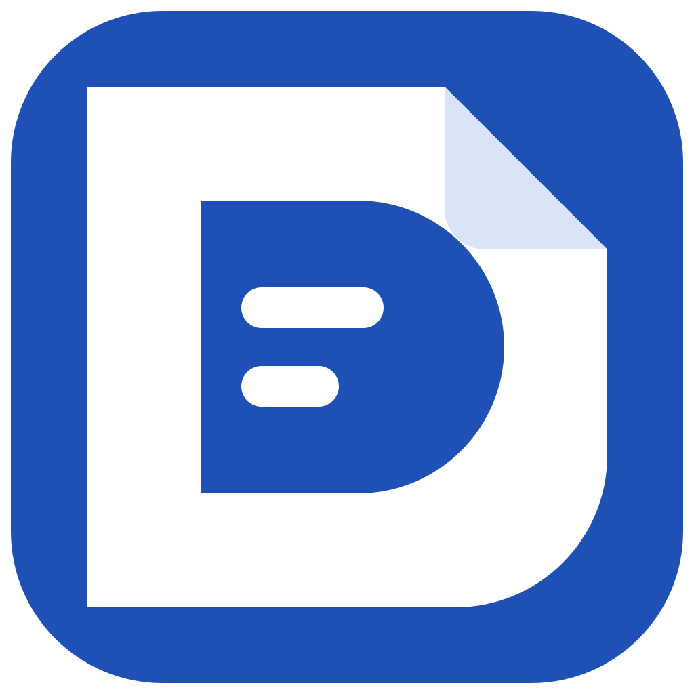

<p align="center"><b>English</b> | <a href="docs/README-ja.md">日本語</a></p>

<p align="center">
  
</p>

<h1 align="center">soraneDocs</h1>

<p align="center">
  <b>An experimental, feature-extended fork of <a href="https://github.com/ibisjp/ibis-office">ibisOffice</a> built with Rust and GPUI.</b><br>
  Mobile porting (iOS &amp; Android), Markdown/Mermaid/PlantUML knowledge workspaces, extended document &amp; diagram formats, BI/data ingestion, and AI assistance.
</p>

<p align="center">
  <a href="https://docs.sorane.dev">Try the Web App (docs.sorane.dev)</a> ·
  <a href="docs/fork-feature-differences.md">Feature Differences</a> ·
  <a href="docs/fork-workflow.md">Fork Workflow</a>
</p>

---

<!-- TODO: Add soraneDocs screenshots here -->

## What is soraneDocs?

**soraneDocs** is an active fork of [ibisOffice](https://github.com/ibisjp/ibis-office) maintained in `sorane-dev/docs`. Inheriting upstream's Rust + GPUI rendering engine, OOXML (`.docx`, `.xlsx`, `.pptx`) compatibility, and MCP foundation, this fork drives both **upstream contributions** and **domain/platform extensions**:

- **Upstream Contributions (Adopted & Proposed)**: Because `ibisjp/ibis-office` restricts pull requests to repository collaborators, improvements are developed here as verifiable proof-of-concept commits and proposed via GitHub Issues. Many have already been **adopted into upstream**, while others remain **proposed (open)** for review.
- **Extended Workspace & Platform**: Brings mobile native support (iOS & Android), an Obsidian-style Markdown/diagram workspace, legacy & regional document formats, BI/external data ingestion, AI assistance, and PWA/GitHub Vault integration to `docs.sorane.dev` and desktop/mobile builds.

For core ibisOffice benchmarks, baseline features, and commercial licensing, see the [upstream repository](https://github.com/ibisjp/ibis-office).

## Key Contributions & Fork Capabilities

Each area below summarizes what this fork has built and contributed — noting items **Adopted** in upstream `ibisOffice`, **Proposed** via upstream Issues, and **Fork** extensions.

### 1. Mobile Porting (iOS & Android) & Cross-Platform GPUI
- **iOS & Android Native Port** *(Proposed: [#247](https://github.com/ibisjp/ibis-office/issues/247))*: Ported the GPUI + `gpui-pre-wgpu` stack to native Android (`crates/gpui-android`) and iOS (`crates/gpui-ios`), adding mobile start views, touch/surface lifecycle handling, and automated Android App Bundle deployment to Google Play internal testing.
- **Platform Fixes** *(Adopted: [#256](https://github.com/ibisjp/ibis-office/issues/256), [#147](https://github.com/ibisjp/ibis-office/issues/147))*: Fixed Android file-picker return crashes and Ubuntu AppImage dock icon registration.

### 2. Markdown, Mermaid & PlantUML Integration / Knowledge Workspace
- **Markdown & Mermaid Foundation** *(Adopted: [#226](https://github.com/ibisjp/ibis-office/issues/226))*: Native Markdown round-trip conversion, clipboard/CLI integration, and offline pure-Rust Mermaid diagram rendering.
- **CommonMark Fidelity & Bidirectional Sync** *(Proposed: [#286](https://github.com/ibisjp/ibis-office/issues/286))*: Round-trip improvements validated against all 652 CommonMark 0.31.2 examples, plus block-level `SourceMap`, surgical WYSIWYG writeback, and bidirectional cursor/scroll sync.
- **PlantUML Integration** *(Proposed: [#298](https://github.com/ibisjp/ibis-office/issues/298))*: Offline pure-Rust PlantUML SVG rendering sharing Mermaid's diagram IR and assets — covering UML (Sequence, Class, State, Usecase, Object/Map, Timing, Activity, Component), planning/structure (Mindmap, WBS, Gantt), C4/JSON/YAML/EBNF/nwdiag/chronology, and lightweight themes/Creole formatting.
- **Obsidian-Style `SoraneWorkspace`** *(Proposed: [#283](https://github.com/ibisjp/ibis-office/issues/283))*: Desktop knowledge shell (`crates/sorane-workspace`) with split panes, tab pinning, session persistence, command palette, daily notes, Wiki links, OKF v0.3 knowledge items, Tag Browser, Outgoing Links, Local Graph, Outline, Office Inspector, and Git dock.

### 3. Extended Document, Diagram & Legacy Formats
- **Pure-Rust PDF, XPS/OpenXPS & OFD** *(Adopted: [#235](https://github.com/ibisjp/ibis-office/issues/235); Proposed: [#272](https://github.com/ibisjp/ibis-office/issues/272))*: Pure-Rust fixed-layout viewing and signature inspection, plus Markdown export with figure preservation.
- **Ichitaro (`.jtd`, `.jtt`, `.jttc`)** *(Fork)*: Read-only preview restoring logical records, vertical text, ruby, borders, images, thumbnails, and TOC, with DOCX/HTML export ([docs/jtd-preview.md](docs/jtd-preview.md)).
- **Microsoft Visio (`.vsdx`)** *(Proposed: [#292](https://github.com/ibisjp/ibis-office/issues/292))*: Viewing, creation, editing, stencil palette, flowchart shapes, snap highlights, and Web/Wasm support.
- **Unified Office Format (UOF / `.uot`)** *(Fork)*: Native UOT document and embedded image import.
- **WordPerfect (`.wpd`) & WPG 2** *(Fork)*: WordPerfect text/table import with WPG 2 vector, bitmap, curve, arc, and compound-path image composition.
- **DocuWorks (`.xdw`, `.xbd`) & Hancom (`.hwp`, `.hwpx`)** *(Proposed: [#254](https://github.com/ibisjp/ibis-office/issues/254), [#288](https://github.com/ibisjp/ibis-office/issues/288))*: Fixed-layout DocuWorks viewing and editable DOCX import for HWP 5.0 / HWPX.
- **EPUB 3 & Production Images** *(Fork)*: Native EPUB 3 import, plus HEIC, DPX, Cineon, OpenEXR, and JPEG 2000 preview ([docs/production-image-preview-ja.md](docs/production-image-preview-ja.md)).
- **OOXML & ODF Compatibility** *(Adopted: [#190](https://github.com/ibisjp/ibis-office/issues/190), [#221](https://github.com/ibisjp/ibis-office/issues/221))*: Office 2007 Standard encryption decryption, DOCX `w14:paraId` preservation, and extended ODF nested/hidden-row/column import.

### 4. BI, External Data Ingestion & Spreadsheet Enhancements
- **External Data Sources & Power Query** *(Proposed: [#263](https://github.com/ibisjp/ibis-office/issues/263))*: Spreadsheet query ingestion for local Parquet (with column selection, multi-file append, Zstandard), JSON Lines, Arrow IPC, Avro, and SQLite, alongside encoding-aware CSV in-place saving.
- **Machine-Readability & Roster Matching** *(Adopted: [#194](https://github.com/ibisjp/ibis-office/issues/194); Proposed: [#257](https://github.com/ibisjp/ibis-office/issues/257))*: Digital Agency machine-readability checker (adopted and unified with upstream's panel), plus `FIELDMATCH` functions, variant-character dictionaries, date review, and administrative PUP/Gaiji normalization.
- **Security & Compliance Analytics** *(Proposed: [#279](https://github.com/ibisjp/ibis-office/issues/279), [#280](https://github.com/ibisjp/ibis-office/issues/280))*: Spreadsheet workflows for reviewing CycloneDX SBOM/CBOM inventories (including PQC migration tracking) and OSV-Scanner vulnerability results.

### 5. AI Assistant & MCP Extensions
- **AI Assistant Sidebar** *(Proposed: [#231](https://github.com/ibisjp/ibis-office/issues/231))*: Cross-format editing assistance and change proposals for DOCX, XLSX, and PPTX backed by OpenAI-compatible APIs (Desktop) and Cloudflare Workers AI (Web).
- **MCP Tooling & Safety** *(Proposed: [#159](https://github.com/ibisjp/ibis-office/issues/159), [#275](https://github.com/ibisjp/ibis-office/issues/275), [#276](https://github.com/ibisjp/ibis-office/issues/276), [#281](https://github.com/ibisjp/ibis-office/issues/281))*: Reconnecting to a running Desktop Assistant from external MCP servers, respecting sheet protection hidden-formula settings, pre-expansion cell-limit checks, and skill integration.

### 6. Japanese Typography, Civic, Legal, Medical & Trust
- **Japanese Typography & Fonts** *(Adopted: [#158](https://github.com/ibisjp/ibis-office/issues/158), [#160](https://github.com/ibisjp/ibis-office/issues/160), [#193](https://github.com/ibisjp/ibis-office/issues/193), [#222](https://github.com/ibisjp/ibis-office/issues/222), [#230](https://github.com/ibisjp/ibis-office/issues/230), [#248](https://github.com/ibisjp/ibis-office/issues/248), [#251](https://github.com/ibisjp/ibis-office/issues/251))*: IVS / Japanese Government Standard Characters rendering & macOS glyph fixes, MS Mincho substitution fix on non-Windows, Japanese symbol/kana advance width & GPOS offset tuning, vertical emphasis mark placement, vertical table cell orientation/merging, and justified bullet layout fixes.
- **Legal, Medical & Structured Forms** *(Proposed: [#229](https://github.com/ibisjp/ibis-office/issues/229), [#246](https://github.com/ibisjp/ibis-office/issues/246), [#270](https://github.com/ibisjp/ibis-office/issues/270))*: e-Gov XML / Lawtext bidirectional conversion and comparison tables; pure-Rust medical document (UKE/DPC, FHIR/CDA/HL7 v2) and non-diagnostic DICOM interoperability (Non-SaMD scope); DOCX form templates and structured-data generation.
- **Signatures & Digital Credentials** *(Proposed: [#232](https://github.com/ibisjp/ibis-office/issues/232))*: Document electronic signature inspection, image C2PA verification, and spreadsheet SD-JWT / mDOC / OID4VP creation and verification.

### 7. Web (Wasm/WebGPU), PWA, Performance & Supply Chain
- **Web Delivery & Touch** *(Adopted: [#152](https://github.com/ibisjp/ibis-office/issues/152), [#157](https://github.com/ibisjp/ibis-office/issues/157), [#207](https://github.com/ibisjp/ibis-office/issues/207), [#212](https://github.com/ibisjp/ibis-office/issues/212))*: Chunked Wasm delivery for CDN limits, on-demand font glyph fetching, two-finger pinch-to-zoom, and touch timestamp panic fix.
- **PWA, GitHub Vault & HTML Export** *(Proposed: [#208](https://github.com/ibisjp/ibis-office/issues/208))*: Installable PWA at `https://docs.sorane.dev` with offline local-file support, GitHub App repository (Vault) login/creation/editing, structured HTML export, and static Japanese font subset chunks.
- **Performance & Provenance** *(Proposed: [#285](https://github.com/ibisjp/ibis-office/issues/285), [#299](https://github.com/ibisjp/ibis-office/issues/299), [#300](https://github.com/ibisjp/ibis-office/issues/300))*: Hot-path caching for GPUI rendering, settings, menu bar, and DOCX/XLSX geometry; CycloneDX 1.6 SBOM/CBOM generation and GitHub Artifact Attestations for Linux AppImage builds.

## Upstream vs. Fork Summary

For a commit-level and module-level breakdown of what is shared with upstream `main` versus what remains fork-specific, see [docs/fork-feature-differences.md](docs/fork-feature-differences.md).

In addition to the proposed/fork-only capabilities above, `soraneDocs` intentionally diverges from upstream in packaging and safety:
- Uses distinct `soraneDocs` branding and app identifiers so desktop/mobile builds can coexist with `ibisOffice`.
- Disables inherited auto-update checks and Windows automatic "Open With" registration to avoid pointing at upstream feeds or overwriting upstream associations.

## Building & Development

```bash
git clone --recurse-submodules https://github.com/sorane-dev/docs.git
cd docs
cargo build --release
```

- **Web edition**: `scripts/build-web.sh --release` (outputs static Wasm/WebGPU assets in `www/`).
- **Desktop bundles**: `scripts/bundle-macos.sh --release`, `scripts/bundle-linux.sh --release`, or `cargo build --release -p ibis-office-app` on Windows.
- **Branch & CI workflow**: `sorane` is the integration branch. See [docs/fork-workflow.md](docs/fork-workflow.md) for testing, CI verification, and deployment details.

## License & Attribution

- **Powered by [ibisOffice](https://github.com/ibisjp/ibis-office)** (in accordance with [docs/TRADEMARK.md](docs/TRADEMARK.md)).
- Licensed under **AGPL-3.0-only** — see [LICENSE](LICENSE).
- Original copyrights in ibisOffice are held by ibis inc. Third-party notices are listed in [docs/THIRD-PARTY-NOTICES.md](docs/THIRD-PARTY-NOTICES.md).
