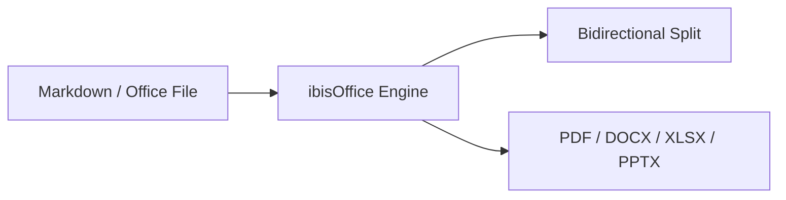
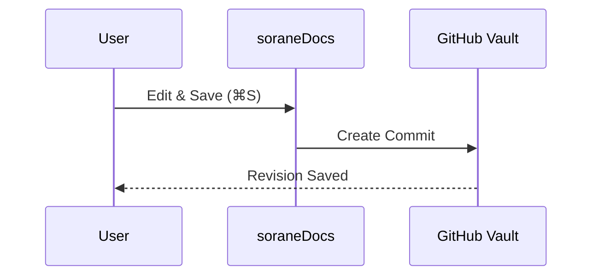
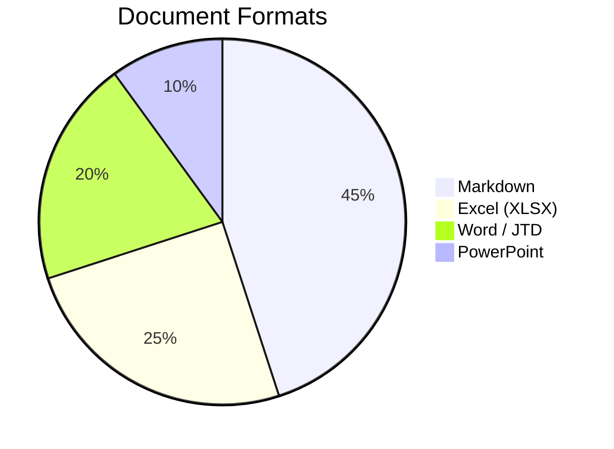
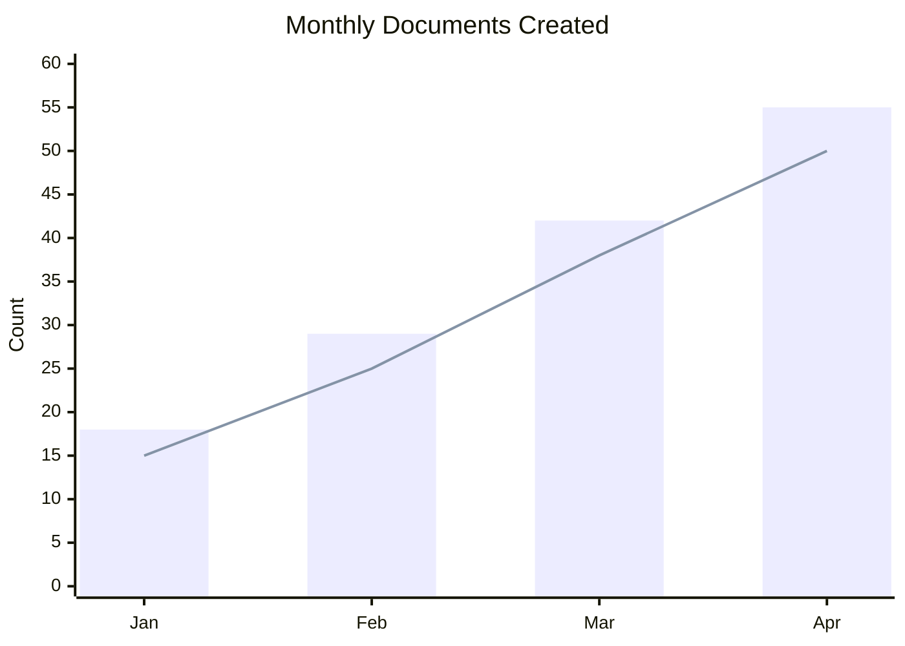

# Mermaid Diagrams Guide

[[help/index|← Back to Help Index]]

Use a fenced code block with the `mermaid` language tag to render diagrams and charts directly. When exporting to DOCX or PPTX, supported charts and diagrams can also be converted to native Office shapes and charts.

## 1. Flowchart (`flowchart LR` / `TD`)

## 2. Sequence Diagram (`sequenceDiagram`)

## 3. Pie Chart (`pie`) & XY Chart (`xychart-beta`)

## 4. Other Supported Diagrams

- `stateDiagram-v2` (State diagrams)
- `classDiagram` (Class diagrams)
- `erDiagram` (Entity-relationship diagrams)
- `gantt` (Gantt charts)

> [!TIP] Labels with parentheses or special characters
> Wrap node labels in quotes, e.g. `id["Label (Detail)"]`, to avoid syntax errors.
