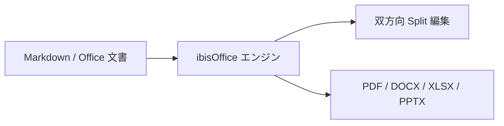
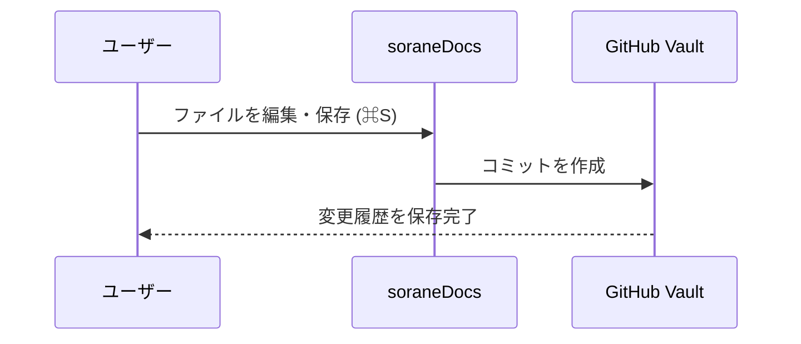
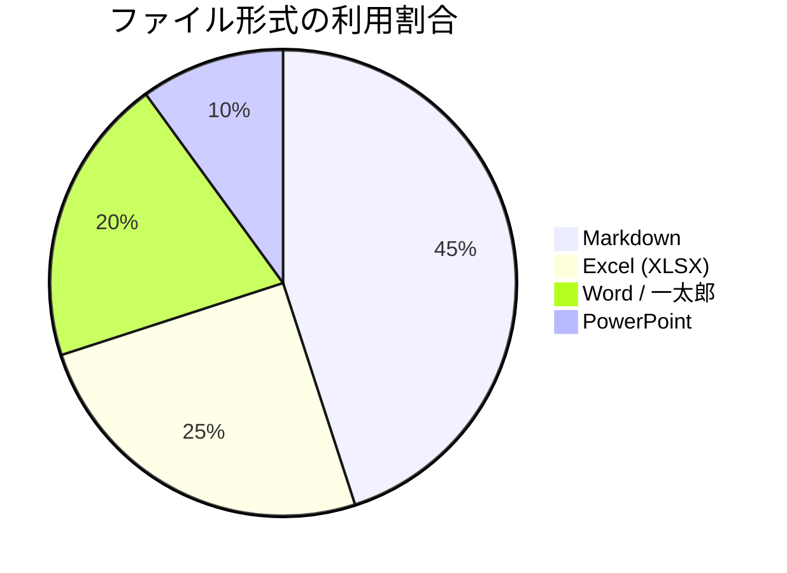

# Mermaid 図表ガイド

[[help/index|← ヘルプ目次に戻る]]

コードブロックの言語に `mermaid` を指定すると、図表やグラフが直接レンダリングされます。Office 文書（DOCX / PPTX）への変換時にはネイティブ図形やグラフとしても出力できます。

## 1. フローチャート (`flowchart LR` / `TD`)



## 2. シーケンス図 (`sequenceDiagram`)



## 3. 円グラフ (`pie`) と XY チャート (`xychart-beta`)



```mermaid
xychart-beta
  title "月次ドキュメント作成数"
  x-axis [1月, 2月, 3月, 4月]
  y-axis "件数" 0 --> 60
  bar [18, 29, 42, 55]
  line [15, 25, 38, 50]
```

## 4. その他の対応図種

- `stateDiagram-v2`（状態遷移図）
- `classDiagram`（クラス図）
- `erDiagram`（ER 図）
- `gantt`（ガントチャート）

> [!TIP] ラベルに括弧や記号を含める場合
> `id["ラベル (補足)"]` のようにダブルクォートで囲むと構文エラーを防げます。
