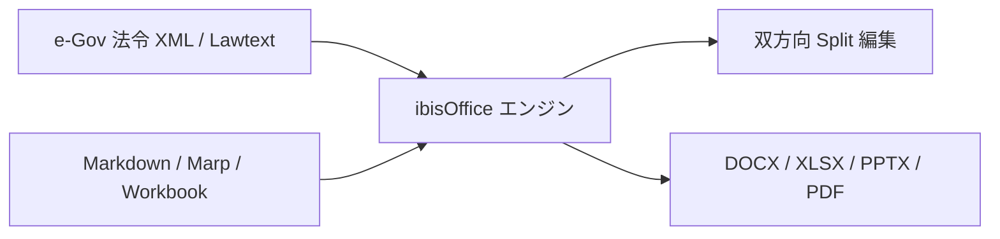
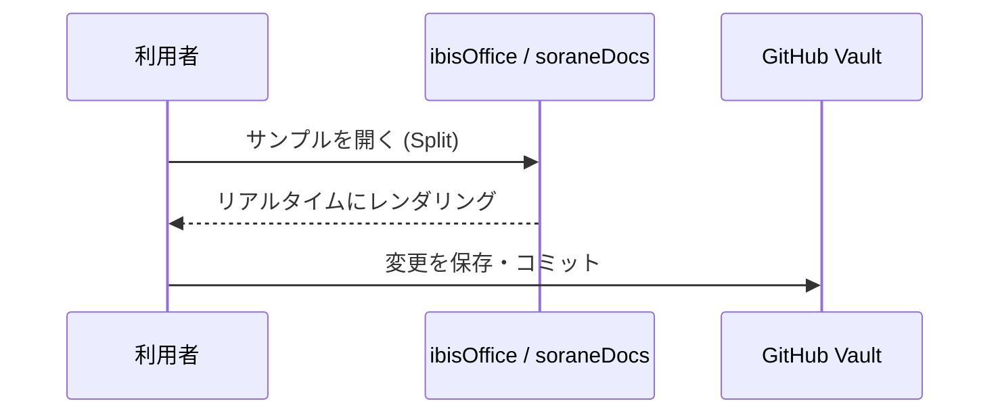
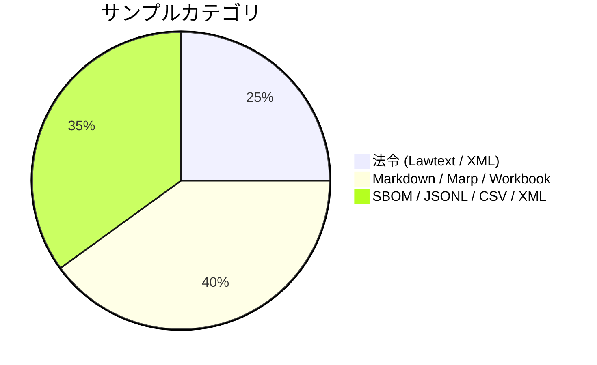

# Mermaid 図表サンプル

[[help/samples/index|← サンプル一覧・ウォークスルーに戻る]]

## フローチャート (`flowchart LR`)



## シーケンス図 (`sequenceDiagram`)



## 円グラフ (`pie`) と XY チャート (`xychart-beta`)



```mermaid
xychart-beta
  title "月別処理件数サンプル"
  x-axis [1月, 2月, 3月, 4月]
  y-axis "件数" 0 --> 100
  bar [32, 48, 65, 84]
  line [28, 45, 60, 80]
```
