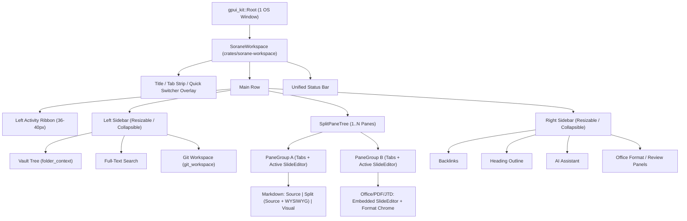
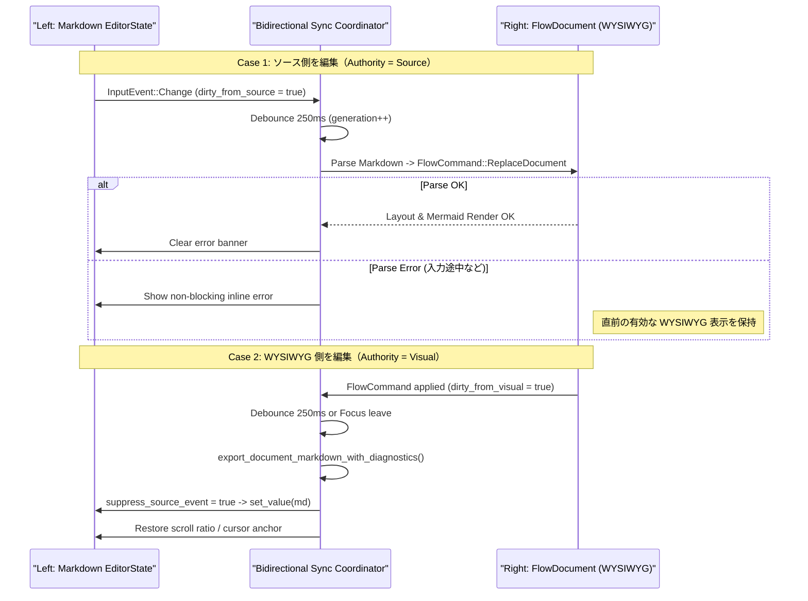

# soraneDocs デスクトップ Workspace UI 設計書

> **実装状況（2026-11-25 時点）**: 本設計書の Phase 0〜4（および Session 永続化・Command Palette・Wiki リンク・Tag Browser・Local Graph を含む Phase 5A/5B）は、`sorane-dev/docs#224` により `sorane` ブランチへ実装・統合済みです。以下の本文は設計時の計画を記録したものです。

## 1. コンセプトと設計方針

### 1.1 目指す体験：「機械可読であることの可視化」
soraneDocs のデスクトップ UI を、単なる「Obsidian クローン」でも従来の「単一文書 Office」でもない、**「構造化されたソース（機械可読）と、人間が直感的に組版・編集できる WYSIWYG 表現が双方向に結びついたドキュメント・ワークスペース」** として再設計する。

* **Markdown 文書（Obsidian 振り切り＋上位体験）**:
  * 左ペインに Markdown / Mermaid / YAML Frontmatter ソース、右ペインに純 Rust 描画の **編集可能な WYSIWYG プレビュー** を並べ、どちら側を編集しても反対側へリアルタイムに反映される。
  * Obsidian の Reading View（読み取り専用）を超え、Mermaid 図や表・数式・日本語組版の編集と、テキストの機械可読性・Git 差分管理を同時に成立させる。
* **非 Markdown 文書（DOCX / XLSX / PPTX / PDF / JTD / 法令等）との共生**:
  * 外枠は Obsidian 風の統一ワークスペース（左リボン・Vault ツリー・タブ・分割ペイン）とし、ペインの中身は ibisOffice のネイティブ編集・閲覧エンジンをそのまま活かす。
  * **「左に PDF / Word / Excel / 一太郎 / 法令を開き、右で Markdown＋Mermaid の調査・設計ノートを書く」** 2 文書並置ワークフローを標準体験にする。

### 1.2 フォーク保守性と AGPL 戦略
* **ibisOffice = エンジン、`sorane-workspace` = 外殻シェル** と明確に責務を分離する。
* `crates/ibis-office-shell` 側への変更は「外部シェルに埋め込まれるための最小限のフック（エンジン口）」だけに限定し、ワークスペース UI 本体（リボン・タブ・分割ペイン・Vault ドック・クイックスイッチャー）は独立クレート（`crates/sorane-workspace`）へ分離する。
* これにより upstream（`ibisjp/ibis-office`）のメニューバー／ツールバー改修を取り込む際のコンフリクト面を最小化しつつ、AGPL のもとで upstream 側がエンジン埋め込み口やワークスペース機能を取り込みたい場合にも再利用しやすい境界を保つ。

### 1.3 確定した設計判断
* **着手順序**: Phase 0（エンジン境界整備）→ Phase 1（Markdown 双方向 Split ビュー）→ Phase 2（外殻 `SoraneWorkspace`）→ Phase 3（右ドック整理）→ Phase 4（SourceMap・高度同期）の順で段階導入する。
* **単一ファイル直接起動時の UI**: 最初から `SoraneWorkspace`（左サイドバー閉・タブ 1 枚）で統一する。フォルダ（Vault）を開いたときは左サイドバーを展開する。
* **WYSIWYG → Markdown 書き戻し**: Phase 1 では既存の全体再シリアライズ（`export_document_markdown_with_diagnostics`）＋スクロール位置維持から実装し、Phase 4 でブロック単位の `SourceMap` と部分書き換えへ発展させる。
* **スコープ境界**: 当面はデスクトップ（macOS / Windows / Linux）専用・Markdown 対象として設計・実装する。Lawtext の双方向展開と Web 版への波及は Phase 4 以降で検討する。

---

## 2. 全体アーキテクチャと画面構成

### 2.1 コンポーネント階層（外殻シェル＋エンジン埋め込み）



### 2.2 画面レイアウトイメージ

```text
+----+------------------+-------------------------------------+-------------------------+-------------------+
| Rb | Left Sidebar     | Pane 1: [memo.md *] [arch.md]       | Pane 2: [spec.pdf]      | Right Sidebar     |
|    | [Vault][Search]  | ← →  docs/design/memo.md [S|Sp|V]   | ← →  refs/spec.pdf 120% | [Backlinks][Out][AI]
| 📁 | > docs/          +------------------+------------------+-------------------------+-------------------+
| 🔍 |   memo.md   (●)  | # 設計メモ       | 設計メモ         |                         | Backlinks (3)     |
| 🌿 |   arch.md        |                  |                  |   (PDF / DOCX / XLSX    | • index.md · 14   |
| ✨ | > refs/          | ```mermaid       |  ┌───┐   ┌───┐  |    native rendered      | • review.md · 8   |
|    |   spec.pdf       | graph LR         |  │ A │──▶│ B │  |    by SlideEditor)      |                   |
|    |   draft.docx     |   A --> B        |  └───┘   └───┘  |                         | Outline           |
|    |                  | ```              |                  |                         |  1. 設計メモ      |
| ⚙  |                  | | 項目 | 値 |    | [直接編集可の表] |                         |  2. 構成図        |
+----+------------------+------------------+------------------+-------------------------+-------------------+
| main · 2 changes | Markdown (Split) · Synced | UTF-8 | 1,240 chars | 100%                                 |
+-----------------------------------------------------------------------------------------------------------+
```

---

## 3. クローム軽量化とペイン単位の出し分け（課題 1）

同じワークスペース内に異なる文書種別が混在するため、**上部クロームはウィンドウ固定ではなく「ペインの文書種別」に応じて切り替える**。

| 文書種別 | ペインヘッダ（常時表示・高さ 32–36px） | Office ツールバー | 書式・校閲サイドバー |
| --- | --- | --- | --- |
| **Markdown** (`.md` / `.markdown`) | `←/→` 履歴・パンくずパス・`[Source \| Split \| Visual]` 切替・同期状態・ツールバー展開トグル | **デフォルト非表示**（必要時のみトグル展開、または選択時ミニバー） | 右ドックに統合（バックリンク／アウトライン／AI を優先表示） |
| **Office 編集文書** (`.docx` / `.xlsx` / `.pptx`) | `←/→`・ファイルパス・保存状態・ツールバー折りたたみトグル | **アクティブペイン時に表示**（コンパクト収納可） | 右ドックの「書式／校閲」タブとして表示 |
| **閲覧専用・特殊形式** (`.pdf` / `.jtd` / `.xdw` / 画像等) | ページ移動・ズーム・検索・来歴／署名検査ボタン | 非表示 | 必要時のみ検査パネルを右ドックへ表示 |

* **タイトルバー統合**: OS ウィンドウのタイトルバー行にタブストリップ（または左サイドバー開閉＋アクティブファイル名）を統合し、従来の「タイトル行＋メニューバー＋ツールバー」の 3 段積みを解消する（macOS はシステムメニューバー利用、Windows/Linux は Alt キー表示またはリボン上部メニューボタン＋展開オプション）。
* **起動コンテキストによる初期状態**:
  * **フォルダ（Vault）を開いたとき**: 左リボン＋左サイドバー展開。
  * **単一ファイルを直接開いたとき**: `SoraneWorkspace`（左サイドバー閉・タブ 1 枚）で統一し、リボンボタン 1 クリックまたはショートカットで左サイドバーを即展開できる。

---

## 4. ナビゲーション・マルチタブ・分割ペイン（課題 2）

### 4.1 データモデル

```rust
pub enum SplitNode {
    Leaf(PaneId),
    Split {
        axis: SplitAxis, // Horizontal | Vertical
        ratio: f32,      // 0.15..=0.85 (ドラッグリサイズ可能)
        first: Box<SplitNode>,
        second: Box<SplitNode>,
    },
}

pub struct PaneGroup {
    pub id: PaneId,
    pub tabs: Vec<TabEntry>,
    pub active_tab: usize,
    pub history: Vec<PathBuf>,
    pub history_index: Option<usize>,
}

pub struct TabEntry {
    pub id: TabId,
    pub path: Option<PathBuf>,
    pub title: SharedString,
    pub kind: ibis_formats::Kind,
    pub pinned: bool,
    pub state: TabState,
}

pub enum TabState {
    /// メモリ上に生きているエンジンインスタンス
    Resident(Entity<SlideEditor>),
    /// クリーンかつ非アクティブなため解放済みの軽量プレースホルダ
    Lazy {
        scroll_hint: Option<f32>,
        markdown_view_mode: Option<MarkdownViewMode>,
    },
}
```

### 4.2 メモリ・ライフサイクル管理
* `SlideEditor` はフォント・レイアウト・メディアキャッシュを含むため、全タブを無制限に `Resident` にはしない。
* **常駐ポリシー**:
  1. いずれかのペインで表示中（アクティブ）のタブ → 必ず `Resident`
  2. 未保存変更（`dirty == true`）があるタブ → 必ず `Resident`
  3. クリーンな非アクティブタブ → LRU で上限（例: 6 タブ）まで `Resident` を保持し、超過分は `Lazy` へ降格（再選択時に即リロード）
* **同一ファイルの重複オープン防止**:
  * `open_guard.rs` をタブ対応に拡張する。既にいずれかのウィンドウ／タブで開かれているパスを再度開こうとした場合、そのタブへフォーカス移動する。

### 4.3 キーボード主導のナビゲーション
* **Vault クイックスイッチャー (`Cmd/Ctrl+O`)**:
  * `window_switcher.rs` と同じ軽量ポップアップ基盤を使い、`folder_context` のファイル一覧（最近開いた順＋ファジーマッチ）を即座に絞り込む。
  * `Enter` でアクティブペインに開く、`Cmd/Ctrl+Enter` で隣ペインに分割して開く。
* **コマンドパレット (`Cmd/Ctrl+P` / 既存のメニュー検索統合)**:
  * `open_toolbar_menu_search` にワークスペース操作（ペイン分割、モード切替、サイドバー開閉、新規ノート作成）を統合する。
* **タブ・ペインショートカット**:
  * `Cmd/Ctrl+W`: タブを閉じる（最後のタブならペイン／ウィンドウを閉じる）
  * `Cmd/Ctrl+Shift+T`: 直前に閉じたタブを再オープン
  * `Cmd/Ctrl+\`: ペイン分割
  * `Cmd/Ctrl+Shift+M`: Markdown の `Source / Split / Visual` 切替
  * `Cmd/Ctrl+[` / `]`: ペイン内履歴の戻る／進む（既存の `FolderPane` 履歴をペイン単位へ移設）

---

## 5. Markdown 双方向リアルタイム編集（Source ↔ Editable WYSIWYG）

### 5.1 位置づけとモデル
`crates/ibis-office-docx/src/markdown_source.rs` の排他トグルを **同一 `SlideEditor` 内の 3 モード** へ拡張する（別文書同士の分割は外側の `SoraneWorkspace` が担当し、同一 Markdown のソース／プレビュー分割は `SlideEditor` 内で完結させることで、保存・ファイル監視・dirty 管理の二重化を防ぐ）。

```rust
#[derive(Clone, Copy, Debug, PartialEq, Eq, Default)]
pub enum MarkdownViewMode {
    Visual, // WYSIWYG のみ（編集可能）
    Split,  // 左: Markdown Source / 右: 編集可能 WYSIWYG（ドラッグリサイズ可）
    Source, // Markdown Source のみ
}
```

### 5.2 双方向同期プロトコル



### 5.3 落とし穴への具体的な対策

1. **再帰ループ遮断 (`SyncAuthority` + `suppress_source_event`)**
   * フォーカスを持つ側を現在の `SyncAuthority` とし、プログラム的な書き戻し中はイベント発火を明示的に無視する。
   * フォーカスが逆側へ移った瞬間、未反映のデバウンス待ちがあれば即座にフラッシュしてから `SyncAuthority` を切り替える。
2. **入力途中のチラつき防止**
   * ` ```mermaid ` の閉じフェンスを打つ前や表の入力途中などでパース・描画が失敗しても、右側の `FlowDocument` を空やエラー画面に潰さず、**最後に成功した描画状態を維持**しつつ細いステータス表示だけ出す。
3. **保存時の整合性**
   * `bytes_for_path` 呼び出し前または保存直前に `flush_bidirectional_sync()` を必ず実行し、`Visual` 側の最新編集がソースに反映された状態で書き出す（逆に `Source` 側が最新なら生テキストのフォーマットを壊さずそのまま書き出す）。
4. **Undo / Redo の扱い**
   * **Phase 1**: 各側（`EditorState` / `FlowDocument`）のネイティブ Undo を維持し、反対側からの同期反映では相手側の編集履歴を不用意に壊さないように同期境界を管理する。
   * **Phase 4**: ブロック単位の `SourceMap`（`BlockIndex <-> LineRange`）を導入し、スクロール連動・クリック箇所ハイライト・WYSIWYG 編集時の変更ブロック部分書き換えへ発展させる。

---

## 6. エンジン分離境界（`ibis-office-shell` への最小変更）

upstream との乖離を抑えるため、`crates/ibis-office-shell` 側の変更を以下の **3 つの薄い契約** に集約する。

### 6.1 `Root -> SlideEditor` 直結の解消（既存約 20 箇所の集約）
`root.view().clone().downcast::<SlideEditor>()` が分散している箇所（`app.rs`, `editor.rs`, `open_guard.rs`, `file_watch.rs`, `git_workspace.rs`, `folder_context/ui.rs`, `settings_dialog.rs`, `about.rs`, `arrange_windows.rs`, `update.rs`, `host_editor.rs`, `font_setup_dialog.rs`, `ibis-office-xlsx/src/sheet_transfer.rs`）を `ibis-office-shell` 内の単一モジュール（`window_editors.rs`）へ集約する。

```rust
/// ウィンドウのルートビューが実装するエンジン公開口。
/// 従来の単体 SlideEditor でも、SoraneWorkspace でも共通に解決できる。
pub trait WorkspaceEditorHost: 'static {
    fn active_editor(&self) -> Option<Entity<SlideEditor>>;
    fn all_editors(&self) -> Vec<Entity<SlideEditor>>;
    fn activate_editor_by_path(&mut self, path: &Path, window: &mut Window, cx: &mut App) -> bool;
}
```

* 終了時の未保存確認（`native_quit_allowed` / `quit_asking_to_save_now`）と `file_watch`、`open_guard` は `all_editors()` を走査する。
* 設定ダイアログ・About・`macos_menu` 同期は `active_editor()` を参照する。

### 6.2 `SlideEditor` の埋め込みクローム制御 (`EmbeddedChromePolicy`)
`render_window` に外部ホスト用のクローム制御を追加する（既存の Web 埋め込み `embed.rs` と同系統）：

```rust
pub struct EmbeddedChromePolicy {
    pub show_title_row: bool,
    pub show_menu_bar: bool,
    pub show_toolbar: bool,
    pub show_left_pane: bool,
    pub show_right_sidebar: bool,
    pub show_status_bar: bool,
}
```

* `EmbeddedChromePolicy` が設定されている場合、`SlideEditor` は `window.set_window_title(...)` や `OpenDocuments::sync(...)` を直接叩かず、状態変更を `SoraneWorkspace` へ通知（または参照提供）する。

### 6.3 既存テスト・シナリオの保護
* 既存のシナリオテスト群は従来どおり単体 `SlideEditor` ルートで無改修のまま通過させる。
* `crates/sorane-workspace` 側には、タブ切替・分割ペイン・未保存終了確認・Markdown 双方向 Split 同期の専用テストを追加する。

---

## 7. 左右サイドバー・ドック整理（課題 3 の見通し）

* **左アクティビティリボン ＋ 左サイドバー（幅ドラッグリサイズ・折りたたみ対応）**:
  * **ファイル（Vault）**: `folder_context/ui.rs` のファイルツリー（上部からバックリンクを外して分離）。
  * **全文検索**: `SearchMode::Content` を独立タブ化。
  * **Git**: `git_workspace.rs` を排他切替ではなくリボン切替として常駐共存させる。
* **右サイドバー（タブ切替式ドック・折りたたみ対応）**:
  * **バックリンク**: `FolderPane` 上部から独立パネル化。
  * **アウトライン**: 見出しジャンプ（既存ナビゲーションペイン統合）。
  * **AI アシスタント**: 全ペイン横断の右ドックとして利用可能化。
  * **書式・校閲**: Office 文書アクティブ時に `sidebars.rs` 経由で開かれるパネルを収容。

---

## 8. 段階的実装ロードマップ

| Phase | 内容 | 主な変更対象 | 成果物・検証ポイント |
| --- | --- | --- | --- |
| **Phase 0** | **エンジン境界の下地整備** | `crates/ibis-office-shell` (`window_editors.rs`, `EmbeddedChromePolicy`) | `downcast::<SlideEditor>()` 20 箇所の集約。既存挙動・全テスト無変更で通過。 |
| **Phase 1** | **Markdown 双方向 Split ビュー** | `crates/ibis-office-docx` (`markdown_source.rs`, `lib.rs`) | `[Source \| Split \| Visual]` 切替、Mermaid リアルタイム描画、WYSIWYG 側直接編集→ソース書き戻し、保存・エラー耐性テスト。 |
| **Phase 2** | **外殻 `SoraneWorkspace` 最小版（課題 1 & 2）** | 新規 `crates/sorane-workspace`、`ibis-office-app` 起動口 | 左リボン＋リサイズ可能左ペイン、タブバー、2 ペイン左右分割、クイックスイッチャー（`Cmd/Ctrl+O`）、文書種別クローム切替。 |
| **Phase 3** | **右ドック・サイドバー再編（課題 3）** | `crates/sorane-workspace`、`folder_context`、`sidebars.rs` | バックリンクの右分離、アウトライン／AI／Office パネル統合、Git とのシームレス切替。 |
| **Phase 4** | **SourceMap と高度同期（拡張）** | `ibis-formats` / `ibis-office-docx` | ブロック単位行マッピングによるスクロール連動・カーソル強調・Diff ノイズ低減。Lawtext や Web 展開の検討。 |
