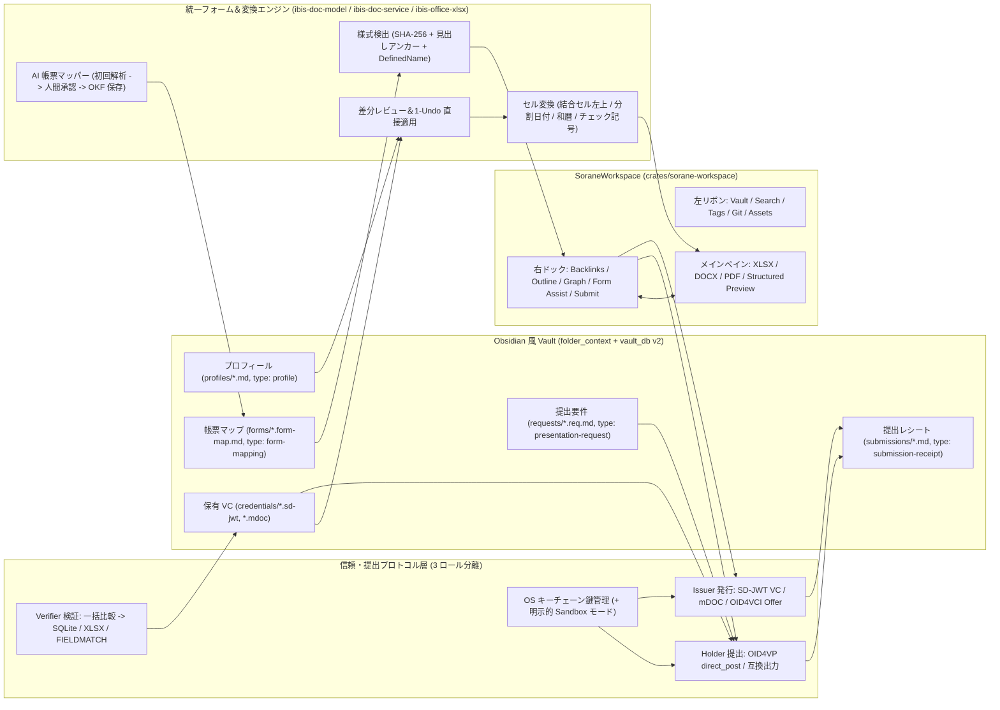

# soraneDocs フォーム入力支援 × Obsidian 風 Vault × Verifiable Credentials 統合設計書

> **ステータス**: Phase 0〜3 完了（Phase 4 着手待ち・2026-11-26 更新）  
> **関連ドキュメント**: [デスクトップ Workspace UI 設計書](desktop-workspace-ui.md) / [Excel フォームからの SD-JWT 生成と OID4VP 提示の設計計画](../xlsx-sd-jwt-plan.md) / [フォームテンプレートの書式と作り方](../form-template-ja.md) / [就労証明書の XLSX 受け渡しと項目対応](../employment-certificate-xlsx-ja.md)

---

## 1. 確定した基本方針

本設計書では、すでに `sorane` ブランチに実装済みの **Verifiable Credentials（SD-JWT VC / ISO mDOC / OID4VP）**、**プレフィル基盤**、**Obsidian 風デスクトップ Vault（`SoraneWorkspace`）**、および **多形式フォーム基盤** を一本の業務フローとして配線し、**「Excel よりも圧倒的に簡単にフォームを埋められ、そのまま自然な提出手段として VC プロトコルを使える」**体験を実現するための設計と段階的ロードマップを定義する。

着手にあたって確定した方針は以下の 3 点である。

1. **汎用プロフィール自動入力ファースト（日常価値から立ち上げる）**
   - 自治体・企業間の制度連携を伴う「就労証明書」のようなフル VC 流通は中長期の応用ケースと位置づける。
   - まずは **「VC が世の中に少ない今日から、Vault に置いた自分のプロフィールノート（YAML Frontmatter）や手元の受領 VC を使って、任意の Excel 申請書・帳票を爆速で埋められる」** 体験（フォームモード v1）を最優先で立ち上げる。
   - その入力体験の自然な延長線上に、VC 由来の「検証済み出典バッジ」と「ワンクリック提出（OID4VP / 互換出力）」を載せる。
2. **デスクトップ版優先（macOS / Windows / Linux + `SoraneWorkspace`）**
   - Web 版（`ibis.sorane.dev` / GitHub Vault バックエンド）は、秘密鍵の保管境界・CORS・クロスデバイス提示など検証すべき不確実性が多いため、まず **デスクトップ版（ローカル Vault + OS キーチェーン + 直接 HTTP `direct_post`）** で完成させる。
   - Web 版への展開は Phase 4 で設計検証の上で取り組む。
3. **フォーク保守性と upstream 境界の維持**
   - [デスクトップ Workspace UI 設計書](desktop-workspace-ui.md) の原則を踏襲し、表計算フォームの汎用改善（結合セルへの安全なプレフィル、入力支援 UI、純粋な互換改善）は `ibis-doc-model` / `ibis-doc-service` / `ibis-office-xlsx` に整理し、Vault 統合・右ドック・OKF 連携は `crates/sorane-workspace` と `folder_context` 側へ分離する。

---

## 2. 現状診断：資産は揃っているが 5 つの配線が断絶している

### 2.1 すでに存在する資産の棚卸し

| 領域 | 既存機能 | 主な実装箇所 |
| --- | --- | --- |
| **VC 暗号・形式エンジン** | 純 Rust ES256 署名/検証、SD-JWT VC (RFC 9901)、ISO mDOC、OID4VP 要求パース、KB-JWT (`kb+jwt`) 生成、`claim.*`/`sd.*`/`disclose.*` バインディング、スキーマ推論 | `crates/ibis-doc-model/src/sd_jwt*.rs` |
| **XLSX UI パネル** | SD-JWT 生成・開示トグルパネル、構造化データからの差分レビュー付きプレフィルパネル | `crates/ibis-office-xlsx/src/sd_jwt_panel.rs`, `prefill_panel.rs`, `prefill_copy.rs` |
| **プレフィル＆検証サービス** | `xlsx_preview_prefill` / `xlsx_apply_prefill`、`presentation_compare`（DCQL / `direct_post` 比較） | `crates/ibis-doc-service/src/tools_prefill.rs`, `tools_wallet.rs`, `wallet_dcql.rs` |
| **多形式フォーム＆構造化閲覧** | DOCX / Markdown (`{{form:*}}`) / HTML / PDF/A-2b フォーム差し込み＆クレーム抽出、`.sd-jwt`/`.mdoc`/`.json`/`.yaml` の構造化プレビュー | `crates/ibis-formats/src/bin/docx_form.rs`, `structured_preview.rs` |
| **Vault / OKF / AI** | `SoraneWorkspace`（2 ペイン分割・タブ・バックリンク・ローカルグラフ）、Turso SQLite インデックス、OKF v0.3 パーサ、AI アシスタント VC ツール群 | `crates/sorane-workspace/`, `crates/ibis-office-shell/src/folder_context/{vault_db,markdown_index}.rs`, `crates/ibis-formats/src/okf.rs`, `crates/ibis-office-shell/src/ai_tools.rs` |

### 2.2 使いこなせていない 5 つの根本原因

1. **メンタルモデルの逆転（技術用語ファースト）**
   - `crates/ibis-office-xlsx/src/toolbar.rs` で「書式（Format）」メニューの奥に `SD-JWT` と `プレフィル` が別々に配置されている。
   - ユーザーの目的は「VC を作ること」ではなく「申請書・帳票をミスなく一瞬で埋めて提出すること」であり、VC はその裏側で働く信頼レイヤーであるべき。
2. **現実の帳票（「神エクセル」・結合セル・無名セル）との断絶**
   - `sd_jwt_panel.rs` は `claim.*` / `sd.*` の命名規約前提で、既存の外部様式にそのまま当たらない。
   - `crates/ibis-doc-service/src/tools_prefill.rs` は `DefinedName` 必須かつ **結合セル（`sheet.merge_at(row, col).is_some()`）を `blocked_target` として拒否**しており、結合セルが多い実務帳票へ流し込めない。また GUI（`prefill_panel.rs`）は「ソース選択 → 手書き `mapping.json` 選択 → 別名保存のみ」で、開いているシートへの直接反映（Undo 付き）に繋がっていない。
3. **Obsidian 風 Vault との断絶**
   - `vault_db.rs` は `files / tags / aliases / links` のみを永続化しており、Markdown YAML Frontmatter の構造化プロパティ、受領済み `.sd-jwt` / `.mdoc`、OKF フォームマッピング定義をインデックスしていない。
   - `scripts/employment-schema/*.example.md` で試作された OKF 形式の定義が Python スクリプト止まりで、`SoraneWorkspace` から参照されない。
4. **プロトコル実送信・鍵管理・ロール分離の断絶**
   - `sd_jwt_panel.rs` はデモ鍵（`Es256KeyPair::demo_issuer_key()` / `demo_holder_key()`）と固定タイムスタンプ `1_700_000_000` を使い、出力はクリップボードコピー止まり。
   - `openid4vp://` からの `direct_post` HTTP 送信や OS キーチェーン鍵管理がなく、しかも **発行（Issuer）・提示（Holder）・検証（Verifier）** の 3 ロールが 1 パネルに混在している。
5. **形式・パネル間のサイロ化**
   - `.sd-jwt` / `.mdoc` を構造化プレビューで開いても「この証明書でフォームを埋める」「提示する」導線がない。`docx_form` は CLI のみで GUI に繋がっていない。

---

## 3. ビジョン：「Excel より簡単に埋まり、自然に VC で送れる」体験

### 3.1 体験のビフォー・アフター

| 工程 | 従来の Excel + 紙 / Web 提出 | soraneDocs が目指す体験 |
| --- | --- | --- |
| **1. 様式を開く** | 結合セル・小さい入力欄・横スクロール・別シートの記載要領を行き来して解読 | 帳票を開くと **「フォームモード（Form Assist）」** を提案。原本帳票と縦型入力フォームを並置し、クリック／フォーカスを双方向連動 |
| **2. 項目を埋める** | 会社名・住所・氏名・生年月日・法人番号・口座番号を毎回手打ち／コピペ。和暦・`□/☑`・文字数溢れでミス多発 | **Vault のプロフィールノート ＋ 保有 VC（`.sd-jwt`/`.mdoc`）** から候補を自動照合し、**差分レビュー付きで 1 クリック一括入力**。残り数項目だけガイド付き（和暦ピッカー・字数ゲージ・Tab ジャンプ）で補完 |
| **3. 根拠・証明を扱う** | 証明書を別でスキャン添付。提出データの改ざん防止や転記ミス防止が人手頼み | VC 由来の項目には **「検証済みバッジ＋出典リンク」** を表示。手入力した新しい値（例：担当者変更）は 1 クリックでプロフィールノートへ逆保存可能 |
| **4. 提出（送る）** | 相手ごとに別名保存し、メール添付や Web 画面へ手動転記 | 統一の **「提出（Submit）」** アクションから、相手が OID4VP 対応なら **選択的開示を確認して `direct_post` 実送信**、未対応なら **互換 XLSX / PDF/A（＋任意で SD-JWT 同梱）** を出力 |
| **5. 提出後の追跡** | 「いつ・どの版で・何を出したか」がローカルフォルダに散逸 | Vault の `submissions/` に **提出レシート（OKF Markdown）** を自動生成。使った帳票・プロフィール・VC へ `[[Wiki リンク]]` が張られ、ローカルグラフで追跡可能 |

### 3.2 段階的価値のグラデーション

1. **Level 1（今日から毎日使える価値）**: VC を 1 枚も持っていなくても、Vault に自分のプロフィール（Markdown YAML）を置いておけば、**あらゆる Excel / Word / PDF 申請書が Excel 本家より圧倒的に速く・ミスなく埋まる**。
2. **Level 2（VC が手元にあると信頼が付く）**: 受領済み `.sd-jwt` / `.mdoc` を Vault に入れるだけで、プロフィールと同列（かつ「発行者署名検証済み」の上位ソース）として自動入力に使える。
3. **Level 3（相手が対応すればそのまま送れる）**: 提出先から `openid4vp://` や OKF 提示要求が来たら、いつもの「提出」ボタンがそのまま選択的開示＋暗号送信の窓口になる。

---

## 4. 全体アーキテクチャとクレート配線



### クレート責務境界

| クレート | 担当する責務 |
| --- | --- |
| `crates/ibis-doc-model` | フォームマッピング・セル変換ルール（分割日付・和暦・排他チェック）のデータモデル、SD-JWT / mDOC / OID4VP の純粋ロジック（現在時刻注入・`direct_post` ペイロード構築） |
| `crates/ibis-doc-service` | `review_prefill` / `reviewed_prefill_command` の結合セル左上許可・変換ルール適用、Verifier 一括比較（`tools_wallet.rs`）と SQLite/XLSX 連携 |
| `crates/ibis-office-xlsx` | 開いているシートへの直接プレフィル適用（Undo 対応）、セルハイライト連動、3 ロール分離後の VC パネル／ダイアログ、独立メニュー導線 |
| `crates/ibis-formats` | OKF v0.3 フロントマター型定義（`profile` / `form-mapping` / `presentation-request` / `submission-receipt`）、`docx_form` のライブラリ API 公開、構造化プレビューへの検証ステータス付与 |
| `crates/ibis-office-shell` | `vault_db.rs` v2（プロパティ・VC・帳票マップの SQLite キャッシュ）、OS キーチェーン抽象、OID4VP `direct_post` HTTP クライアント、AI アシスタントの帳票マッピング提案ツール |
| `crates/sorane-workspace` | 左リボン／右ドックの **Form Assist**・**Submit & Trust**・**Assets** UI、帳票オープン時の自動検出バナー、提出レシートの自動生成とリンク連携 |

---

## 5. Obsidian 風 Vault（OKF v0.3）データ規約と `vault_db` v2 設計

既存の Obsidian Vault や Git 管理を壊さないよう、すべて **プレーンテキスト（OKF v0.3 準拠 Markdown + YAML Frontmatter）および標準クレデンシャルファイル** で表現し、ディレクトリ配置は推奨規約としつつ `type:` フロントマターと拡張子で自動認識する（`sorane.yaml` で上書き可能）。

### 5.1 Vault 内の標準ディレクトリ構成（推奨規約）

```text
my-vault/
├── sorane.yaml                      # 任意のワークスペース設定
├── profiles/
│   ├── me.md                        # type: profile (本人プロフィール)
│   └── company.md                   # type: profile (自社・組織プロフィール)
├── credentials/
│   ├── my-employee-card.sd-jwt      # 受領済み SD-JWT VC（原本のまま保管）
│   └── sample-mdl.mdoc              # 受領済み ISO mDOC
├── forms/
│   ├── vendor-invoice.form-map.md   # type: form-mapping (帳票セル対応表)
│   └── reimbursement.form-map.md
├── requests/
│   └── portal-submit.req.md         # type: presentation-request (提出先要件)
└── submissions/
    └── 2026-11-25-vendor-invoice.md # type: submission-receipt (自動記録レシート)
```

> **セキュリティ原則（秘密鍵の厳格な分離）**:  
> 署名用の秘密鍵（Issuer 秘密鍵・Holder Key Binding 秘密鍵）は **Vault フォルダおよび Git リポジトリに絶対に保存しない**。デスクトップ版では OS キーチェーン（macOS Keychain / Windows Credential Manager / Linux Secret Service）に隔離し、Vault 内には公開鍵参照（`kid` / `jwk_thumbprint`）と非機密メタデータのみを置く。

### 5.2 OKF Markdown スキーマ仕様

#### A. プロフィールノート（`type: profile`）

人間が普通に Obsidian ノートとして読める・編集できる形を維持しつつ、`x-sorane-profile`（またはトップレベル構造化キー）をフォーム自動入力のソースとして利用する。

```yaml
---
type: profile
title: 株式会社サンプル（自社プロフィール）
tags: [profile, company]
x-sorane-profile:
  version: 1
  profile_id: company-default
  scope: organization        # person | organization | household | custom
  fields:
    organization.name: 株式会社サンプル
    organization.name_kana: カブシキガイシャサンプル
    organization.corporate_number: "1234567890123"
    organization.invoice_number: T1234567890123
    organization.representative: 山田 太郎
    address.postal_code: "100-0001"
    address.prefecture: 東京都
    address.locality: 千代田区千代田
    address.street: "1-1-1"
    contact.phone: "03-1234-5678"
    contact.email: billing@example.co.jp
    bank.name: サンプル銀行
    bank.branch: 本店営業部
    bank.account_type: 普通
    bank.account_number: "0123456"
---

# 株式会社サンプル（請求・申請用マスタ）

各種申請書・請求書・見積書の自動入力に使う自社情報。
```

#### B. 外付けフォーム対応表（`type: form-mapping`）

既存の官公庁・取引先 Excel 様式のように `DefinedName` を持たず原本構造を変更しにくい帳票でも、**外付けの OKF ノート** で安全にバインディングできる。`scripts/employment-schema` の設計（原本 SHA-256 ＋ 見出しアンカー検証）を汎用化する。

```yaml
---
type: form-mapping
title: 取引先A 請求書様式（2026年版）
tags: [form-mapping, invoice]
x-sorane-form-mapping:
  version: 1
  form_id: vendor-a-invoice
  form_version: "2026-04"
  format: xlsx                        # xlsx | docx | pdf | html | markdown
  match:
    template_sha256: "<任意: 原本ファイルの SHA-256>"
    sheet: 請求書
    anchors:                          # SHA-256 が異なる派生版でも安全照合するための代表見出し
      - cell: A1
        contains: 請求書
      - cell: B5
        contains: 登録番号
  fields:
    - id: issuer.name
      label: 請求元会社名
      target: { cell: C4 }            # 結合セルの場合は左上セルを指定（または name: "claim.issuer_name"）
      sources:
        - profile: organization.name
      required: true
      max_chars: 40
    - id: issuer.invoice_number
      label: 適格請求書登録番号
      target: { cell: C5 }
      sources:
        - profile: organization.invoice_number
      value_type: text                # 常に文字列として書き込み（先頭ゼロ保護）
    - id: issue_date
      label: 請求日
      target:
        split_date_ymd: { year: G2, month: I2, day: K2 }  # 分割セル変換
      value_type: date
      default: today
    - id: tax_category
      label: 課税区分
      target:
        radio_mark:
          checked: "☑"
          unchecked: "□"
          options:
            taxable: C10
            exempt: F10
      value_type: enum
---

# 記載上の注意

- 原本の結合セルを解除せず左上セルへ書き込む。
- 登録番号は必ず `T` + 13 桁の文字列として入力する。
```

> **互換性の方針**: 既存の `DefinedName`（`claim.*` / `sd.*` / `disclose.*`）を持つシートは、`form-mapping` ノートがなくても自動的にフォーム項目として検出される。外付け `form-mapping` と埋め込み `DefinedName` の両方を同じ内部 IR（`FormSchema`）へ正規化することで、UI と変換エンジンを 1 本化する。

#### C. 提出レシート（`type: submission-receipt`）

提出（OID4VP 送信 / 互換ファイル出力 / VC 発行）の完了時に `submissions/YYYY-MM-DD-<form_id>.md` を自動生成する。

```yaml
---
type: submission-receipt
title: 取引先A 請求書 提出記録（2026-11-25）
tags: [submission, invoice]
x-sorane-submission:
  version: 1
  submitted_at: "2026-11-25T17:30:00+09:00"
  mode: hybrid_xlsx                   # oid4vp_direct_post | hybrid_xlsx | pdfa | vc_issue
  form_id: vendor-a-invoice
  form_version: "2026-04"
  recipient: "https://portal.vendor-a.example"
  output_sha256: "<出力ファイルまたは vp_token の SHA-256>"
  disclosed_fields:
    - issuer.name
    - issuer.invoice_number
    - issue_date
---

# 提出記録

- 使用した様式定義: [[forms/vendor-invoice.form-map]]
- 参照したプロフィール: [[profiles/company]]
- 参照した証明書: [[credentials/my-employee-card.sd-jwt]]
```

### 5.3 `vault_db.rs`（Turso SQLite）スキーマ v2 拡張

`crates/ibis-office-shell/src/folder_context/vault_db.rs` の `SCHEMA_VERSION` を `"1"` → `"2"` へ上げ（既存の自動再構築機構 `open_or_recreate` をそのまま活用）、`markdown_index.rs` のスキャン時にフロントマターと `.sd-jwt`/`.mdoc` を増分キャッシュする。

```sql
-- 1. Markdown フロントマター構造化プロパティ（type: profile 等）
CREATE TABLE IF NOT EXISTS frontmatter_props (
    path TEXT NOT NULL,
    doc_type TEXT NOT NULL,
    profile_id TEXT,
    key_path TEXT NOT NULL,
    value_json TEXT NOT NULL,
    value_type TEXT NOT NULL,
    PRIMARY KEY (path, key_path)
);
CREATE INDEX IF NOT EXISTS idx_fm_type_key ON frontmatter_props(doc_type, key_path);

-- 2. Vault 内の受領済みクレデンシャル（.sd-jwt / .mdoc）
CREATE TABLE IF NOT EXISTS vault_credentials (
    path TEXT PRIMARY KEY,
    size INTEGER NOT NULL,
    mtime_secs INTEGER NOT NULL,
    mtime_nanos INTEGER NOT NULL,
    format TEXT NOT NULL,            -- 'sd-jwt' | 'mdoc'
    vct_or_doctype TEXT NOT NULL,
    issuer TEXT,
    expires_at INTEGER,
    digests_verified INTEGER NOT NULL,
    digests_total INTEGER NOT NULL,
    sig_status TEXT NOT NULL,        -- 'valid' | 'invalid' | 'unchecked'
    claims_json TEXT NOT NULL
);

-- 3. 外付けフォームマッピング＆提示要求定義
CREATE TABLE IF NOT EXISTS form_definitions (
    path TEXT PRIMARY KEY,
    kind TEXT NOT NULL,              -- 'form-mapping' | 'credential-definition' | 'presentation-request'
    form_id TEXT NOT NULL,
    form_version TEXT,
    target_format TEXT,
    template_sha256 TEXT,
    sheet_hint TEXT,
    spec_json TEXT NOT NULL
);
CREATE INDEX IF NOT EXISTS idx_form_def_sha ON form_definitions(template_sha256);
```

---

## 6. フォーム入力支援（Form Mode / Form Assist）詳細設計

### 6.1 `SoraneWorkspace` での UI 配置と動線

```text
+----+------------------+-------------------------------------+-------------------------------+
| Rb | Left Sidebar     | Active Pane: [申請書.xlsx]          | Right Dock: [Form Assist]     |
| 📁 | Vault            | ----------------------------------- | [プロファイル: 自社 ▼] [一括入力] |
| 🔍 | ▸ profiles/      | ℹ フォーム定義検出: 12/15 項目自動可  |                               |
| 🏷 | ▸ credentials/   |                                     | 進捗: ████████░░ 12/15 必須   |
| 🌿 | ▸ forms/         |   (ネイティブ XLSX / DOCX / PDF      | [未入力のみ] [エラーのみ]       |
| 🪪 | ▸ submissions/   |    該当セルがリアルタイムハイライト)  | ----------------------------- |
|    |                  |                                     | ✔ 会社名 [Vault: 自社]        |
|    |                  |                                     |   [ 株式会社サンプル        ] |
|    |                  |                                     | ✔ 証明番号 [VC検証済 🛡]      |
|    |                  |                                     |   [ T1234567890123         ] |
|    |                  |                                     | ○ 請求日 (令和8年11月25日)    |
|    |                  |                                     |   [ 2026-11-25  📅 和暦切替 ] |
|    |                  |                                     | ! 備考 (残り 12 / 40 文字)    |
|    |                  |                                     | ----------------------------- |
|    |                  |                                     | [互換保存 (XLSX/PDF)] [提出 ▸]|
+----+------------------+-------------------------------------+-------------------------------+
```

- **左アクティビティリボン（`LeftPanelKind`）**: 既存 `Vault / Search / Tags / Git` に加え、プロフィール・保有 VC・帳票マップを俯瞰する **`Assets`（フォーム・証明書資産）** を追加（初期段階では Vault 内のクイックフィルタでも可）。
- **右ドック（`RightPanelKind`）**: 既存 `Backlinks / Outline / Graph` に **`FormAssist`** と **`SubmitTrust`** を文脈連動で追加。
- **メニュー導線の再編**: `crates/ibis-office-xlsx/src/toolbar.rs` の「書式（Format）」の奥にある `SD-JWT` と `プレフィル` を、ツールバー／コマンドパレット（`Cmd/Ctrl+P`）から直結できる独立アクション **「フォーム入力支援（Form Assist）」「提出・証明（Submit / VC）」** へ昇格する。

### 6.2 `tools_prefill.rs` の制約解除と変換エンジン設計

現行の `crates/ibis-doc-service/src/tools_prefill.rs` には、実務帳票で詰まる 4 つの制約がある。これらを以下のように改修する。

| 項目 | 現状の制約 | 改修後の仕様 |
| --- | --- | --- |
| **結合セル** | `sheet.merge_at(row, col).is_some()` で一律 `blocked_target` | 対象セルが **結合範囲の左上セル（anchor）** であれば書き込み許可。左上以外（結合従属セル）は自動的に左上へ解決するか明示エラーとする |
| **適用方法** | GUI（`prefill_panel.rs`）は別名保存（`save_reviewed_copy`）のみ | **開いているワークブックへ 1 Undo ステップで直接適用**（既存の `reviewed_prefill_command` + `SlideEditor::run_sheet` を接続）を標準とし、「原本を壊さず別名保存」をオプションとして併設 |
| **既存値セル** | `occupied` は一律選択不可 | 既定では保護（チェック OFF）しつつ、「既存値を上書きする」トグルでユーザーが明示的にチェック可能にする |
| **ターゲット解決** | 単一セルの `DefinedName` のみ | `DefinedName` に加え、外付け `form-mapping` の **A1 セル番地・結合セル左上・複合変換ターゲット（`split_date_ymd`, `split_date_era`, `radio_mark`, `split_digits`）** をサポート |

### 6.3 日本語・業務フォーム特化アシスト（Excel を明確に超える機能）

1. **和暦 ↔ 西暦シームレス入力**: `2026-11-25` / `R8.11.25` / `令和8年11月25日` のいずれを入力しても、様式の要求ターゲット（西暦文字列・Excel 日付シリアル・和暦文字列・年/月/日 3 分割セル）へ自動変換して書き込む（`ibis-formats` の既存 `date-ja` ロジックを共通化）。
2. **字数上限・枠溢れリアルタイム警告**: `max_chars` 指定および対象セル（結合範囲含む）の描画幅から、入力中に残り文字数と折り返し溢れを表示。
3. **入力時サジェスト＆正規化**: 既存の `variant_review` / 行政 PUP / `FIELDMATCH` の正規化資産を活かし、全角・半角・フリガナ・異体字・ハイフン有無の揺れを 1 クリック整形。
4. **逆流保存（Form → Vault Profile）**: フォーム上で新しく入力・修正した項目（例：新しい担当者名や電話番号）に対し、右ドック下部で「プロフィール（`profiles/company.md`）にも反映する」を選べるようにし、使うほど Vault が育つ好循環を作る。
5. **AI 帳票マッパー（初回のみ AI、2 回目以降は決定論）**:
   - 外付け `form-mapping` も `DefinedName` もない初見の Excel 様式を開いた際、右ドックに **「AI で入力欄を自動検出してマッピング案を作る」** ボタンを表示。
   - 既存 `ai_tools.rs` を通じてシートの見出し・結合セル・入力規則・空欄構造を解析し、Draft の `form-mapping` を生成 → ユーザーが画面上でセルハイライトを見ながら確認・修正 → Vault の `forms/` に OKF ノートとして保存。2 回目以降は AI コストゼロ・オフライン・100% 再現性で即座に動作する。

---

## 7. VC プロトコル配線設計（3 ロール分離と自然な提出フロー）

### 7.1 `sd_jwt_panel.rs` の 3 ロール分離と現実対応

現行の `crates/ibis-office-xlsx/src/sd_jwt_panel.rs` は「発行・提示・検証」が 1 画面に混在しているため、以下の 3 モードへ明確に分離する。

1. **提出する（Submit / Holder）** — フォームの通常利用者が最も頻繁に使う窓口
   - **互換提出**: 記入済み XLSX / PDF/A-2b を書き出す（任意で記入内容に対応する未署名 JSON または署名済み SD-JWT を同梱）。
   - **OID4VP オンライン提出**: 提出先から渡された `openid4vp://...` URI（または Vault 内の `requests/*.req.md`）を読み込み、DCQL / Presentation Exchange の要求項目と **Vault 保有 VC ＋ 現在シートのクレーム** を自動照合 → 開示／非開示のチェック一覧を確認 → **`response_mode=direct_post` で `response_uri` へ実 HTTP POST**（失敗時やオフライン検証用にコピー出力も残す）。
2. **証明して発行する（Issue / Issuer）** — 証明書・修了証・社内証明を発行する立場
   - フォーム記入内容から SD-JWT VC（`.sd-jwt`）または ISO mDOC（`.mdoc`）を生成・保存。将来的には OID4VCI Credential Offer（QR / URI）生成へ接続。
3. **受け取って検証する（Verify / Verifier）** — 提出された証明を確認・集計する立場
   - 単一ファイルの検証（構造化プレビュー）およびフォルダ内一括検証（`presentation_compare` 統合 → 署名・ダイジェスト・有効期限・DCQL 過不足一覧 → SQLite / Excel テーブル / `FIELDMATCH` へ取り込み）。

### 7.2 暗号・鍵管理・時刻の是正（デモ脱却）

- **固定タイムスタンプの廃止**: `sd_jwt_panel.rs` の `1_700_000_000` を廃止し、システム現在時刻（`SystemTime::now()`）を `iat` に設定する（テスト時のみ注入可能にする）。
- **Sandbox（テスト鍵）と本番鍵の明確な分離**:
  - デフォルトのテスト用デモ鍵（`Es256KeyPair::demo_*`）で署名する場合は、UI・出力プレビュー双方に **`[Sandbox / テスト鍵]`** バッジを明示し、本番の証明と誤認させない。
  - Phase 2 で OS キーチェーン連携を導入し、端末固有の Holder 鍵ペア（Key Binding 用 ES256）およびインポート済み組織 Issuer 鍵（JWK / X.509 `x5c`）を安全に永続管理する。
- **構造化プレビューからの逆導線**:
  - `.sd-jwt` / `.mdoc` を開いた際の構造化プレビュー（`structured_preview.rs`）上部に、検証ステータスバッジ（発行者・ダイジェスト・署名・期限）と **「開いているフォームに自動入力」「OID4VP で提示」** アクションを追加する。

---

## 8. 段階的実装ロードマップ（Phase 0 〜 Phase 4）

各 Phase は単独でテスト可能・実用価値が出る粒度で区切り、`sorane` ベースの機能ブランチごとに完了・統合する。

### Phase 0：配線整理と土台の是正（目安：小規模・最優先）
> **ゴール**: 今ある部品が「迷わず見つかり」「現実の結合セル帳票で壊れず」「テスト時刻やロール混在がない」状態にする。

- **主な変更対象**:
  - `crates/ibis-office-xlsx/src/toolbar.rs`: `SD-JWT` / `プレフィル` を「書式」メニューから昇格し、ツールバー／コマンドパレットに **「フォーム入力支援」「提出・証明」** 導線を追加。
  - `crates/ibis-doc-service/src/tools_prefill.rs` & `crates/ibis-office-xlsx/src/prefill_panel.rs`:
    - 結合セル左上（anchor）への書き込み許可（`blocked_target` 条件の緩和）と単体テスト追加。
    - 開いているワークブックへ **1 Undo ステップで直接適用するボタン** を追加（従来の別名保存と並存）。
    - 既存値（`occupied`）を明示確認の上で上書き可能にするオプションを追加。
  - `crates/ibis-office-xlsx/src/sd_jwt_panel.rs`:
    - 固定時刻 `1_700_000_000` を実現在時刻へ変更。
    - テスト用デモ鍵使用時に `Sandbox` バッジを表示。
    - UI を **「提出（Present）」「発行（Issue）」「検証（Verify）」** の 3 セグメントへ整理。
- **検証基準**: 結合セルを含む合成 XLSX fixture でプレフィル直接適用→Undo/Redo が通ること、既存 `sd_jwt` / `prefill` 全テストが通過すること。

### Phase 1：汎用プロフィール自動入力ファースト — Vault × Form Assist MVP（本命フェーズ）
> **ゴール**: VC がなくても、Vault のプロフィール（YAML）＋手元の `.sd-jwt`/`.mdoc` から、任意の Excel 申請書が Excel 本家より圧倒的に簡単に埋まる。

- **主な変更対象**:
  - `crates/ibis-formats/src/okf.rs`（＋新規 `form_mapping.rs`）: `type: profile` と `type: form-mapping` のパーサ・バリデータ・サンプルテンプレート。
  - `crates/ibis-office-shell/src/folder_context/{vault_db.rs, markdown_index.rs}`: スキーマ v2（`frontmatter_props` / `vault_credentials` / `form_definitions`）と増分インデックス。
  - `crates/ibis-doc-model` / `crates/ibis-doc-service`: 複合セル変換エンジン（`split_date_ymd` / `split_date_era` / `radio_mark` / 先頭ゼロ保護テキスト）と、外付け `form-mapping`＋埋め込み `DefinedName` の統一解決。
  - `crates/sorane-workspace` & `crates/ibis-office-xlsx`:
    - 右ドック **`FormAssist`** パネル（縦型入力フォーム、シートセルとの双方向フォーカス・ハイライト、`Tab` 移動、必須/字数メーター、和暦ピッカー）。
    - Vault プロフィール（`profiles/*.md`）および保有 VC（`credentials/*.sd-jwt`, `*.mdoc`）からの **1 クリック自動入力＆出典バッジ表示**。
    - プロフィールへの逆流保存（手入力値の書き戻し）と、初回プロフィール作成ウィザード（スターターテンプレート）。
    - AI アシスタント連携：「このシートの `form-mapping` 案を生成 → レビュー → `forms/` に保存」導線。
- **検証基準**:
  - 結合セル・分割年月日・`□/☑` チェック欄を持つ合成申請書 XLSX に対し、Vault の `profiles/company.md` + `credentials/*.sd-jwt` から 1 クリックで全項目が埋まり、Excel 互換保存後に値が完全一致すること。
  - `vault_db` v1 → v2 の自動再生成と増分キャッシュヒットの単体テスト通過。

### Phase 2：VC 提出プロトコル実配線・OS キーチェーン・提出レシート
> **ゴール**: フォームの「提出」ボタンから OID4VP `direct_post` が実際に飛び、安全に鍵管理され、提出履歴が Vault に自動蓄積される。

- **主な変更対象**:
  - デスクトップ用 OS キーチェーン統合（Holder / Issuer ES256 鍵の生成・保持・JWK/`x5c` インポート）。
  - OID4VP `direct_post` 実 HTTP POST クライアント（TLS 検証・送信前最終確認ダイアログ・エラー/リダイレクトハンドリング・テスト用ローカルモック Verifier との結合テスト）。
  - 統一 **「提出（Submit）」** ダイアログ（互換出力 XLSX/PDF + SD-JWT 同梱 / OID4VP オンライン送信 / VC 発行）。
  - Vault `submissions/*.md` への提出レシート自動生成（使用様式・プロフィール・VC への `[[Wiki リンク]]` 付き）。
  - 構造化プレビュー（`.sd-jwt` / `.mdoc`）からの「フォーム入力に使う」「OID4VP で提示」アクション直結。

### Phase 3：全形式（DOCX / PDF / Markdown）統一 ＋ Verifier 一括検証×BI
> **ゴール**: 1 つの Vault＋VC から Excel だけでなく Word / PDF 申請書も同じ UI で埋まり、受領側も大量の提出物を一括検証して集計できる。

- **主な変更対象**:
  - `crates/ibis-formats/src/bin/docx_form.rs` のコアロジックをライブラリ化し、DOCX コンテンツコントロール・Markdown `{{form:*}}`・PDF/A-2b AcroForm を同じ **Form Assist** UI に接続。
  - **受領検証ダッシュボード（Verifier モード）**: フォルダ内の `.sd-jwt` / `.mdoc` / フォーム提出物を `presentation_compare` で一括検証し、既存の Turso/SQLite（`tools_sqlite.rs`）・Excel テーブル・`FIELDMATCH` へそのまま展開。

### Phase 4：Web 版（GitHub Vault）・モバイル連携・制度ユースケース（就労証明書等）展開
> **ゴール**: デスクトップ版で確立したモデルを Web・モバイル・実務制度へ広げる。

- **検討・実装項目**:
  - **Web 版（`ibis.sorane.dev`）の成立性検証**:
    - GitHub Vault（`worker/github-vault.ts`）は公開/非公開リポジトリ上にプロファイル・フォーム定義・レシートを置く用途には適するが、秘密鍵と高機密 VC はブラウザ内 WebCrypto（非抽出鍵）＋ローカル IndexedDB へ分離するハイブリッド構成を検証。
    - W3C Digital Credentials API（`navigator.credentials.get()`）および Cloudflare Worker によるクロスデバイス OID4VP セッション中継の検証。
  - **モバイル版（`apps/android`, `apps/ios`）連携**: スマホ Wallet（マイナンバーカード / EUDI Wallet 等）からの QR 提示を PC 版 soraneDocs のフォーム入力へ直接流し込む体験。
  - **制度・業界ユースケース適用**: 就労証明書（[employment-certificate-xlsx-ja.md](../employment-certificate-xlsx-ja.md)）や各種行政・取引先標準様式のマッピング集（コミュニティ共有可能な OKF レシピ）整備。

---

## 9. 着手時に確定した設計判断

Phase 0 / Phase 1 着手にあたって、以下の 4 点を既定方針として進める。

1. **プロフィール語彙（`fields:` キー体系）**: 標準プリセット（`person.*` / `organization.*` / `address.*` / `contact.*` / `bank.*`、および SD-JWT PID 互換エイリアス `family_name`, `given_name`, `birthdate` 等）を推奨しつつ、ユーザー任意キーも許容する。
2. **`form-mapping` の記述形式**: 単一の `.form-map.md` に完結して書ける形を基本とし、既存の `scripts/employment-schema`（`type: credential-definition` + 外部 `approved.json`）も後方互換で読み込めるようにする。
3. **右ドック UI の配置バランス**: `SoraneWorkspace` の軽量さを維持するため、帳票・VC 関連ファイルを開いている文脈で自然に呼び出せるドック構成を基本とする。
4. **着手の粒度**: まず **Phase 0 単体**（メニュー昇格・結合セル左上プレフィル許可＆直接適用・`sd_jwt_panel` の時刻修正／Sandbox 明示／3 ロール分離）を検証・統合し、その土台の上で **Phase 1（`vault_db` v2 + 汎用プロフィール自動入力 MVP）** へ進む。
