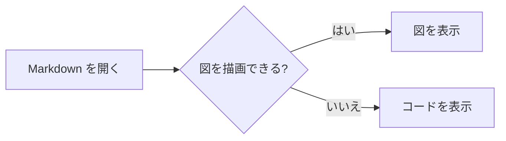
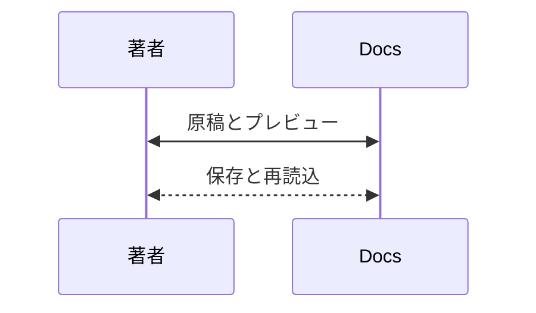
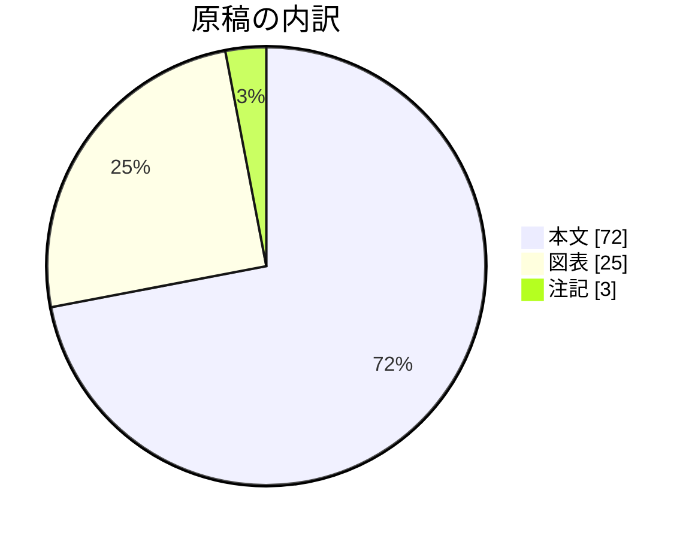
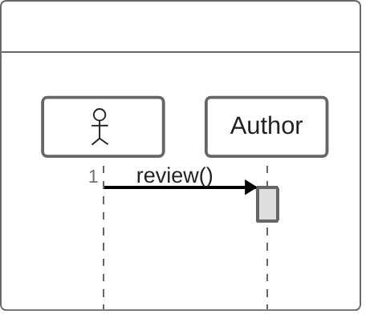

# Docs Markdown Reference Manual

このファイルは Markdown の使い方を説明するリファレンスであり、Docs で開いて表示と保存を試せるデモです。対応状況はフォークの統合コミット `1cd79c2c` を基準にしています。

## 使い方

1. このファイルを Docs で開きます。
2. 表、数式、図とグラフを確認し、コピーを DOCX に保存します。
3. DOCX を開き直して Markdown に書き出し、Mermaid のブロックを確認します。
   - PPTX の場合は CLI で変換し、スライドとして開きます。
   - Windows と macOS では利用するフォントによって改行位置が変わることがあります。

> [!NOTE]
> この原本は検証の入力です。往復で生成されたファイルは別の場所に保存します。

## Markdown の書式

**太字**、*斜体*、~~取り消し線~~、インラインコード `--export md`、[CLI の使い方](cli-options-ja.md)を同じ段落で確認できます。

- 箇条書きの親項目
  - 日本語の子項目
- [x] Markdown を開く
- [ ] 保存後の図を確認する

| 入力 | 主な用途 | 例数 |
| :--- | :---: | ---: |
| Markdown | 文書・スライド | 3 |
| Mermaid | 図・グラフ | 4 |
| Lawtext | 条文 | 2 |

次の式は数式ブロックの例です。

$$
E = mc^2
$$

次はコードブロックです。コマンドを実行する場合は、リポジトリのルートで `ibisOffice` を利用できるようにしてください。

```sh
ibisOffice --export docx --out-dir /tmp/docs-reference/docx docs/markdown-reference-ja.md
ibisOffice --export pptx --out-dir /tmp/docs-reference/pptx docs/markdown-reference-ja.md
ibisOffice --export md --out-dir /tmp/docs-reference/markdown /tmp/docs-reference/docx/markdown-reference-ja.docx
```

## Mermaid

Flowchart、sequence、ER、state、Gantt などは SVG として表示されます。`pie` と `xychart` は通常、編集可能な Office グラフになります。取り込み経路によっては SVG になります。グラフを編集すると、再書き出し時には編集結果を表す `chart` ブロックになる場合があります。[Mermaid の対応範囲](mermaid-compatibility.md)。

### 図の描画

箱、矢印、日本語ラベルを確認します。



双方向の実線と破線で、参加者が二人のまま両端に矢印が付くことを確認します。



### Office グラフ

凡例と値を確認します。小さい扇形は SVG フォールバック時のラベル確認にも使えます。



### 未対応の図

次は ZenUML の例です。現時点ではコードとして表示されます。DOCX または PPTX に保存してから Markdown に戻し、言語指定 `mermaid` と本文が残ることを確認します。



## 法令標準XML と Lawtext

Docs は UTF-8 の法令標準XMLや、法令名・法令番号と条見出しを持つ Lawtext を認識し、条文を Markdown に変換して開きます。文書全体を法令として扱う挙動は、以下のコード例を単独のファイルに保存するか、同梱の XML で試せます。

以下は架空の条文です。内容だけを `sample.lawtext` に保存してください。

```text
原稿確認規程（令和八年規程第一号）

（目的）
第一条 この規程は、原稿の確認方法を定める。
２ 確認結果は、原稿とともに保存する。

（見直し）
第二条 この規程は、必要に応じて見直す。
```

```sh
ibisOffice --export md --out-dir /tmp/docs-reference/law sample.lawtext
ibisOffice --export lawxml --out-dir /tmp/docs-reference/law sample.lawtext
ibisOffice --export md --out-dir /tmp/docs-reference/law crates/ibis-pptx/tests/lawtext/321CONSTITUTION.xml
```

日本国憲法の XML では、Markdown に前文が出ることと、ibisOffice が生成した Lawtext を読み直すと本則の構造が一致することを CI で確認します。改正履歴や全 XML 要素の可逆性、外部実装が出力する Lawtext との互換性は個別に確認が必要です。[CI の入力と出典](../crates/ibis-pptx/tests/lawtext/README.md)。

## ステージング文書としての更新

Markdown の機能を追加または変更する PR では、利用者の表示や保存結果が変わる場合、関連する説明と最小の例を同じ PR で更新します。例には入力、期待する結果、確認した経路を添えます。既知の差は本文に残し、対応した時点で書き換えます。

公開できる合成例を使い、実文書で得た知見は再現できる最小例に置き換えます。構文や保存形式の回帰を検出する自動テストは、専用のテストにも追加します。この文書は機能を組み合わせたときの表示と操作を確認するために使います。
