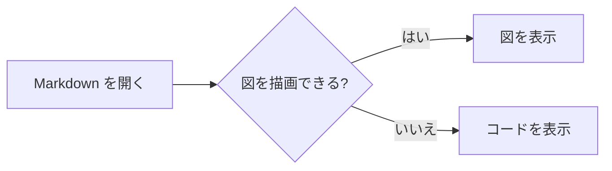
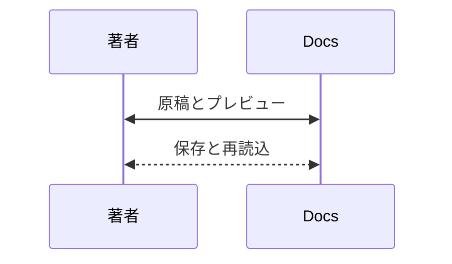
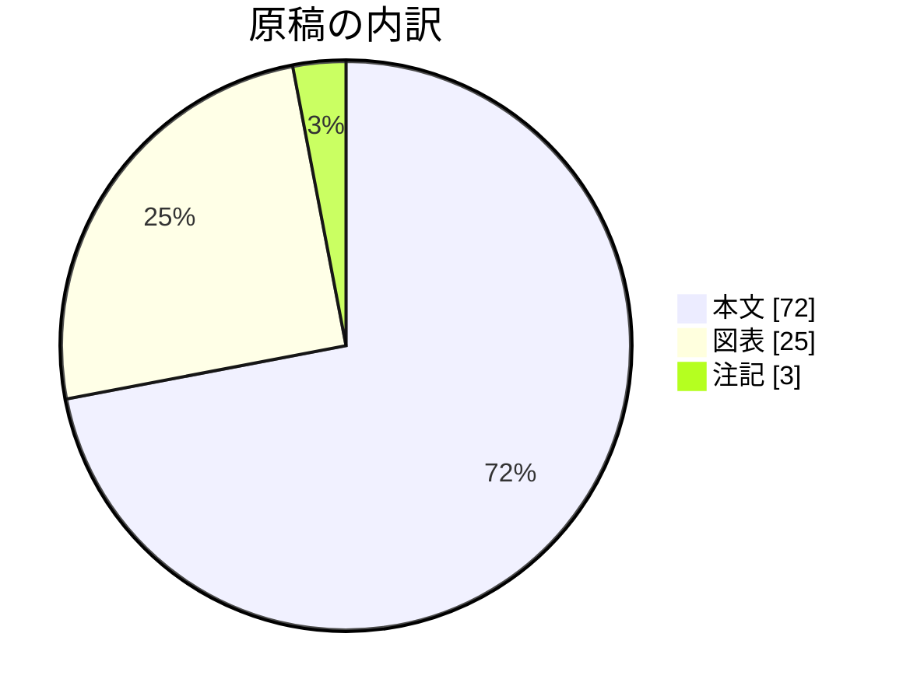
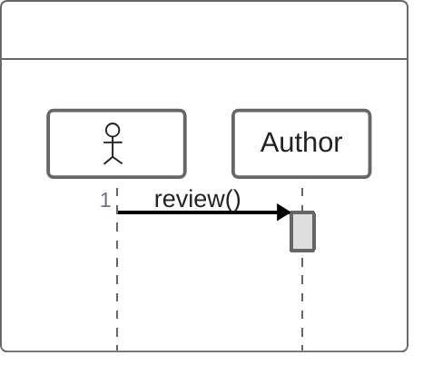

# Docs Markdown Reference Manual

このファイルは Markdown の使い方を説明するリファレンスであり、Docs で開いて表示と保存を試せるデモです。対応状況はフォークの統合コミット `1cd79c2c` を基準にしています。

## 使い方

1. このファイルを Docs で開きます。
2. 表、数式、図とグラフを確認し、コピーを DOCX に保存します。
3. DOCX を開き直して Markdown に書き出し、Mermaid のブロックを確認します。
   - PPTX の場合は CLI で変換し、スライドとして開きます。
   - Windows と macOS では利用するフォントによって改行位置が変わることがあります。

> [!NOTE]
> この原本は検証の入力です。往復で生成されたファイルは別の場所に保存します。

## Markdown の書式

**太字**、*斜体*、~~取り消し線~~、インラインコード `--export md`、[CLI の使い方](cli-options-ja.md)を同じ段落で確認できます。

- 箇条書きの親項目
  - 日本語の子項目
- [x] Markdown を開く
- [ ] 保存後の図を確認する

| 入力 | 主な用途 | 例数 |
| :--- | :---: | ---: |
| Markdown | 文書・スライド | 3 |
| Mermaid | 図・グラフ | 4 |
| Lawtext | 条文 | 2 |

次の式は数式ブロックの例です。

$$
E = mc^2
$$

インラインの分数 $\frac{a_1}{\sqrt{b}}$ や、別行の行列も表示できます。

$$
\begin{pmatrix} a & b \\ c & d \end{pmatrix}
$$

演算子の上下限の配置は `\limits`（上下）または `\nolimits`（右側）で指定できます。次の式を DOCX に保存し、Markdown に書き戻しても、配置の指定を保持します。DOCX ではネイティブの数式として保存されます。

$$
\int\limits_{0}^{1} x^2\,dx = \frac{1}{3}
$$

$$
\sum\nolimits_{i=1}^{n} i = \frac{n(n+1)}{2}
$$

次はコードブロックです。コマンドを実行する場合は、リポジトリのルートで `ibisOffice` を利用できるようにしてください。

```sh
ibisOffice --export docx --out-dir /tmp/docs-reference/docx docs/markdown-reference-ja.md
ibisOffice --export pptx --out-dir /tmp/docs-reference/pptx docs/markdown-reference-ja.md
ibisOffice --export md --out-dir /tmp/docs-reference/markdown /tmp/docs-reference/docx/markdown-reference-ja.docx
```

## Office Open Markdown の往復確認

Office Open Markdown は、Office 文書の構造を人と AI が編集できる Markdown に移し、対応する構造を編集可能な OOXML に戻す取り組みです。数式は LaTeX 記法で書き、DOCX では Word の数式形式である OMML として保存します。

次の複数行の式は、DOCX に変換してから Markdown に戻すと、各行と `&` の整列位置を保ちます。

$$
\begin{aligned}
x &= 1 \\
yy &= 2
\end{aligned}
$$

行列の行・列と、複数行の式の整列位置は、OMML を入力にした往復テストでそれぞれ確認しています。OMML の整列用属性は Markdown の `&` に変換され、DOCX に戻すときは等式配列内の整列マーカーとして保存されます。

### 式にリンクする

本文から [エネルギーの式](#eq_energy) にリンクできます。

$$
E=mc^2
$$ {#eq_energy}

閉じる `$$` の後ろの `{#eq_energy}` は DOCX のブックマークになり、本文の `[エネルギーの式](#eq_energy)` は文書内リンクになります。ラベルは文書内で一意にし、英字で始まる40文字以内の英数字とアンダースコアを使います。リンクの表示文字列は指定したまま保持されます。

### 往復の確認範囲と実装順

往復テストでは、Markdown と DOCX の間で変換した後の文書モデルを比較します。数式を例にすると、式の構造、インラインと別行の区別、整列位置、参照先を確認します。記法や XML は変換時に正規化される場合があります。

| 順番 | 対象 | 確認すること |
| :--- | :--- | :--- |
| 1 | 数式への文書内リンク | ブックマークと参照先が一致すること。合成 DOCX で検証済み。 |
| 2 | 式・図・表の番号と参照 | Word の番号フィールドと相互参照が、挿入や並べ替えの後も対応すること。 |
| 3 | ページ脚注と文末脚注 | 参照、本文、注記の種別を保存して再読込できること。 |
| 4 | 引用と参考文献 | 本文中の引用を文献データに結び付け、編集後も参照できること。 |
| 5 | 複雑な表 | 見出しとセルの関係を保持し、結合や入れ子を再構成できること。 |

## Markdown 構文一覧

ここでの対応は、入力を読み取って Docs の文書モデルに反映できることを指します。保存形式や書き出し先によって保持される情報は異なります。Markdown に戻すと記法や空白が正規化されることがあります。

| 分類 | 入力構文 |
| :--- | :--- |
| 見出し・段落 | `#` から `######`、見出しの `{#anchor align=center}`、段落の `{align=left}` / `center` / `right` / `justify` / `distribute` |
| 引用・通知 | `>`、`[!NOTE]` / `[!TIP]` / `[!IMPORTANT]` / `[!WARNING]` / `[!CAUTION]` |
| リスト | `-` / `*` / `+`、`1.`、入れ子、`[ ]` / `[x]` のタスク項目 |
| コード・数式 | バッククォートまたはチルダのコードフェンス、インラインコード、`$...$`、`$$...$$`、`math` / `latex` / `tex` フェンス |
| 表 | パイプ区切り、`:---` / `:---:` / `---:` で列を左・中央・右揃え |
| 区切り | `---` / `***` の水平線、`\newpage` / `::: pagebreak` / `<!-- pagebreak -->`、`\columnbreak` / `::: columnbreak` |
| 目次・脚注 | `[[toc]]` / `::: toc`、`[^id]` と `[^id]: 本文` |
| 強調・文字装飾 | `**太字**`、`*斜体*`、`***太字斜体***`、`~~削除線~~`、`++下線++`、`==強調表示==`、`^上付き^`、`~下付き~` |
| 日本語組版 | `{漢字\|かんじ}` / `｜漢字《かんじ》` のルビ、`[25]{.tcy}` の縦中横、`《《傍点》》` / `[傍点]{.em}` |
| リンク・画像 | `[名前](URL)`、`[名前](#anchor)`、``。画像には相対ファイルパスや Data URI、`{width=... height=...}` の寸法指定を利用できます。 |
| 変更履歴・コメント | `{++挿入++}`、`{--削除--}`、`{~~旧~>新~~}`、`{>>著者: コメント<<}` |
| 図・グラフ | `mermaid` と `chart` フェンス。対応する図種・グラフ種は下記を参照してください。 |
| プレゼンテーション | `marp: true` / `slides: true` / `type: presentation` / `type: slides`、スライド区切り、`<!-- notes: 発表者ノート -->`。 |
| スプレッドシート | CLI で複数の Markdown 表を XLSX に変換できます。見出しと表を使う経路で、一般文書のレイアウトとは別に扱います。 |

### 文書の front matter

ファイル先頭の `---` で囲んだ設定を使います。下表の `/` はキーの別名を表します。

| 用途 | キー |
| :--- | :--- |
| 文書情報 | `title`、`subtitle` / `subject`、`author` / `creator`、`keywords` / `tags`、`description` / `summary`、`category`、`company` |
| ページ | `size` / `paper`、`orientation`、`margins`、`columns`、`column_separator`、`direction` / `text_direction`、`line_numbers`。ページ設定には `page.` 付きの別名もあります。 |
| 書体・段落 | `font` / `font_family`、`east_asian_font`、`font_size`、`style_set`、`paragraph_spacing` |
| 文書の表示・編集 | `header`、`footer`（`{page}` と `{filename}`）、`watermark`、`page_color`、`track_changes` |

代表値は次のとおりです。寸法には `mm`、`cm`、`in`、`pt` などの単位付き指定を使えます。

- `orientation` は `portrait` / `landscape`。縦書きは `direction: vertical`（`tbrl`）、横書きは `horizontal`（`lrtb`）。
- `margins` は `normal` / `narrow` / `wide` または寸法。各辺には `margins.top`（`page.margins.top`、`margin_top`）などを指定できます。辺の名前は `top` / `bottom` / `left` / `right` です。
- `columns` は 1〜12、`line_numbers` は `true` / `page` / `continuous`。後者はページをまたいで行番号を振ります。
- `style_set` は `default` / `casual` / `centered` / `formal` / `elegant` / `modern` / `simple` / `minimalist`。
- `paragraph_spacing` は `default` / `no_space`（`no_paragraph_space`、`none`）/ `compact` / `tight` / `open` / `relaxed` / `double`。

### ネイティブグラフの chart フェンス

`type`（`kind`、`chart`）、`title`、`width`、`height`、`categories`（`labels`、`x`）を指定できます。データは CSV 行、または `series:` / `data:` の下に `- 売上: [10, 20]` や `- name: 売上, values: [10, 20]` の形式で書きます。

| 分類 | `type` の値 |
| :--- | :--- |
| 縦棒 | `column` / `clustered-column`、`stacked-column`、`percent-stacked-column` / `100%-stacked-column` |
| 横棒 | `bar` / `clustered-bar`、`stacked-bar`、`percent-stacked-bar` / `100%-stacked-bar` |
| 折れ線・面 | `line`、`stacked-line`、`area`、`stacked-area` |
| 円・その他 | `pie`、`doughnut` / `donut`、`radar`、`scatter` |

次の例では、編集可能なグラフが一つ表示されます。

```chart
type: column
title: 月別の原稿数
categories: [1月, 2月]
series:
- 原稿: [10, 20]
```

## Mermaid

Flowchart、sequence、ER、state、Gantt などは SVG として表示されます。`pie` と `xychart` は通常、編集可能な Office グラフになります。取り込み経路によっては SVG になります。グラフを編集すると、再書き出し時には編集結果を表す `chart` ブロックになる場合があります。[Mermaid の対応範囲](mermaid-compatibility.md)。

### デモを開く

[図種別デモ](mermaid-demo-ja.md) は、そのまま Docs で開ける Markdown です。固定した公式コーパスの33図種に表示例があります。この Reference には日本語ラベル、双方向矢印、横棒グラフ、数値 x 軸の例もあります。

公式コーパスの全例を、図種別の Markdown として生成できます。目次には描画結果と、対応・未実装・対象外として追跡する構文の一覧が載ります。各例には、該当する既知の制約を表示します。

```sh
MERMAID_CORPUS_DEMO=/tmp/ibis-mermaid-demo \
  cargo test -p ibis-pptx --test mermaid_corpus
```

[Web 版の図種別デモ](https://docs.sorane.dev/samples/mermaid/web.html) からも各ページを開けます。生成先の `index.md` が目次です。例の出典と MIT ライセンスも生成先に含まれます。Mermaid CI では `mermaid-markdown-demo` 成果物として取得できます。

### 対応する図種と構文

第1列は現在認識するすべての図種キーワードと別名です。第2列は公式例コーパスで対応として追跡している項目です。設定キーや演算子は[構文一覧の元データ](../crates/ibis-pptx/tests/mermaid/features.txt)と[図種ごとの入力例](../crates/ibis-pptx/tests/mermaid/corpus/)で照合できます。

共通設定は図の先頭の YAML に書きます。タイトル、配色テーマ、主要な色変数を扱います。HTML ラベルは SVG の通常テキストとして表示します。ELK 固有の配置、任意の CSS、コールバック、アニメーションは再現しません。

| 図種キーワードと別名 | コーパスで追跡している対応構文・設定 |
| :--- | :--- |
| `pie` | title, showData, slice values / config: pie options (textPosition, donutHole, highlightSlice, legendPosition) / config: pie theme variables (pie1-12, pieOuterStrokeWidth) |
| `xychart` / `xychart-beta` | title, horizontal orientation, categorical / numeric x-axis, bar / line / y-axis title / range / point labels (line [540 "PaLM", ...]) / config: xyChart options (width, height, showDataLabel, showDataLabelOutsideBar) / config: xyChart theme variables (plotColorPalette, titleColor) |
| `zenuml` | 参加者・別名・主要な注釈、同期・非同期メッセージ、生成、戻り値、ループと分岐、並行処理、try / catch / finally。 |
| `sequenceDiagram` | rect highlight / create / destroy participants / par/and, critical/option dividers / lower-case note / participant types @{ "type" } / bidirectional arrows <<->> |
| `flowchart` / `flowchart-v2` / `flowchart-elk` / `graph` | classDef / class / ::: styling / style statement / linkStyle / bidirectional / circle / cross edges / invisible link ~~~ / expanded node shapes @{ shape } / node icons @{ icon } (drawn as a symbol in a box) / edge ids (e1@-->) / edge curve e1@{ curve } / collapsed subgraph @{ view } / markdown strings "`...`" / Font Awesome icons (fa:) as Unicode symbols |
| `stateDiagram` / `stateDiagram-v2` | note / concurrency -- / classDef / class / ::: |
| `classDiagram` / `classDiagram-v2` | namespace / note / classDef / style / ::: / generics ~T~ / relation cardinality "1" --> "\*" / lollipop interfaces ()-- / config: class.hideEmptyMembersBox / config: class.hierarchicalNamespaces (dotted namespaces nest) |
| `erDiagram` | entity alias p[Person] / word cardinality (one or more, 1 to ...) / subgraph / direction / classDef / style / ::: / markdown in entity names (\*\*bold\*\* _italic_) |
| `gantt` | axisFormat / tickInterval / weekday / weekend / vert markers / todayMarker / until / config: gantt options (useWidth, topAxis, rightPadding, numberSectionStyles, barHeight, barGap) |
| `mindmap` | node shapes ((circle)) {{hexagon}} / icons ::icon() (drawn as a named badge; icon fonts are not embedded) / markdown strings "`...`" / config: colorBy (depth) / config: branch colours (cScale, cScaleLabel) / config: root colour (git0, gitBranchLabel0) |
| `gitGraph` | cherry-pick / commit type (HIGHLIGHT / REVERSE) / branch order / direction (gitGraph LR: / TB: / BT:) / config: gitGraph options / config: git theme variables (git0-7, gitInv, gitBranchLabel, commit / tag labels) |
| `journey` | `title` / `section` / `Task: 5: Actor` |
| `timeline` | section / config: period colours (cScale, cScaleLabel, disableMulticolor) |
| `quadrantChart` | point styling (radius, color, :::) / config: chartWidth / chartHeight / pointRadius / config: quadrant theme variables (quadrantNFill / TextFill, point / axis / title fills) |
| `requirementDiagram` | requirement / element blocks and relationships / reverse relationships (<- kind -) / classDef / class / ::: styling / style statement / direction / markdown names and text ("\*\*bold\*\*", "\*italic\*") |
| `kanban` | card metadata @{ ticket, assigned, priority } / config: section width |
| `packet` / `packet-beta` | relative field widths (+N) / title line / config: packet options (showBits, bitOrder, bitsPerRow, bitWidth, rowHeight, padding) / config: packet theme variables (startByteColor, blockFillColor ...) |
| `sankey` / `sankey-beta` | quoted CSV fields / config: sankey options (showValues, labelStyle, nodeWidth, nodePadding, linkColor, nodeAlignment) / config: node colours (nodeColors) |
| `block` / `block-beta` | columns (N / auto) / nested blocks (block:id:span ... end) / widths (id:N) and space / space:N / block arrows <["label"]>(right, left, up, down, x, y) / edges with labels (A-- "X" -->B) / style / classDef / class |
| `architecture-beta` / `architecture` | groups (group id(icon)[title] in parent) / junctions / edge sides and arrows (a:R --> L:b) / align row / column / built-in icons (cloud, database, disk, internet, server) |
| `C4Context` / `C4Container` / `C4Component` / `C4Dynamic` / `C4Deployment` | title line / boundaries (Enterprise_ / System_ / Container_Boundary, Boundary) / deployment nodes / Db / Queue / _Ext element variants / BiRel / Rel_Back / Rel_U, _D, _L, _R / UpdateElementStyle ($bgColor, $fontColor, $borderColor) / UpdateRelStyle colours ($textColor, $lineColor) / UpdateLayoutConfig ($c4ShapeInRow, $c4BoundaryInRow) / element tags ($tags, no visual effect without AddElementTag) |
| `treemap` / `treemap-beta` | nested sections by indentation / classes (:::class, classDef) / config: diagramPadding / width / height / config: valueFormat ($, thousands, .Nf, .N%) |
| `venn` / `venn-beta` | title line / unions of two or three sets / set and union sizes (:N) / text items in a region / style (fill, stroke, color) |
| `radar` / `radar-beta` | multiple axis / curve lines / max / min / graticule polygon / title line / config: axisScaleFactor, axisLabelFactor, curveTension, width, height, margins / config: curve colours (cScale) / config: radar theme variables (curveOpacity, curveStrokeWidth, axisColor, graticuleColor, graticuleOpacity) |
| `usecase` / `usecase-beta` | actors (normal / hollow / awesome / fa: icon) / use cases (ellipse / rect, business, «stereotype») / system boundaries and packages / direction / links (-->, <--, --, o / x / triangle ends, labels) / include / extend links (..> : include) / edge ids (A id@--> B) and edge styles / notes (note for X) / json boxes / classDef / class / style / :::class / accTitle / accDescr / config: actor / usecase fonts / config: nodeSpacing / rankSpacing / diagramPadding / config: colorScheme (rotate palette; role draws the default colours) / config: useMaxWidth (no effect; the SVG has a fixed size) |
| `wardley` / `wardley-beta` | components and anchors at [visibility, evolution] / component label offsets, (inertia), (build/buy/outsource/market) / dependency links (->) / flows (+>, +<, +<>, +'label'>) / evolve / custom evolution stages (@ widths, dual labels) / size / title / pipelines / notes / annotations legend / accelerators / deaccelerators |
| `treeView-beta` / `treeView` | box-drawing prefixes (├── └── │) / :::class highlight / ## comments / config: showIcons (generic folder / file glyphs) / config: rowIndent / lineThickness / config: treeView theme variables (labelFontSize, labelColor, lineColor) |
| `swimlane-beta` / `swimlane` | lanes (subgraph id [title] … end) / links with labels and chains / flowchart node shapes / classDef / class / style / accTitle / accDescr |
| `eventmodeling` | timeframes (tf / timeframe) / reset frames (rf / resetframe) / inline payloads { … } / data blocks and [[references]] / explicit sources (->> NN) / streams (Stream.Event lanes) |
| `ishikawa-beta` | 最初の行に結果、その後に原因。インデントで下位要因を指定。 |
| `cynefin-beta` | 5領域、引用符付き項目、タイトル、ラベル付き遷移、幅・高さ・余白、説明文の表示、境界の振幅。遷移は図の下に表示。 |
| `agentflow-beta` / `agentflow` | flows (flow id["Agent"] … end, nested) / global block / node shapes (input / task / tool / decision / refdoc / action) / links (-->, -.-, --x, -- text -->) / connectors / collapsed flows (@{ view: collapsed }) / metadata (protocol, endpoint, connectorRef, params, returns, value, instruction; not drawn) / config: nodeSpacing / rankSpacing |
| `railroad-beta` / `railroad-ebnf-beta` / `railroad-abnf-beta` / `railroad-peg-beta` | EBNF rules (alternatives, ? \* +, groups, [ ] and { }) / ABNF rules (/ and n\*m repetition) / PEG rules (<- / ! &) / function form (sequence / choice / optional / zeroOrMore / oneOrMore / terminal / nonterminal) / title |

### 図の描画

箱、矢印、日本語ラベルを確認します。



双方向の実線と破線で、参加者が二人のまま両端に矢印が付くことを確認します。



### DOCX 内で Mermaid ソースを編集

Markdown から取り込んだ SVG の Mermaid 図を DOCX で選び、書式メニューの「Mermaid ソースを編集…」を開きます。上のフローチャートのラベルを変えて「適用」を押すと、図が更新されます。取り消しでは図とソースが一緒に戻ります。保存して開き直し、Markdown に書き出すと更新したソースを確認できます。

描画できないソースを入力するとエラーを表示します。ソース編集は元の Mermaid を保持している DOCX の画像が対象です。

PPTX では Mermaid の SVG 図を一つ選び、図の書式メニューから「Mermaid ソースを編集…」を開きます。新しい図は元の枠内に縦横比を保って収まり、中心位置を保ちます。Office グラフになった図はグラフの編集機能を使用してください。

### Office グラフ

凡例と値を確認します。小さい扇形は SVG フォールバック時のラベル確認にも使えます。



横向きは `xychart horizontal` または `config.xyChart.chartOrientation: horizontal` で指定できます。棒だけの場合は編集可能な横棒グラフになり、折れ線がある場合は SVG で表示します。

```mermaid
xychart horizontal
  title "申請の処理件数"
  x-axis [四月, 五月, 六月]
  y-axis 0 --> 40
  bar [18, 25, 34]
```

数値 x 軸は `x-axis "経過秒" 0 --> 10` のように指定します。系列ごとに範囲の両端を含めて等間隔に点を配置し、1点だけの場合は下限に配置します。数値 x 軸を使う図は SVG として表示し、Markdown に戻すと Mermaid ソースを復元します。

```mermaid
xychart
  x-axis "経過秒" 0 --> 10
  y-axis "処理件数" 0 --> 40
  line "実績" [8, 21 "中間", 35]
  line "目標" [10, 38]
```

### 未対応の図

本文にバッククォートやチルダだけの行がある場合は、その行より長いフェンスか、もう一方の記号を使います。Mermaid を書き出すときは、本文と衝突しない長さのフェンスを選びます。

### ZenUML

次は ZenUML のシーケンス図です。メッセージに付いたコメントはプレーンテキストの注記として描画します。DOCX または PPTX に保存してから Markdown に戻し、言語指定 `mermaid` と本文が残ることを確認します。



## 法令標準XML と Lawtext

Docs は UTF-8 の法令標準XMLや、法令名・法令番号と条見出しを持つ Lawtext を認識し、条文を Markdown に変換して開きます。文書全体を法令として扱う挙動は、同梱の Lawtext と XML をそれぞれ開いて試せます。

Lawtext 本家が掲載している行政手続法の第一条を、法令名と法令番号が別行の原文のまま同梱しています。次の例では、章見出し、条の見出し、第二項を確認できます。[Lawtext 本家の掲載例](https://github.com/yamachig/Lawtext/blob/60567c6ca7de6b14c8c1d895338c4614b49969d1/README.md#lawtextの例--example-of-lawtext)・[同梱した入力](../crates/ibis-pptx/tests/lawtext/administrative-procedure-act.lawtext)。

```sh
ibisOffice --export md --out-dir /tmp/docs-reference/law crates/ibis-pptx/tests/lawtext/administrative-procedure-act.lawtext
ibisOffice --export lawxml --out-dir /tmp/docs-reference/law crates/ibis-pptx/tests/lawtext/administrative-procedure-act.lawtext
ibisOffice --export md --out-dir /tmp/docs-reference/law crates/ibis-pptx/tests/lawtext/321CONSTITUTION.xml
```

日本国憲法の XML では、Markdown に前文が出ることと、ibisOffice が生成した Lawtext を読み直すと本則の構造が一致することを CI で確認します。改正履歴や全 XML 要素の可逆性、他の Lawtext 構文との互換性は個別に確認が必要です。[CI の入力と出典](../crates/ibis-pptx/tests/lawtext/README.md)。

### Lawtext の構文と法令標準 XML の対応範囲

| 構造 | Lawtext での表記 |
| :--- | :--- |
| 法令名・番号 | `行政手続法（平成五年法律第八十八号）`、または法令名の次の行に `（平成五年法律第八十八号）` |
| 編・章・節・款・目 | `第一編`、`第一章 総則`、`第一節`、`第一款`、`第一目`。見出しの段を保持します。 |
| 条・枝番・見出し | `第一条 本文`、`第一条の二 本文`。`（目的等）` は条に先立つ行に書きます。 |
| 項 | 条に続く本文は第一項、`２ 本文` や `2 本文` は番号付きの項になります。 |
| 号・号の下位項目 | 項の下で、行頭に空白を2文字以上置いた `一 本文` を号とし、号の下で4文字以上置いた `イ 本文` を下位項目とします。 |
| 附則 | `附則`、`附 則`、`附則（改正法令番号）`。附則内の条や項を扱います。 |
| 別表 | `別表` で始まる見出しとパイプ区切りの表。括弧内に関係条を指定できます。 |

法令標準 XML の取り込みでは、`Law` / `LawNum` / `LawBody` / `LawTitle`、`EnactStatement` / `Preamble`、`MainProvision`、編・章・節・款・目、`Article` / `ArticleCaption` / `ArticleTitle`、`Paragraph` / `Item` / `Subitem1` 以降、`SupplProvision`、`AppdxTable` と表の行・列を読み取ります。XML 内のすべての属性や要素が、Lawtext や Markdown への変換を往復して保持されるわけではありません。

変換した Markdown の先頭には `type: lawtext` と法令情報（`law_title`、`law_num`、`era`、`year`、`num`、`law_type`）が入ります。法令形式で書き出すときは、条見出しや項・号の構造を編集後も保ってください。

## ステージング文書としての更新

Markdown の機能を追加または変更する PR では、利用者の表示や保存結果が変わる場合、関連する説明と最小の例を同じ PR で更新します。例には入力、期待する結果、確認した経路を添えます。既知の差は本文に残し、対応した時点で書き換えます。

公開できる合成例を使い、実文書で得た知見は再現できる最小例に置き換えます。構文や保存形式の回帰を検出する自動テストは、専用のテストにも追加します。この文書は機能を組み合わせたときの表示と操作を確認するために使います。
