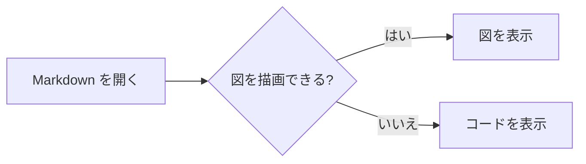
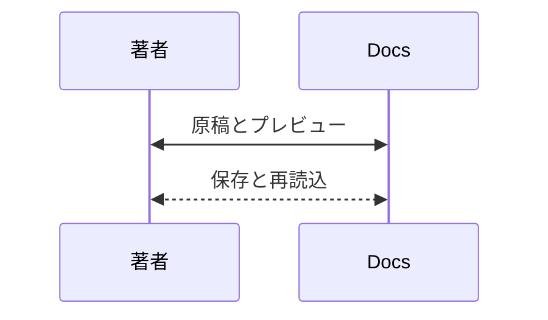
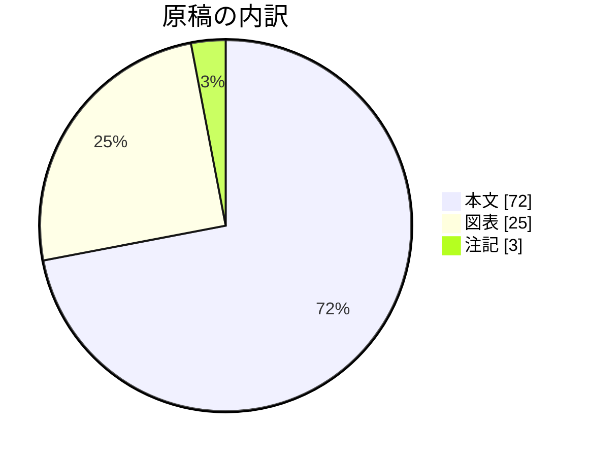
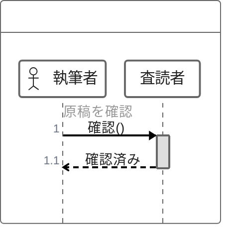

# Docs Markdown Reference Manual

形式判定、YAML、変換経路ごとの保持範囲は [Markdown・YAML 入出力仕様](markdown-yaml-spec-ja.md) を参照してください。

## ibisOffice と Docs

[参照仕様・互換性の範囲・検証方法](markdown-compatibility-ja.md) に、外部仕様と実装の対応をまとめています。

改正前後の法令から文書を生成する手順は [法令XML・Lawtextから法案五点セットを起案する](lawtext-five-set-ja.md) を参照してください。

ibisOffice は、Word（DOCX）、Excel（XLSX）、PowerPoint（PPTX）のファイルを開き、編集して保存できるオフィススイートです。製品全体については [ibisOffice の日本語 README](../README-ja.md) を参照してください。

**Docs** は、ibisOffice の `masanork` フォークのビルドをパッケージ化して提供する際の配布名です。ソースコードのライセンスには ibisOffice の商標の使用許諾が含まれず、派生版の製品名に「ibisOffice」を使うには株式会社アイビスの許可が必要です。このフォークは Docs の名前で配布しています。詳しくは [ibisOffice の商標ガイド](TRADEMARK.md) を参照してください。

このリファレンスでは、Markdown で文書を作り、Office 形式に変換し、ふたたび Markdown に戻したときにどの情報が残るかを確認できます。たとえば、文章に加えて、見出しや表、数式、図のソースを、テキストとして読み直したり編集したりできます。

このファイルは、日本語の Markdown リファレンスと、Docs で表示・保存・再読込を試せるデモを兼ねています。書式や構文を確認する場合は、使用するビルドと同じリビジョンのリファレンスを開いてください。

## 使い方

1. このファイルを Docs で開きます。
2. 表、数式、図とグラフを確認し、コピーを DOCX に保存します。
3. DOCX を開き直して Markdown に書き出し、数式や Mermaid のソースがどう戻るかを確認します。
   - PPTX の場合は CLI で変換し、スライドとして開きます。
   - Windows と macOS では利用するフォントによって改行位置が変わることがあります。

> [!NOTE]
> この原本は検証の入力です。往復で生成されたファイルは別の場所に保存します。

## Markdown の書式

**太字**、*斜体*、~~取り消し線~~、インラインコード `--export md`、[CLI の使い方](cli-options-ja.md)を同じ段落で確認できます。

- 箇条書きの親項目
  - 日本語の子項目
- [x] Markdown を開く
- [ ] 保存後の図を確認する

| 入力 | 主な用途 | 例数 |
| :--- | :---: | ---: |
| Markdown | 文書・スライド | 3 |
| Mermaid | 図・グラフ | 4 |
| Lawtext | 条文 | 2 |

次の式は数式ブロックの例です。

$$
E = mc^2
$$

インラインの分数 $\frac{a_1}{\sqrt{b}}$ や、別行の行列も表示できます。

$$
\begin{pmatrix} a & b \\ c & d \end{pmatrix}
$$

演算子の上下限の配置は `\limits`（上下）または `\nolimits`（右側）で指定できます。次の式を DOCX に保存し、Markdown に書き戻しても、配置の指定を保持します。DOCX ではネイティブの数式として保存されます。

$$
\int\limits_{0}^{1} x^2\,dx = \frac{1}{3}
$$

$$
\sum\nolimits_{i=1}^{n} i = \frac{n(n+1)}{2}
$$

次はコードブロックです。コマンドを実行する場合は、リポジトリのルートで `ibisOffice` を利用できるようにしてください。

```sh
ibisOffice --export docx --out-dir /tmp/docs-reference/docx docs/markdown-reference-ja.md
ibisOffice --export pptx --out-dir /tmp/docs-reference/pptx docs/markdown-reference-ja.md
ibisOffice --export md --out-dir /tmp/docs-reference/markdown /tmp/docs-reference/docx/markdown-reference-ja.docx
```

## Office Open Markdown の往復確認

Office Open Markdown は、Office 文書の構造を人と AI が編集できる Markdown に移し、対応する構造を編集可能な OOXML に戻す取り組みです。数式は LaTeX 記法で書き、DOCX では Word の数式形式である OMML として保存します。

次の複数行の式は、DOCX に変換してから Markdown に戻すと、各行と `&` の整列位置を保ちます。

$$
\begin{aligned}
x &= 1 \\
yy &= 2
\end{aligned}
$$

行列の行・列と、複数行の式の整列位置は、OMML を入力にした往復テストでそれぞれ確認しています。OMML の整列用属性は Markdown の `&` に変換され、DOCX に戻すときは等式配列内の整列マーカーとして保存されます。

### 式にリンクする

本文から [エネルギーの式](#eq_energy) にリンクできます。

$$
E=mc^2
$$ {#eq_energy}

閉じる `$$` の後ろの `{#eq_energy}` は DOCX のブックマークになり、本文の `[エネルギーの式](#eq_energy)` は文書内リンクになります。ラベルは文書内で一意にし、英字で始まる40文字以内の英数字とアンダースコアを使います。リンクの表示文字列は指定したまま保持されます。

### 式・図・表に番号を付ける

本文から式 ({{ref:eq_energy_number}}) を参照します。参照は番号の段落より前にも置けます。

{{seq:equation}} {#eq_energy_number align=right}

`{{seq:equation}}` は DOCX の `SEQ Equation`、`{{ref:eq_energy_number}}` はブックマークを指す `REF` フィールドになります。数式にリンクするラベルと、番号を参照するラベルは別々に付けます。番号だけを参照したい場合は、番号フィールド専用の段落にします。

`{{seq:figure}}` と `{{seq:table}}` は図と表の独立した連番です。たとえば `図 {{seq:figure}} {#fig_setup}` を参照すると、ラベル付きの「図 1」になります。番号を追加して Markdown を読み直すと、各連番と参照が再計算されます。

この節の連番とリンク付き参照は、Markdown に書き戻せます。これらのフィールドに未対応の Word スイッチが付いている場合は、表示文字列を書き出します。

### 本文中の文献引用

`{{cite:Smith-2024}}` は Word の `CITATION Smith-2024` フィールドになります。日本語ロケールを指定する場合は `{{cite:Tanaka_2025:1041}}` と書きます。文献タグには半角英数字と `_`、`-`、`.` を使えます。

本文の文献タグと任意のロケールを Markdown と DOCX の間で保持します。引用箇所は `{{cite:Tanaka_2025#12}}`、ロケール付きのページ範囲は `{{cite:Tanaka_2025:1041#12–15}}` と書きます。半角数字の単一ページと、ハイフンまたは en ダッシュでつないだ範囲に対応し、DOCX の `CITATION` フィールドでは `\p` として保持します。複数の文献を一つの引用にまとめるには `{{cite:Tanaka_2025:1041#12–15;Smith-2024#24}}` のようにセミコロンで区切ります。ページ指定とロケールは文献ごとに指定できます。未対応のスイッチが付いた引用は、Word に保存された表示文字列を書き出します。Word の文献データは、YAML フロントマターの直後（フロントマターがなければ文書の先頭）の `word-bibliography` フェンスに格納します。本文のタグ名は `b:Tag` と一致させます。フェンスは文書メタデータとして読み込み、本文からは除外します。

````markdown
```word-bibliography
<b:Sources xmlns:b="http://schemas.openxmlformats.org/officeDocument/2006/bibliography">
  <b:Source>
    <b:Tag>Tanaka_2025</b:Tag>
    <b:SourceType>Book</b:SourceType>
    <b:Author><b:Author><b:NameList><b:Person><b:Last>田中</b:Last></b:Person></b:NameList></b:Author></b:Author>
    <b:Title>研究の方法</b:Title>
    <b:Year>2025</b:Year>
  </b:Source>
</b:Sources>
```

本文中の引用 {{cite:Tanaka_2025:1041}}。
````

この例の DOCX を Word for Mac で開き、引用を更新すると「[田中, 2025]」になることを確認しました。Word が文献データに追加した参照順も、Markdown を経由して DOCX に保持されます。

### 参考文献一覧

一覧を置く位置に `::: bibliography` を独立した行で書きます。日本語ロケールを指定する場合は `::: bibliography 1041` と書きます。DOCX では Word の `BIBLIOGRAPHY` フィールドになり、Word でフィールドを更新すると、文献データから一覧が生成されます。

独立した一覧を Markdown に戻すと、Word が生成した一覧は元の位置のマーカーに戻ります。Markdown 本文で一覧の見出しを自由に指定できます。文献の絞り込みなど、未対応のスイッチを含む一覧は表示テキストとして書き出します。Word for Mac では、文献2件の一覧を生成し、Markdown を経由して作り直した DOCX に一覧フィールドと後続段落が残ることを確認しました。

### 確認済みの DOCX 往復

往復テストでは、Markdown と DOCX の間で変換した後の文書モデルを比較します。数式を例にすると、式の構造、インラインと別行の区別、整列位置、参照先を確認します。記法や XML は変換時に正規化される場合があります。

| 対象 | 確認結果 |
| :--- | :--- |
| 数式への文書内リンク | 合成 DOCX を Word で保存し、Markdown への変換と DOCX への再変換後も数式のブックマークと参照先が一致することを確認済み。 |
| 式・図・表の番号と参照 | 合成 DOCX で、Word による式・図・表の連番と式番号参照の更新、および Markdown 経由の DOCX への往復を確認済み。 |
| ページ脚注と文末脚注 | 同じ ID の両注記を区別し、参照・本文・種別と、注記内の段落・リスト・表を保持します。 |
| 引用と参考文献 | 本文の引用タグ・ロケール・ページ範囲、Word の文献データ、基本の参考文献一覧フィールドを往復できます。Word for Mac でページ範囲を表示し、保存した DOCX から Markdown に戻せることを確認済みです。 |
| 複雑な表 | 横結合・縦結合・入れ子表の往復と原本のセル引用を確認済み。 |

### ファイル形式ごとの往復範囲

| 形式 | Markdown との変換で扱える内容 | 往復で差が出る例 |
| :--- | :--- | :--- |
| DOCX | 本文、見出し、リスト、リンク、ページ脚注・文末脚注、結合・入れ子表、対応する数式、連番・参照、引用・参考文献。フロントマターで対応する用紙・向きなどの文書設定も指定できます。 | 段幅の異なる段組み、ヘッダーとフッター内の表や装飾、任意の Word フィールド、数式内の文字色。 |
| PPTX | スライドの区切り、本文、画像、表、対応するグラフ、発表者ノート。 | 複雑な図形の装飾・グループ、マスターとレイアウト、アニメーション。 |
| XLSX | 表示中のシートを見出し付きの表として出力します。シート指定があれば名前と座標を保ち、文字列、数値、数式を注記で明示できます。AI JSON では表示文字列、保存値とその型、数式を確認できます。 | 非表示部分のデータと表示状態。入力規則の再構成には CLI のオプションが必要です。 |

### 対応状況と残るギャップ

日常的な文書編集と AI での再利用に関わる差を、各形式で3項目、計9項目に整理しています。範囲には文書構造・値の意味・レイアウトが含まれます。表の順序は、既存の機械可読な情報を活用できるか、編集によって意味が変わるのを防げるかを基準にしています。

| 順番 | 形式 | 対象 | 対応状況または確認すること |
| :--- | :--- | :--- | :--- |
| 1 | XLSX | シート構造とセルの型 | シート名・順序と表示セルの座標、および文字列 `0012` と数値 `12`、真偽値と同じ綴りの文字列の区別に対応。 |
| 2 | XLSX | 数式と参照 | 式と表示値を区別し、別シートへの参照を保持します。合成ブックで参照先を変えた後の再計算を確認済み。 |
| 3 | DOCX | 脚注・文末脚注の内部構造 | 合成文書で、複数段落、リスト、表と本文の参照先が DOCX を経由しても残ることを確認済み。 |
| 4 | PPTX | 表の構造 | 合成 PPTX で結合セルと見出し行の有効・無効を往復確認済み。 |
| 5 | DOCX | セクションごとの組版 | 用紙の寸法と向き、余白、等幅段組み、標準のヘッダー・フッター、セクションの開始位置を合成 DOCX で往復確認済み。 |
| 6 | DOCX | フィールド・数式の詳細 | ページ・セクション番号とリンク付きページ参照に対応。引用の追加スイッチや数式内の装飾が残る。 |
| 7 | PPTX | 要素の配置 | 画像・テキストボックス・基本図形の座標、回転、反転、重なり順を保持します。 |
| 8 | XLSX | ブックの設定 | 非表示シート・行・列と入力規則を、表示中の表と区別して保持できること。 |
| 9 | PPTX | スライドの外観と動作 | マスター、レイアウト、アニメーションの適用先を保持できること。 |

XLSX のシート名・順序・開始座標と、値の型を保つ基本の記法を追加しました。数式を含むセルも、保存された値と式を分けて往復できます。セルの数値表示形式とブックの日付システムも保持します。動的配列数式のスピル範囲と従来の固定範囲配列数式も保持します。非表示状態、入力規則、定義名は CLI のオプションで保持できます。脚注・文末脚注の内部構造にも対応しました。PPTX の表では結合セルと見出し行の設定を保持できます。

XLSX を `--export md` で書き出すと、非表示シート・行・列、ワークシート以外のシート、入力規則の省略を標準エラーに1行1件の JSON で報告します。`--export ai-json` では同じ情報が `diagnostics` に入ります。各報告の `source.sheet` は元のシート名です。行・列・入力規則には `source.ranges` が付きます。範囲は元のシート上の表記で、例えば `4:6`、`C:E`、`B3:D5` です。シート全体の省略にはシート名が付きます。報告にはセルの値や入力規則の式は含まれません。

入力規則も保持したい場合は、CLI で次のように書き出します。

```sh
ibisOffice --export md --include-xlsx-validations --out-dir markdown workbook.xlsx
ibisOffice --export xlsx --out-dir rebuilt markdown/workbook.md
```

表示シートの入力規則を `xlsx-sheet` コメント内の `validations` に保存します。適用範囲は元シートの A1 座標です。規則の種類、比較方法、式、ドロップダウン、入力時の案内とエラー時のメッセージを保持します。表の行・列を移動した場合は、必要に応じて適用範囲と式も編集してください。入力規則が非表示シートを参照する場合は、シートを含めるオプションも指定してください。入力規則が定義名を参照する場合は、定義名を含めるオプションも指定してください。入力規則の式やメッセージも Markdown ファイルに含まれるため、共有前に内容を確認できます。

表示シートの非表示行・列も保持するには、`--export md` に `--include-xlsx-hidden-axes` を付けます。`--include-xlsx-validations` と併用できます。非表示セルの値と式が Markdown の表に入り、`xlsx-sheet` コメントの `hiddenRows` と `hiddenColumns` に元の行・列の範囲が入ります。`--export xlsx` で値・式・非表示状態を復元します。シート全体を非表示にしている場合は、次のオプションも必要です。非表示解除時の行高・列幅には既定値を使います。通常の Markdown と AI JSON には非表示セルの値を含めません。

シート全体を含めるには、`--export md` に `--include-xlsx-hidden-sheets` を付けます。ワークシートの順序と名前を保ち、`xlsx-sheet` コメントの `state` に `hidden` または `veryHidden` を記録します。`--export xlsx` で内容と非表示状態を戻し、最初の表示シートをアクティブにします。チャートシートなど、ワークシート以外のシートは引き続き省略されます。

```sh
ibisOffice --export md --include-xlsx-hidden-sheets --include-xlsx-hidden-axes --include-xlsx-validations --out-dir markdown workbook.xlsx
ibisOffice --export xlsx --out-dir rebuilt markdown/workbook.md
```

非表示シートも、セルの内容は Markdown の表として読めます。通常の Markdown と AI JSON では、非表示シートの表を省略し、診断にシート名を記録します。

定義名を復元するには、`--export md` に `--include-xlsx-defined-names` を付けます。Markdown 冒頭の `xlsx-defined-names` コメントに、名前、式、非表示属性を記録します。シート単位の定義名には `sheet` でシート名を記録します。シートが省略されて順番が変わっても、出力された定義名のスコープはシート名で復元します。

```sh
ibisOffice --export md --include-xlsx-defined-names --include-xlsx-validations --include-xlsx-hidden-sheets --out-dir markdown workbook.xlsx
ibisOffice --export xlsx --out-dir rebuilt markdown/workbook.md
```

通常の Markdown と AI JSON の診断には、省略した定義名の件数が入ります。定義名が参照する非表示シートや非表示セルも必要な場合は、対応するオプションを指定してください。参照式はそのまま保持されますが、外部ブックへの接続は再構成されません。

### Marp 原稿と PPTX

`marp: true` の原稿は横罫線でスライドを区切ります。`headingDivider: 2` でATX見出しのレベル1・2を、`headingDivider: [1, 3]` でレベル1・3を区切りにできます。フロントマターでは、レベルを YAML のブロック配列でも指定できます。指定がなければ見出しが複数あっても同じスライドに置きます。 [Marpの見出し区切り](https://marp.app/docs/guide/heading-divider)

```markdown
---
marp: true
headingDivider:
  - 1
  - 3
---

# 最初のスライド

## 同じスライドの小見出し

### 次のスライド
```


フロントマターと単独行から始まるコメントの `size: 16:9` と `size: 4:3` に対応し、`pptx_size` がある場合はそちらを優先します。

単独行から始まる HTML コメントは、対応する Marp ディレクティブを含むものや ibisOffice の位置注記を除き、複数行でも PPTX の発表者ノートに入ります。従来の `<!-- notes: … -->` も読み書きできます。コードフェンス内のコメントはコードとして扱います。

ページ番号はフロントマターの `paginate: true` で表示します。単独行の HTML コメントでも指定できます。`<!-- paginate: false -->` はそのスライド以降で表示を止め、`<!-- _paginate: false -->` はそのスライドだけ表示を止めます。

| 値 | 表示 | 番号の進み方 |
| --- | --- | --- |
| `true` | 表示 | 進める |
| `false` | 非表示 | 進める |
| `hold` | 表示 | 前の番号を維持 |
| `skip` | 非表示 | 進めない |

表紙を数えない場合は、フロントマターに `paginate: true` と `_paginate: skip` を併記します。PPTX ではスライド右下に編集可能なテキストボックスを作ります。Markdown に戻すと番号と配置をテキストボックスとして保持し、スライドの並べ替え後はテキストを編集できます。 [Marpitのページ番号](https://marpit.marp.app/directives#pagination)

PPTX からは ibisOffice の位置注記を含む Markdown を書き出します。Marp テーマの CSS、背景やページ番号の元ディレクティブ、独自サイズのプリセットは往復の対象外です。元のテーマや指定を使って再レンダリングする場合は Marp 原稿とテーマ CSS を保管してください。

### PPTX の要素の位置と重なり順

PPTX を Markdown に書き出すと、スライドの大きさは `pptx_size`、各要素の位置と大きさは `pptx-shape` の `frame` に入ります。単位は EMU で、`frame` は左、上、幅、高さの順です。ファイル内で後ろにある要素ほど手前に重なります。要素の注記を残して本文を編集すると、別々のテキストボックスとして指定した位置に戻ります。

```markdown
---
marp: true
pptx_size: [9144000,6858000]
---

<!-- pptx-slide -->

<!-- pptx-shape:{"frame":[800000,700000,3600000,2100000],"preset":"ellipse","fill":[16711680,255]} -->

<!-- pptx-shape:{"frame":[1500000,1000000,3100000,1000000]} -->

重ねたテキスト。ここを編集できます。
```

四角形、角丸四角形、楕円は単色の塗りも保持します。画像はフレームと回転・反転を保持します。高度な図形の装飾、グループ、マスターは引き続き往復の対象外です。

### 脚注・文末脚注の複数段落、リスト、表

短い注記は従来どおり `[^1]: 注記の本文` と書けます。複数のブロックを含む場合は、定義行のコロンで改行し、各ブロックを半角スペース4個で字下げします。文末脚注には `[^endnote-1]` を使います。

```markdown
本文から脚注[^1]と文末脚注[^endnote-1]を参照します。

[^1]:
    最初の段落です。

    - 注記内の項目

    | 項目 | 値 |
    | --- | --- |
    | 例 | 42 |

[^endnote-1]:
    文末脚注の最初の段落です。

    二つ目の段落です。
```

DOCX に保存して Markdown に戻しても、本文中の参照、注記の種別と内部ブロックを保持します。

### DOCX のセクションごとのページ設定

セクション末尾の独立した行に `::: section` と JSON を置きます。`break` は次のセクションの開始位置で、`next-page`、`continuous`、`next-column`、`odd-page`、`even-page` を指定できます。最後のセクションは `end` で閉じます。

```markdown
縦向きの本文。

::: section {"break":"next-page","size":[11906,16838],"columns":2,"column_gap":300,"header":"前半 {page}"}

横向きの本文。

::: section {"break":"end","size":[16838,11906],"columns":1,"first_page":4,"header":"後半"}
```

`size` は幅と高さ、`margins` は上・右・下・左・ヘッダー位置・フッター位置・とじしろの順で、単位はいずれも twip（1/20ポイント）です。`columns`、`column_gap`、`column_separator` は等幅の段組みを指定します。`first_page` はそのセクションのページ番号を指定値から開始します。`header` と `footer` は標準のヘッダー・フッターで、省略時は前のセクションから継承します。文字列中の `{page}` と `{filename}` は対応するフィールドになります。

初ページを別にするにはセクションに `"title_page":true` を付け、`header_first` と `footer_first` を指定します。偶数ページを別にするには YAML に `even_and_odd_headers: true` を付け、セクションに `header_even` と `footer_even` を指定します。各欄を省略すると前のセクションの同じ種類の欄を継承し、空文字列を指定すると明示的に空欄にします。

```markdown
---
even_and_odd_headers: true
---

表紙から始まる本文。

::: section {"break":"end","title_page":true,"header_first":"表紙","footer_first":"","header":"奇数ページ","header_even":"偶数ページ","footer":"{page} / {numpages}","footer_even":"{page} / {numpages}"}
```

段幅が異なる段組み、ヘッダー・フッター内の表や装飾は、この記法の対象外です。

### DOCX のページ・セクション番号フィールド

本文、ヘッダー、フッターで、次の記法を Word で更新できるフィールドとして保持します。

| Markdown | DOCX での用途 |
| :--- | :--- |
| `{{field:page}}` | 現在のページ番号 |
| `{{field:pages}}` | 文書の総ページ数 |
| `{{field:section}}` | 現在のセクション番号 |
| `{{field:section-pages}}` | 現在のセクション内のページ数 |
| `{{field:page-ref:target}}` | ブックマーク `target` のページへのリンク付き参照 |

たとえば、`footer: "{page} / {{field:pages}}"` で現在のページ番号と総ページ数が入ります。ヘッダー・フッターの `{page}` も引き続き使えます。ページ参照の対象は `# 見出し {#target}` のように指定できます。番号の書式を付ける場合は `{{field:page:ROMAN}}` のように書き、`Arabic`、`ROMAN`、`roman`、`ALPHABETIC`、`alphabetic` を使用できます。

## 表のセル結合

### 横方向

結合するセルの末尾に `<!-- colspan:2 -->` を付け、続く列を空セルにします。数字は、結合する先頭のセルを含めた列数です。次の表を DOCX に保存して Markdown に戻すと、列の位置と結合の指定を保持します。

| 集計対象 <!-- colspan:2 --> | | 件数 |
| :--- | :--- | ---: |
| 国内 | 文書 | 12 |
| 海外 | 文書 | 8 |

標準的な Markdown 表示ではコメントが隠れ、続く列には空セルが表示されます。結合範囲に値がある場合、Docs は各セルを個別に読み込みます。

### 縦方向

結合元に `<!-- vmerge:start -->`、直下の空セルに `<!-- vmerge:continue -->` を付けます。3行以上の結合は、対象の各行に継続マーカーを付けます。横方向にも結合する場合は、各行のセルに同じ `colspan` を先に書きます。

| 分類 | 内訳 | 件数 |
| :--- | :--- | ---: |
| 国内 <!-- colspan:2 --> <!-- vmerge:start --> | | 12 |
| <!-- colspan:2 --> <!-- vmerge:continue --> | | 8 |
| 海外 | 文書 | 5 |

DOCX との往復では列幅の範囲と結合の開始・継続を保持します。継続セルに内容がある場合や、直上のセルと開始列・結合列数が合わない場合は、そのセルを縦結合しません。

### 入れ子表

セル内のパイプ表を `<!-- nested-table: … -->` で囲みます。内側の表の行は `<br>` で区切り、内側のパイプには `\|` と書きます。内側の表に含まれる `&`、`<`、`>` はそれぞれ `&amp;`、`&lt;`、`&gt;` にします。

| 分類 | 内訳 |
| :--- | :--- |
| 国内 | 紙と電子<br><!-- nested-table: \| 媒体 \| 件数 \|<br>\| --- \| ---: \|<br>\| 紙 \| 3 \|<br>\| 電子 \| 9 \| --><br>計12件 |

Docs はセルの中に編集可能な表を表示します。DOCX から Markdown に戻すと、内側の表と前後の文章を保持します。Markdown の読み込みは外側の表を除いて最大8階層です。HTML コメントを非表示にする Markdown ビューアーでは、内側の表はソースで確認できます。

### PPTX の表の結合と見出し行

PPTX の表でも横結合・縦結合の印を使えます。横と縦を組み合わせた長方形の結合では、継続行にも同じ `colspan` を付け、覆われるセルを空欄にします。PPTX で先頭行に見出し行のスタイルを適用しない場合は、最初のセルの冒頭に `<!-- pptx-no-header -->` を置きます。Markdown 表の区切り行は引き続き必要です。

```markdown
| <!-- pptx-no-header --> 共通 <!-- colspan:2 --> <!-- vmerge:start --> | | 一 |
| --- | --- | --- |
| <!-- colspan:2 --> <!-- vmerge:continue --> | | 二 |
```

## Markdown 構文一覧

ここでの対応は、入力を読み取って Docs の文書モデルに反映できることを指します。保存形式や書き出し先によって保持される情報は異なります。Markdown に戻すと記法や空白が正規化されることがあります。

| 分類 | 入力構文 |
| :--- | :--- |
| 見出し・段落 | `#` から `######`、見出しの `{#anchor align=center}`、段落の `{align=left}` / `center` / `right` / `justify` / `distribute` |
| 引用・通知 | `>`、`[!NOTE]` / `[!TIP]` / `[!IMPORTANT]` / `[!WARNING]` / `[!CAUTION]` |
| リスト | `-` / `*` / `+`、`1.`、入れ子、`[ ]` / `[x]` のタスク項目 |
| コード・数式 | バッククォートまたはチルダのコードフェンス、インラインコード、`$...$`、`$$...$$`、`math` / `latex` / `tex` フェンス |
| 表 | [横・縦結合と入れ子表](#表のセル結合)。パイプ区切り、`:---` / `:---:` / `---:` で列を左・中央・右揃え |
| 区切り | `---` / `***` の水平線、`\newpage` / `::: pagebreak` / `<!-- pagebreak -->`、`\columnbreak` / `::: columnbreak` |
| 目次・脚注 | `::: toc` / `[TOC]`、`[^id]` と `[^id]: 本文`、文末脚注の `[^endnote-1]` |
| 連番・相互参照 | [式・図・表の番号](#式図表に番号を付ける) の `{{seq:equation}}`、`{{seq:figure}}`、`{{seq:table}}`、`{{ref:名前}}` |
| 強調・文字装飾 | `**太字**`、`*斜体*`、`***太字斜体***`、`~~削除線~~`、`++下線++`、`==強調表示==`、`^上付き^`、`~下付き~` |
| 日本語組版 | `{漢字\|かんじ}` / `｜漢字《かんじ》` のルビ、`[25]{.tcy}` の縦中横、`《《傍点》》` / `[傍点]{.em}` |
| リンク・画像 | `[名前](URL)`、`[名前](#anchor)`、``。画像には相対ファイルパスや Data URI、`{width=... height=...}` の寸法指定を利用できます。 |
| 変更履歴・コメント | `{++挿入++}`、`{--削除--}`、`{~~旧~>新~~}`、`{>>著者: コメント<<}` |
| 文献引用 | [本文中の文献引用](#本文中の文献引用) の `{{cite:タグ}}`、`{{cite:タグ:ロケール}}`、`{{cite:タグ:ロケール#ページ範囲}}`、[参考文献一覧](#参考文献一覧) の `::: bibliography` と `::: bibliography ロケール` |
| 図・グラフ | `mermaid` と `chart` フェンス。対応する図種・グラフ種は下記を参照してください。 |
| プレゼンテーション | `marp: true` / `slides: true` / `type: presentation` / `type: slides`。スライド区切り、サイズ、発表者ノートは [Marp 原稿と PPTX](#marp-原稿と-pptx) を参照してください。 |
| スプレッドシート | CLI で Markdown 表を XLSX に変換できます。`<!-- xlsx-sheet "シート名" -->` で表をシートに分けられます。 |

### 文書の front matter

ファイル先頭の `---` で囲んだ設定を使います。下表の `/` はキーの別名を表します。

| 用途 | キー |
| :--- | :--- |
| 文書情報 | `title`、`subtitle` / `subject`、`author` / `creator`、`keywords` / `tags`、`description` / `summary`、`category`、`company` |
| ページ | `size` / `paper`、`orientation`、`margins`、`columns`、`column_separator`、`direction` / `text_direction`、`line_numbers`。ページ設定には `page.` 付きの別名もあります。 |
| 書体・段落 | `font` / `font_family`、`east_asian_font`、`font_size`、`style_set`、`paragraph_spacing` |
| 文書の表示・編集 | `header`、`footer`（`{page}` と `{filename}`）、`watermark`、`page_color`、`track_changes` |

代表値は次のとおりです。寸法には `mm`、`cm`、`in`、`pt` などの単位付き指定を使えます。

- `orientation` は `portrait` / `landscape`。縦書きは `direction: vertical`（`tbrl`）、横書きは `horizontal`（`lrtb`）。
- `margins` は `normal` / `narrow` / `wide` または寸法。各辺には `margins.top`（`page.margins.top`、`margin_top`）などを指定できます。辺の名前は `top` / `bottom` / `left` / `right` です。
- `columns` は 1〜12、`line_numbers` は `true` / `page` / `continuous`。後者はページをまたいで行番号を振ります。
- `style_set` は `default` / `casual` / `centered` / `formal` / `elegant` / `modern` / `simple` / `minimalist`。
- `paragraph_spacing` は `default` / `no_space`（`no_paragraph_space`、`none`）/ `compact` / `tight` / `open` / `relaxed` / `double`。

### 形式指定と OKF のタグ

通常の文書には形式指定は不要です。OKF の型と形式指定を併記する原稿では、`type` に知識項目の型、`x-ibis-format` に開き方を書きます。たとえば `type: presentation` の知識項目を文書として開くには `x-ibis-format: document` を併記します。スライドには `x-ibis-format: presentation`、Lawtext には `x-ibis-format: lawtext` を使えます。形式判定の詳細は [入出力仕様](markdown-yaml-spec-ja.md#入力と処理経路) を参照してください。

```markdown
---
type: Metric
title: 月次売上
description: 月ごとの売上合計
tags: [finance, 月次]
---

# 月次売上
```

原稿を `.md` で保存し、そのフォルダーを開きます。先頭に空でない文字列の `type` がある Markdown を OKF の知識項目として扱います。`index.md` と `log.md` は予約ファイルです。

| フォルダーペインまたは Assistant の `folder_list` の検索語 | 一致する項目 |
| --- | --- |
| `type:metric` | 型に `metric` を含む項目 |
| `tag:finance` または `tag:月次` | 指定したタグを含む項目 |
| `tag:finance, ops` | `tags: "finance, ops"` のようにカンマを含む一つのタグを持つ項目 |

タグは大文字・小文字を区別せず、一つずつ完全一致で検索します。`tags: [finance, ops]` は二つのタグなので `tag:finance` と `tag:ops` で個別に探せます。YAML のブロック配列でも同じように書けます。

DOCX の文書プロパティからは `title`、`description`、`tags` に反映できます。既存タグの中にカンマがある場合や複数行の値など、安全に反映できない編集は診断され、元の YAML 値が残ります。これらの値は Markdown 原稿の YAML で直接編集できます。

知識項目に検証者と再確認期限を記録する例です。フォルダーペインと Assistant の `folder_read` で信頼状態と鮮度を確認できます。判定規則は [信頼状態と鮮度](markdown-yaml-spec-ja.md#信頼状態と鮮度) を参照してください。

```yaml
generated:
  by: "process:monthly-import"
  at: "2026-11-23T09:00:00+09:00"
verified:
  - by: "human:reviewer"
    at: "2026-11-24T09:00:00+09:00"
stale_after: "2026-12-01"
```

### MyST・Obsidian の取り込み（試験対応）

同じ Markdown 原稿に、通常の記法と以下の構文を混在させられます。

- MyST では、見出しの直前の `(results)=` を Word のブックマークにします。参照には既存の `[結果](#results)` を使えます。単一段落の本文を持つ `{note}`、`{tip}`、`{important}`、`{warning}`、`{caution}` のコードフェンスとコロンフェンス（`:::{note}` … `:::`）は、既存のアラート書式で取り込みます。ラベルは ASCII 英字で始まる英数字・アンダースコア 40 文字以内です。
- Obsidian では、同じ 5 種の大文字・小文字の違いを許容した基本 callout（`hint` は `tip`、`attention` は `warning` として取り込み）と、`[[#Results]]`、`[[#Results|結果]]` を取り込めます。Markdown原稿では、`[[#日本語 見出し|参照]]` も見出しへのリンクになります。明示ブックマークがある場合は優先します。Office文書内でも確実に移動できるようにする場合は、`## Results {#Results}` のようにWord互換のブックマークを指定します。デスクトップで開いたフォルダー内では `[[資料/手順#詳細|開く]]` のように別ノートやその見出しを開けます。同名ファイルがある場合はフォルダー基準のパスを指定します。

旧 OOMarkdown 原稿で目次・参考文献一覧を指定していた行は、`[[toc]]` を `::: toc`、`[[bibliography]]` を `::: bibliography`、`[[bibliography:1041]]` を `::: bibliography 1041` に置き換えてください。DOCX に保存済みのフィールドは、Markdown に書き出すと新しい記法になります。

DOCX からは ibisOffice の Markdown 記法（`{#results}`、`[結果](#results)`、`> [!NOTE]` など）で書き出します。元の記法で編集を続ける場合は Markdown 原稿を保管してください。MyST の自動参照番号・引用や、Obsidian のノート埋め込み・折りたたみ付き callout は試験対応の対象外です。

MyST のコードフェンスまたはコロンフェンスで囲んだ `{figure} 画像パス` は、インライン画像とキャプション段落に変換します。`:alt:` を画像の代替テキスト、Word互換の `:label:` または `:name:` をキャプションのブックマークに使います。固定寸法の `width`・`height` と、左右・中央の `align` に対応します。DOCXからは標準Markdownの画像・段落・アンカーで書き出します。


```markdown
:::{figure} images/results.png
:alt: 月別売上の棒グラフ
:label: fig_results
:width: 80mm
:align: center

月別の売上集計。
:::

[図を参照](#fig_results)
```

#### MyST の同一文書内参照

表示名を指定する `{ref}` ロールで、同じ文書にある一意なブックマークへリンクできます。図の `:label:` や見出しラベルのほか、コードフェンスまたはコロンフェンスで囲んだ `{math}` の `:label:` も参照先にできます。

```markdown
式は {ref}`エネルギーの式 <eq_energy>` を参照してください。

:::{math}
:label: eq_energy

E=mc^2
:::
```

参照先は前方にも置けます。見つからない場合や同じラベルが複数ある場合は、ロールを原文の文字列として残します。DOCXからは、解決した参照を通常のMarkdownアンカー、数式をラベル付きの数式ブロックとして書き出します。表示名の自動取得と、`{eq}`・`{numref}` の自動採番は対象外です。 [MySTの相互参照](https://mystmd.org/guide/cross-references)

#### 別ノートへのリンク

デスクトップで開いたフォルダーでは、`[[資料/手順]]` はフォルダー基準のパス、`[[手順]]` は一意なファイル名として解決します。同名ファイルがある場合は `[[資料/手順#詳細|手順の詳細]]` のようにパスを指定してください。過去の Git コミットを閲覧しているときは、リンク先も同じコミットから開きます。Obsidian の Vault は既存フォルダーとして開けます。 [Obsidian の内部リンク](https://obsidian.md/help/Linking%2Bnotes%2Band%2Bfiles/Internal%2Blinks)

#### Obsidian の画像埋め込み

原稿と同じディレクトリーまたはその下にある画像を `![[images/chart.png]]` で取り込めます。`![[images/chart.png|120]]` は幅を、`![[images/chart.png|120x80]]` は幅と高さをピクセル単位で指定します。ファイルを開くときに原稿のディレクトリーを使える環境が対象です。

参照できない画像は元の記法が本文に残ります。DOCX などから Markdown に戻すと、取り込んだ画像は通常の Markdown 画像になります。 [Obsidianの画像埋め込み](https://help.obsidian.md/embeds)

### ネイティブグラフの chart フェンス

`type`（`kind`、`chart`）、`title`、`width`、`height`、`categories`（`labels`、`x`）を指定できます。データは CSV 行、または `series:` / `data:` の下に `- 売上: [10, 20]` や `- name: 売上, values: [10, 20]` の形式で書きます。

| 分類 | `type` の値 |
| :--- | :--- |
| 縦棒 | `column` / `clustered-column`、`stacked-column`、`percent-stacked-column` / `100%-stacked-column` |
| 横棒 | `bar` / `clustered-bar`、`stacked-bar`、`percent-stacked-bar` / `100%-stacked-bar` |
| 折れ線・面 | `line`、`stacked-line`、`area`、`stacked-area` |
| 円・その他 | `pie`、`doughnut` / `donut`、`radar`、`scatter` |

次の例では、編集可能なグラフが一つ表示されます。

```chart
type: column
title: 月別の原稿数
categories: [1月, 2月]
series:
- 原稿: [10, 20]
```

## Mermaid

`mermaid` フェンス内の flowchart、sequence、ER、state、Gantt、ZenUML などは SVG として表示されます。`pie` と `xychart` は通常、編集可能な Office グラフになります。取り込み経路によっては SVG になります。グラフを編集すると、再書き出し時には編集結果を表す `chart` ブロックになる場合があります。[Mermaid の対応範囲](mermaid-compatibility.md)

### デモを開く

[図種別デモ](mermaid-demo-ja.md) は、そのまま Docs で開ける Markdown です。代表例を図種ごとに確認できます。このリファレンスでも、日本語ラベル、双方向矢印、横棒グラフ、数値 x 軸を試せます。

公式コーパスの全例を、図種別の Markdown として生成できます。目次には描画結果と、対応・未実装・対象外として追跡する構文の一覧が載ります。各例には、該当する既知の制約を表示します。

```sh
MERMAID_CORPUS_DEMO=/tmp/ibis-mermaid-demo \
  cargo test -p ibis-formats --test mermaid_corpus
```

[Web 版の構文デモ集](https://docs.sorane.dev/samples/mermaid/web) には、固定した Mermaid 12.3.0 の公式例539件があります。ローカル生成先では `index.md` が目次です。出典と MIT ライセンスは生成先に含まれ、Mermaid CI では `mermaid-markdown-demo` 成果物として取得できます。

### 対応する図種と構文

第1列は現在認識するすべての図種キーワードと別名です。第2列は公式例コーパスで対応として追跡している項目です。設定キーや演算子は[構文一覧の元データ](../crates/ibis-formats/tests/mermaid/features.txt)と[図種ごとの入力例](../crates/ibis-formats/tests/mermaid/corpus/)で照合できます。

共通設定は図の先頭の YAML に書きます。タイトル、配色テーマ、主要な色変数を扱います。HTML ラベルは SVG の通常テキストとして表示します。ELK 固有の配置、任意の CSS、コールバック、アニメーションは再現しません。

| 図種キーワードと別名 | コーパスで追跡している対応構文・設定 |
| :--- | :--- |
| `pie` | title, showData, slice values / config: pie options (textPosition, donutHole, highlightSlice, legendPosition) / config: pie theme variables (pie1-12, pieOuterStrokeWidth) |
| `xychart` / `xychart-beta` | title, horizontal orientation, categorical / numeric x-axis, bar / line / y-axis title / range / point labels (line [540 "PaLM", ...]) / config: xyChart options (width, height, showDataLabel, showDataLabelOutsideBar) / config: xyChart theme variables (plotColorPalette, titleColor) |
| `zenuml` | 参加者・別名・主要な注釈、同期・非同期メッセージ、生成、戻り値、ループと分岐、並行処理、try / catch / finally。 |
| `sequenceDiagram` | rect highlight / create / destroy participants / par/and, critical/option dividers / lower-case note / participant types @{ "type" } / bidirectional arrows <<->> |
| `flowchart` / `flowchart-v2` / `flowchart-elk` / `graph` | classDef / class / ::: styling / style statement / linkStyle / bidirectional / circle / cross edges / invisible link ~~~ / expanded node shapes @{ shape } / node icons @{ icon } (drawn as a symbol in a box) / edge ids (e1@-->) / edge curve e1@{ curve } / collapsed subgraph @{ view } / markdown strings "`...`" / Font Awesome icons (fa:) as Unicode symbols |
| `stateDiagram` / `stateDiagram-v2` | note / concurrency -- / classDef / class / ::: |
| `classDiagram` / `classDiagram-v2` | namespace / note / classDef / style / ::: / generics ~T~ / relation cardinality "1" --> "\*" / lollipop interfaces ()-- / config: class.hideEmptyMembersBox / config: class.hierarchicalNamespaces (dotted namespaces nest) |
| `erDiagram` | entity alias p[Person] / word cardinality (one or more, 1 to ...) / subgraph / direction / classDef / style / ::: / markdown in entity names (\*\*bold\*\* _italic_) |
| `gantt` | axisFormat / tickInterval / weekday / weekend / vert markers / todayMarker / until / config: gantt options (useWidth, topAxis, rightPadding, numberSectionStyles, barHeight, barGap) |
| `mindmap` | node shapes ((circle)) {{hexagon}} / icons ::icon() (drawn as a named badge; icon fonts are not embedded) / markdown strings "`...`" / config: colorBy (depth) / config: branch colours (cScale, cScaleLabel) / config: root colour (git0, gitBranchLabel0) |
| `gitGraph` | cherry-pick / commit type (HIGHLIGHT / REVERSE) / branch order / direction (gitGraph LR: / TB: / BT:) / config: gitGraph options / config: git theme variables (git0-7, gitInv, gitBranchLabel, commit / tag labels) |
| `journey` | `title` / `section` / `Task: 5: Actor` |
| `timeline` | section / config: period colours (cScale, cScaleLabel, disableMulticolor) |
| `quadrantChart` | point styling (radius, color, :::) / config: chartWidth / chartHeight / pointRadius / config: quadrant theme variables (quadrantNFill / TextFill, point / axis / title fills) |
| `requirementDiagram` | requirement / element blocks and relationships / reverse relationships (<- kind -) / classDef / class / ::: styling / style statement / direction / markdown names and text ("\*\*bold\*\*", "\*italic\*") |
| `kanban` | card metadata @{ ticket, assigned, priority } / config: section width |
| `packet` / `packet-beta` | relative field widths (+N) / title line / config: packet options (showBits, bitOrder, bitsPerRow, bitWidth, rowHeight, padding) / config: packet theme variables (startByteColor, blockFillColor ...) |
| `sankey` / `sankey-beta` | quoted CSV fields / config: sankey options (showValues, labelStyle, nodeWidth, nodePadding, linkColor, nodeAlignment) / config: node colours (nodeColors) |
| `block` / `block-beta` | columns (N / auto) / nested blocks (block:id:span ... end) / widths (id:N) and space / space:N / block arrows <["label"]>(right, left, up, down, x, y) / edges with labels (A-- "X" -->B) / style / classDef / class |
| `architecture-beta` / `architecture` | groups (group id(icon)[title] in parent) / junctions / edge sides and arrows (a:R --> L:b) / align row / column / built-in icons (cloud, database, disk, internet, server) |
| `C4Context` / `C4Container` / `C4Component` / `C4Dynamic` / `C4Deployment` | title line / boundaries (Enterprise_ / System_ / Container_Boundary, Boundary) / deployment nodes / Db / Queue / _Ext element variants / BiRel / Rel_Back / Rel_U, _D, _L, _R / UpdateElementStyle ($bgColor, $fontColor, $borderColor) / UpdateRelStyle colours ($textColor, $lineColor) / UpdateLayoutConfig ($c4ShapeInRow, $c4BoundaryInRow) / element tags ($tags, no visual effect without AddElementTag) |
| `treemap` / `treemap-beta` | nested sections by indentation / classes (:::class, classDef) / config: diagramPadding / width / height / config: valueFormat ($, thousands, .Nf, .N%) |
| `venn` / `venn-beta` | title line / unions of two or three sets / set and union sizes (:N) / text items in a region / style (fill, stroke, color) |
| `radar` / `radar-beta` | multiple axis / curve lines / max / min / graticule polygon / title line / config: axisScaleFactor, axisLabelFactor, curveTension, width, height, margins / config: curve colours (cScale) / config: radar theme variables (curveOpacity, curveStrokeWidth, axisColor, graticuleColor, graticuleOpacity) |
| `usecase` / `usecase-beta` | actors (normal / hollow / awesome / fa: icon) / use cases (ellipse / rect, business, «stereotype») / system boundaries and packages / direction / links (-->, <--, --, o / x / triangle ends, labels) / include / extend links (..> : include) / edge ids (A id@--> B) and edge styles / notes (note for X) / json boxes / classDef / class / style / :::class / accTitle / accDescr / config: actor / usecase fonts / config: nodeSpacing / rankSpacing / diagramPadding / config: colorScheme (rotate palette; role draws the default colours) / config: useMaxWidth (no effect; the SVG has a fixed size) |
| `wardley` / `wardley-beta` | components and anchors at [visibility, evolution] / component label offsets, (inertia), (build/buy/outsource/market) / dependency links (->) / flows (+>, +<, +<>, +'label'>) / evolve / custom evolution stages (@ widths, dual labels) / size / title / pipelines / notes / annotations legend / accelerators / deaccelerators |
| `treeView-beta` / `treeView` | box-drawing prefixes (├── └── │) / :::class highlight / ## comments / config: showIcons (generic folder / file glyphs) / config: rowIndent / lineThickness / config: treeView theme variables (labelFontSize, labelColor, lineColor) |
| `swimlane-beta` / `swimlane` | lanes (subgraph id [title] … end) / links with labels and chains / flowchart node shapes / classDef / class / style / accTitle / accDescr |
| `eventmodeling` | timeframes (tf / timeframe) / reset frames (rf / resetframe) / inline payloads { … } / data blocks and [[references]] / explicit sources (->> NN) / streams (Stream.Event lanes) |
| `ishikawa-beta` | 最初の行に結果、その後に原因。インデントで下位要因を指定。 |
| `cynefin-beta` | 5領域、引用符付き項目、タイトル、ラベル付き遷移、幅・高さ・余白、説明文の表示、境界の振幅。遷移は図の下に表示。 |
| `agentflow-beta` / `agentflow` | flows (flow id["Agent"] … end, nested) / global block / node shapes (input / task / tool / decision / refdoc / action) / links (-->, -.-, --x, -- text -->) / connectors / collapsed flows (@{ view: collapsed }) / metadata (protocol, endpoint, connectorRef, params, returns, value, instruction; not drawn) / config: nodeSpacing / rankSpacing |
| `railroad-beta` / `railroad-ebnf-beta` / `railroad-abnf-beta` / `railroad-peg-beta` | EBNF rules (alternatives, ? \* +, groups, [ ] and { }) / ABNF rules (/ and n\*m repetition) / PEG rules (<- / ! &) / function form (sequence / choice / optional / zeroOrMore / oneOrMore / terminal / nonterminal) / title |

### 図の描画

箱、矢印、日本語ラベルを確認します。



双方向の実線と破線で、参加者が二人のまま両端に矢印が付くことを確認します。



### DOCX・PPTX 内で Mermaid ソースを編集

Markdown から取り込んだ SVG の Mermaid 図を DOCX で選び、書式メニューの「Mermaid ソースを編集…」を開きます。上のフローチャートのラベルを変えて「適用」を押すと、図が更新されます。取り消しでは図とソースが一緒に戻ります。保存して開き直し、Markdown に書き出すと更新したソースを確認できます。

描画できないソースを入力するとエラーを表示します。ソース編集は元の Mermaid を保持している DOCX の画像が対象です。

PPTX では Mermaid の SVG 図を一つ選び、図の書式メニューから「Mermaid ソースを編集…」を開きます。新しい図は元の枠内に縦横比を保って収まり、中心位置を保ちます。Office グラフになった図はグラフの編集機能を使用してください。

### Office グラフ

凡例と値を確認します。小さい扇形は SVG フォールバック時のラベル確認にも使えます。



横向きは `xychart horizontal` または `config.xyChart.chartOrientation: horizontal` で指定できます。棒だけの場合は編集可能な横棒グラフになり、折れ線がある場合は SVG で表示します。

```mermaid
xychart horizontal
  title "申請の処理件数"
  x-axis [四月, 五月, 六月]
  y-axis 0 --> 40
  bar [18, 25, 34]
```

数値 x 軸は `x-axis "経過秒" 0 --> 10` のように指定します。系列ごとに範囲の両端を含めて等間隔に点を配置し、1点だけの場合は下限に配置します。数値 x 軸を使う図は SVG として表示し、Markdown に戻すと Mermaid ソースを復元します。

```mermaid
xychart
  x-axis "経過秒" 0 --> 10
  y-axis "処理件数" 0 --> 40
  line "実績" [8, 21 "中間", 35]
  line "目標" [10, 38]
```

### コード表示に戻る場合とフェンスの選び方

未対応の構文や解釈できない図は `mermaid` のコードブロックとして表示します。DOCX・PPTX を経由しても Markdown に書き出すとコードが戻ります。SVG として描画された図でも、ラベルの見え方は実行環境で利用できるフォントによって変わります。

本文にバッククォートやチルダだけの行がある場合は、その行より長いフェンスか、もう一方の記号を使います。Mermaid を書き出すときは、本文と衝突しない長さのフェンスを選びます。

### ZenUML

ZenUML は `mermaid` フェンスの先頭に `zenuml` と書きます。ibisOffice は対応する呼び出し、戻り値、分岐などをシーケンス図の SVG として描画します。次の例では、呼び出し前の `//` コメントが注記になり、呼び出しと戻り値が別々の矢印になります。



DOCX・PPTX では図を選んで「Mermaid ソースを編集…」から修正できます。Markdown に書き戻すと、描画に使ったシーケンス図の内部表現ではなく、保存した ZenUML の本文が戻ります。[ZenUML の図種別デモ](mermaid-demo-ja.md#zenuml)

## 法令標準XML と Lawtext

Docs は UTF-8 の法令標準XMLや、法令名・法令番号と条見出しを持つ Lawtext を認識し、条文を Markdown に変換して開きます。文書全体を法令として扱う挙動は、同梱の Lawtext と XML をそれぞれ開いて試せます。

Lawtext 本家が掲載している行政手続法の第一条を、法令名と法令番号が別行の原文のまま同梱しています。次の例では、章見出し、条の見出し、第二項を確認できます。[Lawtext 本家の掲載例](https://github.com/yamachig/Lawtext/blob/60567c6ca7de6b14c8c1d895338c4614b49969d1/README.md#lawtextの例--example-of-lawtext)・[同梱した入力](../crates/ibis-formats/tests/lawtext/administrative-procedure-act.lawtext)。

```sh
ibisOffice --export md --out-dir /tmp/docs-reference/law crates/ibis-formats/tests/lawtext/administrative-procedure-act.lawtext
ibisOffice --export lawxml --out-dir /tmp/docs-reference/law crates/ibis-formats/tests/lawtext/administrative-procedure-act.lawtext
ibisOffice --export md --out-dir /tmp/docs-reference/law crates/ibis-formats/tests/lawtext/321CONSTITUTION.xml
```

日本国憲法の XML では、Markdown に前文が出ることと、ibisOffice が生成した Lawtext を読み直すと本則の構造が一致することを CI で確認します。改正履歴や全 XML 要素の可逆性、他の Lawtext 構文との互換性は個別に確認が必要です。[CI の入力と出典](../crates/ibis-formats/tests/lawtext/README.md)。

### Lawtext の構文と法令標準 XML の対応範囲

| 構造 | Lawtext での表記 |
| :--- | :--- |
| 法令XMLの基本属性 | 題名前の `[Era="Reiwa"]`、`[Year="07"]`、`[Num="001"]`、`[LawType="Act"]`、`[Lang="en"]`。先頭のゼロを含め、指定された値を保持します。 公布月・日は `[PromulgateMonth="06"]` と `[PromulgateDay="09"]` で保持します。 |
| 法令名・番号 | `行政手続法（平成五年法律第八十八号）`、または法令名の次の行に `（平成五年法律第八十八号）` |
| 編・章・節・款・目 | `第一編`、`第一章 総則`、`第一節`、`第一款`、`第一目`。見出しの段を保持します。 |
| 条・枝番・見出し | `第一条 本文`、`第一条の二 本文`。`（目的等）` は条に先立つ行に書きます。 |
| 項 | 条に続く本文は第一項、`２ 本文` や `2 本文` は番号付きの項になります。 |
| 号・号の下位項目 | 項の下で、行頭に空白を2文字以上置いた `一 本文` を号とし、号の下で4文字以上置いた `イ 本文` を下位項目とします。 |
| 附則 | `附則`、`附 則`、`附　則`。改正法令番号は `附則（改正法令番号）`、抄録は `附則（改正法令番号）（抄）` と表記します。附則内の号の省略範囲は `一から三まで 略`、`二及び三 略` と表記します。 |
| 別表 | `別表` で始まる見出しとパイプ区切りの表。括弧内に関係条を指定できます。 |

法令標準 XML の取り込みでは、`Law` / `LawNum` / `LawBody` / `LawTitle`、`EnactStatement` / `Preamble`、`MainProvision`、編・章・節・款・目、`Article` / `ArticleCaption` / `ArticleTitle`、`Paragraph` / `Item` / `Subitem1` 以降、`SupplProvision`、`AppdxTable` と表の行・列を読み取ります。XML 内のすべての属性や要素が、Lawtext や Markdown への変換を往復して保持されるわけではありません。

変換した Markdown の先頭には `x-ibis-format: lawtext` と法令情報（`law_title`、`law_num`、`era`、`year`、`num`、`law_type`）が入ります。法令形式で書き出すときは、条見出しや項・号の構造を編集後も保ってください。

## XLSX のシート名と順序

XLSX を Markdown に書き出すと、表示中の各ワークシートの冒頭に `<!-- xlsx-sheet "売上" -->` が付きます。名前は JSON 文字列として引用符で囲みます。この印がある Markdown を XLSX に変換すると、出現順に名前付きシートを作成します。表のないシートも作成できます。印のない Markdown の複数の表は、従来どおり一つのシートに並びます。

```markdown
<!-- xlsx-sheet "売上" -->

## 売上

| 区分 | 金額 |
| --- | --- |
| 国内 | 42 |

<!-- xlsx-sheet "在庫" -->

## 在庫

| 品目 | 個数 |
| --- | --- |
| ノート | 5 |
```

表を B3 から配置するには `<!-- xlsx-sheet {"name":"売上","origin":"B3"} -->` と指定します。XLSX から書き出すときも、表示対象のデータ範囲が A1 以外から始まる場合は開始セルが付きます。表に含まれる空行も行位置を使います。名前だけの指定は A1 から配置します。

名前付きシートでは、セルの末尾に `<!-- xlsx-text -->` を付けると、`0012` や `TRUE` を文字列として保存します。XLSX から書き出す際は、Markdown を読み込むと数値や真偽値と解釈される文字列にこの印を付けます。印のない値は従来どおり推定します。

表示文字列から元の数値を復元できない場合は、たとえば `25% <!-- xlsx-number:0.25 -->` と書き出します。XLSX への変換には印の中の数値を使うため、値を編集するときはその数値も更新してください。数値表示形式は `<!-- xlsx-format:"0%" -->` のように JSON 文字列で指定します。値の印がある場合はその後、数式の印がある場合はその前に置きます。1904 日付システムのブックでは文書の1行目に `<!-- xlsx-date-system:1904 -->` を付けます。省略時は 1900 日付システムです。金額の表示文字列にドル記号を書くときは `\$` とエスケープします。

```markdown
<!-- xlsx-date-system:1904 -->
<!-- xlsx-sheet "表示形式" -->

| 比率 | 金額 | 日付 | 集計 |
| --- | --- | --- | --- |
| 25% <!-- xlsx-number:0.25 --> <!-- xlsx-format:"0%" --> | \$1,234.50 <!-- xlsx-number:1234.5 --> <!-- xlsx-format:"$#,##0.00" --> | 2027-03-16 <!-- xlsx-number:45000 --> <!-- xlsx-format:"yyyy-mm-dd" --> | 1,000 <!-- xlsx-format:"#,##0" --> <!-- xlsx-formula:"=500*2" --> |
```

表示データ範囲の内側にある非表示の行・列は、空欄として書き出します。周囲のセルは元の座標に戻ります。非表示セルの内容は書き出さず、再生成した XLSX では該当の行・列は表示状態の空欄になります。

### XLSX の数式とシート間参照

数式セルは、表示値に `<!-- xlsx-formula:"=SUM(C4:C5)" -->` のような印を添えて書き出します。数式は `=` から始め、JSON 文字列として引用符で囲みます。保存値に型の印が付く場合は、数式の印を最後に置きます。

動的配列数式は、起点セルに `<!-- xlsx-formula:{"formula":"=SEQUENCE(2,2)","spill":"D4"} -->` のように書き出します。`spill` はシート上の右下のセルで、起点が C3 の場合は C3:D4 がスピル範囲です。`#SPILL!` の場合は起点セルを指定します。

従来の固定範囲配列数式は、起点セルに `<!-- xlsx-formula:{"formula":"=A1:A2*3","fixedArray":"B2"} -->` のように書き出します。例の起点が B1 の場合、範囲は B1:B2 です。保存済みの結果は表の各セルに出力し、XLSX に戻すと固定範囲を復元します。Markdown で入力値や式を編集した場合、この変換は固定範囲の再計算まで行いません。

```markdown
<!-- xlsx-sheet {"name":"売上","origin":"C3"} -->

| 金額 |
| --- |
| 2 |
| 3 |
| 5 <!-- xlsx-formula:"=SUM(C4:C5)" --> |

<!-- xlsx-sheet "集計" -->

| 合計 |
| --- |
| 5 <!-- xlsx-formula:"='売上'!C6" --> |
```

XLSX へ戻すと数式セルが復元されます。この例では、対応する計算エンジンで売上の C4 を 7 に変更すると、売上の C6 と集計の A2 がともに 10 になります。外部ブックの定義は、この記法の対象外です。

## AI 向け JSON 書き出し

DOCX、XLSX、Lawtext、法令標準 XML は CLI から `--export ai-json` で書き出せます。

```sh
ibisOffice --export ai-json --out-dir /tmp/docs-reference report.docx
```

出力は `report.ai.json` です。`markdown` に本文、`sourceSha256` に入力ファイルの SHA-256 が入ります。`markdownBytes` は JSON を読み取った後の Markdown 文字列に対する UTF-8 バイト範囲です。開始位置を含み、終了位置は含みません。

- DOCX の `blocks` は本文の段落・表と、ページ脚注・文末脚注を指します。本文の `index` は 0 始まり、`modelId` は読み込んだ時点の文書モデル内の ID です。注記の `id` は元の DOCX の値です。`part` が `footnotes` か `endnotes` かで、同じ ID の注記を区別できます。
- DOCX の `tables` には本文の表の構造が入ります。`source` は `blocks` 内の表と共通です。`structure.rows` と各行の `cells` は文書順で、`row` と `column` は 1 始まりです。`header` は繰り返し見出し行の指定を表します。
- セルの `columnSpan` は横方向の結合列数です。`verticalMerge` は `none`、`start`、`continue` のいずれかです。セル内の `blocks` には段落の Markdown と入れ子表の構造が、原文と同じ順番で入ります。段落やセルの `modelId` は同じ原本を参照するときに使います。
- DOCX の `tableCells` は、本文のパイプ表に出力されたセル内容の UTF-8 範囲です。`source.tableModelId` と `source.modelId` は表とセルの ID、`row` と `column` は 1 始まりの開始位置です。結合列を数えた原本の列番号が入ります。空セル、結合指定、区切りのパイプにセル範囲は付きません。入れ子表の引用位置は外側のセルまで特定でき、内側の行・列は `tables` に含まれます。
- XLSX の `cells` はシート名と 1 始まりの行列を持ちます。表示文字列、保存された値とその型、数式を別々に記録します。Markdown 出力と同じく表示中のシート・行・列を対象にします。
- Lawtext と法令標準 XML の `articles` は法令番号、条番号、附則の位置と改正法令番号を記録します。本則の附則位置は `null` です。
- `diagnostics` は Markdown 出力で検出した変換上の差を示します。結合セルや入れ子表の構造は `tables` で確認できます。

位置情報は書き出し時の入力に対応します。改版後の照合や、AI の編集案の適用に使う場合は入力の SHA-256 を確認してください。

DOCX のページ脚注と文末脚注に同じ ID がある場合、Markdown は別々のラベルで書き出します。

```markdown
本文[^1]と補足[^endnote-1]。

[^1]: ページ脚注
[^endnote-1]: 文末注記
```

`ai-locate` で注記本文を引用すると、元の DOCX の注記種別と ID が返ります。Markdown を DOCX に戻すと、`endnote-` に正の整数を続けたラベルは、その ID を持つ文末脚注になります。例の `[^1]` はページ脚注、`[^endnote-1]` は文末脚注として保存されます。Markdown を再取り込みすると、注記内の複数行は一つの段落にまとめられます。

### AI の指摘から原文の位置を引く

`--export ai-locate --ai-query citation.json report.docx` は、指定範囲と重なる段落・表・脚注、条文、セルを標準出力に JSON で返します。`citation.json` には `version: 1` に相当する JSON フィールドと、書き出し時の `sourceSha256`、引用した `markdownBytes`、その範囲と完全に一致する `quote` を入れます。入力のハッシュが変わっていた場合や、UTF-8 の文字境界・引用が一致しない場合はエラーになります。

デスクトップ版では `ibisOffice --ai-query citation.json report.docx` で原本を開き、該当段落の先頭へ移動できます。対象は一つの本文段落、または一つの表セルの中に収まる引用です。表セルの場合はセル内の最初の段落へ移動します。複数段落・セルをまたぐ引用や脚注、法令と表計算の位置は `ai-locate` で確認できます。DOCX の表を引用したときは、`matches` に表全体、`tableCellMatches` に引用範囲が重なるセルが入り、`paragraphModelId` はそのセルの最初の段落を指します。

### 段落の編集案を確認して適用する

引用の JSON に、原文の段落全体のプレーンテキストを `before`、変更後の一行のテキストを `replacement` として追加します。

```sh
ibisOffice --export ai-preview --ai-query proposal.json report.docx
ibisOffice --export ai-apply --ai-query proposal.json --out-file report-reviewed.docx report.docx
```

プレビューは変更前後の段落全体を JSON で返します。適用時にも照合を行い、新規ファイルに保存します。段落全体の置換は一つのテキストランからなる本文段落が対象です。保護・署名・変更履歴の記録が有効な文書や、リンク・ブックマークなどの注釈を含む対象段落は拒否します。

引用箇所だけを置換するには、段落全体のプレーンテキスト `before` 上の範囲を `paragraphBytes` として追加します。どちらの範囲も UTF-8 のバイト単位で、開始を含み、終了を含みません。たとえばエクスポートされた Markdown の先頭が `前**旧**後` の場合、`before` は `前旧後`、`quote` は `旧`、`markdownBytes` は `[5, 8]`、`paragraphBytes` は `[3, 6]` です。`replacement` に `新` を指定すると、太字のまま `旧` が `新` に変わります。両方の範囲が同じ箇所を指し、引用が一つのテキストラン内に収まる必要があります。

### 表のセルの編集案を確認して適用する

`ai-preview` と `ai-apply` を使います。編集案の `target` は `"tableCell"` とし、`markdownBytes` は `tableCells` にあるセル全体の範囲を指定します。`quote` はその範囲の Markdown、`before` はセル全体のプレーンテキストです。たとえば太字のセルでは `quote` が `**東京**`、`before` が `東京` になります。`replacement` に `大阪` を指定すると、保存後も太字のままです。

セルの一部を置換する場合は、`markdownBytes` と `quote` に該当箇所を指定し、`paragraphBytes` に同じ箇所の `before` 上の UTF-8 バイト範囲を追加します。`before` には引き続きセル全体のプレーンテキストを入れます。たとえば `東京と**東京**` の太字の「東京」だけを置換する場合、`before` は `東京と東京`、`paragraphBytes` は `[9, 15]` です。

対象は一つの段落を持つ、本文の結合されていないセルです。全体の置換には単一のテキストランが必要です。部分置換は一つのテキストランに収まる引用を対象とし、他のランの書式とテキストを保持します。プレビューには表・セルの ID と行・列が入り、適用時は原本と照合して別の DOCX に保存します。

### 引用箇所を削除する

段落やセルで引用した箇所だけを削除するには、部分置換と同じように `paragraphBytes` を指定し、`replacement` に空文字列 `""` を入れます。たとえば `東京と**大阪**` から太字の「大阪」を削除する場合、`before` は `東京と大阪`、`paragraphBytes` は `[9, 15]` です。削除と置換は同じバッチに含められます。

### 引用の直前・直後に挿入する

挿入位置の目印となる引用を `markdownBytes` と `paragraphBytes` で指定し、`insert` に `"before"`（直前）または `"after"`（直後）を入れます。`replacement` は挿入する一行のテキストです。引用は残り、挿入したテキストは目印のテキストランの書式を引き継ぎます。たとえば太字の「東京」を目印に `insert: "after"` と `replacement: "支店"` を指定すると、太字の「東京支店」になります。

一括編集では、同じ位置への複数の挿入や、置換・削除の範囲の内側または端への挿入を拒否します。

### 複数の編集案をまとめる

`ai-preview` と `ai-apply` には、同じ DOCX に対する複数の編集案も渡せます。JSON の最上位に `version: 1`、原本の `sourceSha256`、編集案の配列 `edits` を置きます。配列の各要素には単独の編集案と同じ `markdownBytes`、`quote`、`before`、`replacement` などを入れます。`version` と `sourceSha256` は最上位から引き継ぎます。

すべての編集案を同じ原本に照合します。一件でも照合に失敗すると出力ファイルは作成されず、エラーには配列内の何件目かが表示されます。同じ段落やセルでも、原本上の範囲が重ならない部分置換をまとめられます。同じテキストラン内でも指定でき、置換後の文字数が変わっても他の範囲には影響しません。範囲が重複する場合は一括適用を拒否します。プレビューの `edits` は入力順に、各案を単独で原本に当てた場合の変更前後を返します。`targets` は段落・セルごとに全案を反映した変更前後を返します。対象は最初に現れた順で、`editIndices` は対応する案の入力順の番号（1 始まり）です。適用時は全件を反映した一つの新しい DOCX を作ります。

### プレビューで変更位置を確認する

単独プレビューと一括プレビューの各 `edits` 要素は、操作の種類を `operation`（`replace`、`delete`、`insert`）で返します。`markdownBytes` と `quote` は照合した引用です。`affectedParagraphBytes` は、原本の段落またはセルのプレーンテキスト `before` のうち、実際に変わる UTF-8 バイト範囲を指します。挿入の場合は開始と終了が同じ位置です。`replacement` はその範囲に入る文字列です。

### 確認した編集案を指定して保存する

`ai-preview` が返す `previewSha256` を編集案 JSON の最上位にコピーできます。`ai-apply` はこの値を指定した場合、照合済みの変更内容から再計算し、一致しなければ保存しません。一括編集では案の順番も照合します。編集案を変更したら、改めてプレビューして新しい値を取得します。

`ai-apply` に `--require-preview` を付けると、`previewSha256` がない編集案も拒否します。

この値は原本に対する編集内容を照合するためのものです。確認者の本人性や承認を証明する電子署名ではありません。

### 保存結果を JSON に記録する

`ai-apply` に `--ai-receipt` を付けると、DOCX の保存に成功した後で結果を標準出力に返します。結果には `outputPath` と `outputSha256`、原本の `sourceSha256`、編集件数 `editCount` が入ります。`previewSha256` は適用した案のハッシュです。`previewVerified` は、編集案にその値が指定され、一致を確認した場合に `true` になります。確認済みの案だけを保存するには `--require-preview` も付けます。

### 編集案 JSON を検証する

単独編集と一括編集の入力形式は [編集案 JSON Schema v1](schemas/ai-edit-proposal-v1.schema.json) で確認できます。Draft 2020-12 のバリデーターを使うと、項目名の誤り、必須項目の不足、空のバッチ、改行を含む置換などを事前に検出できます。

ファイルの SHA-256、UTF-8 の文字境界、引用と原文の一致、編集範囲の重複は原本を使って確認します。スキーマの検証後も、保存する前に `ai-preview` で原本との照合結果を確認してください。

### CLI で一括編集を試す

macOS または Linux のシェルで、`ibisOffice` と `python3` を使います。合成文書を一時ディレクトリに作り、本文と書式付きの表セルをまとめて変更します。書き出された Markdown を UTF-8 に変換してから位置を求めます。

```sh
demo=$(mktemp -d)
cat > "$demo/original.md" <<'EOF'
出張先を確認する。

| 支店 |
| --- |
| **東京**と*大阪* |
EOF
ibisOffice --export docx --out-dir "$demo" "$demo/original.md"
ibisOffice --export ai-json --out-dir "$demo" "$demo/original.docx"
python3 - "$demo" <<'PY'
import json
import sys
from pathlib import Path

demo = Path(sys.argv[1])
bundle = json.loads((demo / "original.ai.json").read_text(encoding="utf-8"))
markdown = bundle["markdown"].encode("utf-8")

def byte_range(text, quote):
    encoded = quote.encode("utf-8")
    start = text.index(encoded)
    return [start, start + len(encoded)]

def edit(quote, before, replacement, **fields):
    return dict(markdownBytes=byte_range(markdown, quote), quote=quote,
                before=before, replacement=replacement, **fields)

cell = "東京と大阪"
batch = {
    "version": 1,
    "sourceSha256": bundle["sourceSha256"],
    "edits": [
        edit("出張先を確認する。", "出張先を確認する。", "出張先を確定する。"),
        edit("東京", cell, "横浜市", target="tableCell",
             paragraphBytes=byte_range(cell.encode("utf-8"), "東京")),
        edit("大阪", cell, "札幌", target="tableCell",
             paragraphBytes=byte_range(cell.encode("utf-8"), "大阪")),
    ],
}
(demo / "batch.json").write_text(json.dumps(batch, ensure_ascii=False), encoding="utf-8")
PY
ibisOffice --export ai-preview --ai-query "$demo/batch.json" "$demo/original.docx" > "$demo/preview.json"
cat "$demo/preview.json"
```

プレビューを確認したら、次のコマンドで照合用のハッシュを編集案に追加して保存します。

```sh
python3 - "$demo" <<'PY'
import json
import sys
from pathlib import Path

demo = Path(sys.argv[1])
batch = json.loads((demo / "batch.json").read_text(encoding="utf-8"))
preview = json.loads((demo / "preview.json").read_text(encoding="utf-8"))
batch["previewSha256"] = preview["previewSha256"]
(demo / "checked.json").write_text(json.dumps(batch, ensure_ascii=False), encoding="utf-8")
PY
ibisOffice --export ai-apply --require-preview --ai-query "$demo/checked.json" \
  --out-file "$demo/reviewed.docx" "$demo/original.docx"
ibisOffice --export md --out-dir "$demo" "$demo/reviewed.docx"
cat "$demo/reviewed.md"
```

プレビューの `targets` には本文とセルの2件が入り、セルの適用後テキストは「横浜市と札幌」になります。保存後の `reviewed.md` では `**横浜市**と*札幌*` になり、太字と斜体を確認できます。`original.docx` は原本のままです。

デスクトップ CI では macOS と Linux のビルド済みバイナリに対して、同じ操作と保存結果のハッシュ、照合失敗と上書き拒否を検証します。ローカルでも `python3 scripts/test-ai-edit-cli.py target/debug/ibisOffice` で実行できます。

## ステージング文書としての更新

Markdown の機能を追加または変更する PR では、利用者の表示や保存結果が変わる場合、関連する説明と最小の例を同じ PR で更新します。例には入力、期待する結果、確認した経路を添えます。既知の差は本文に残し、対応した時点で書き換えます。

公開できる合成例を使い、実文書で得た知見は再現できる最小例に置き換えます。構文や保存形式の回帰を検出する自動テストは、専用のテストにも追加します。この文書は機能を組み合わせたときの表示と操作を確認するために使います。
