# Mermaid 図種別デモ

Docs でこの Markdown を開くと、図種別の表示を確認できます。[Markdown Reference](markdown-reference-ja.md) には対応する構文・設定と、数値 x 軸や横棒グラフなどの追加例があります。

このページは固定した Mermaid 公式コーパスから、図種ごとに1例を選んだものです。例の出典とライセンスは [SOURCE.json](../crates/ibis-pptx/tests/mermaid/corpus/SOURCE.json) と [MIT ライセンス](../crates/ibis-pptx/tests/mermaid/corpus/LICENSE) を参照してください。全例を図種別の Markdown に生成する手順は [Reference](markdown-reference-ja.md) にあります。

## エージェントフロー

[公式構文](https://github.com/mermaid-js/mermaid/blob/2086904e76c692331e34a45d7cc3bc30860d040e/docs/syntax/agentflow.md) · [コーパス例 11](../crates/ibis-pptx/tests/mermaid/corpus/agentflow.mmd)

```mermaid
---
config:
  agentflow:
    nodeSpacing: 70
    rankSpacing: 70
---
agentflow-beta TB
  a["A"] --> b["B"]
```

## アーキテクチャ

[公式構文](https://github.com/mermaid-js/mermaid/blob/2086904e76c692331e34a45d7cc3bc30860d040e/docs/syntax/architecture.md) · [コーパス例 3](../crates/ibis-pptx/tests/mermaid/corpus/architecture.mmd)


## ブロック

[公式構文](https://github.com/mermaid-js/mermaid/blob/2086904e76c692331e34a45d7cc3bc30860d040e/docs/syntax/block.md) · [コーパス例 2](../crates/ibis-pptx/tests/mermaid/corpus/block.mmd)

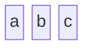

## C4

[公式構文](https://github.com/mermaid-js/mermaid/blob/2086904e76c692331e34a45d7cc3bc30860d040e/docs/syntax/c4.md) · [コーパス例 4](../crates/ibis-pptx/tests/mermaid/corpus/c4.mmd)

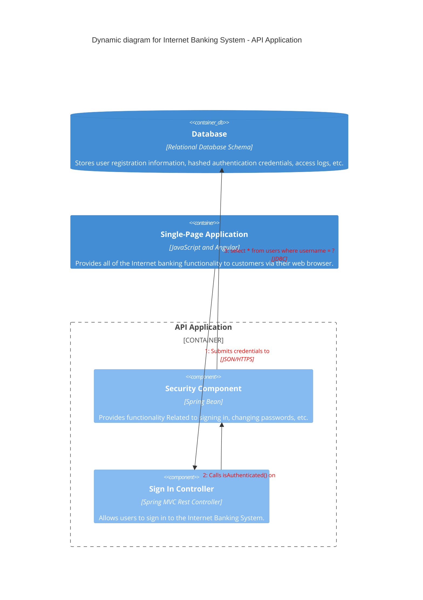

## クラス

[公式構文](https://github.com/mermaid-js/mermaid/blob/2086904e76c692331e34a45d7cc3bc30860d040e/docs/syntax/classDiagram.md) · [コーパス例 16](../crates/ibis-pptx/tests/mermaid/corpus/classDiagram.mmd)

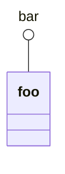

## ER

[公式構文](https://github.com/mermaid-js/mermaid/blob/2086904e76c692331e34a45d7cc3bc30860d040e/docs/syntax/entityRelationshipDiagram.md) · [コーパス例 5](../crates/ibis-pptx/tests/mermaid/corpus/entityRelationshipDiagram.mmd)

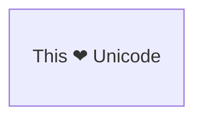

## イベントモデリング

[公式構文](https://github.com/mermaid-js/mermaid/blob/2086904e76c692331e34a45d7cc3bc30860d040e/docs/syntax/eventmodeling.md) · [コーパス例 1](../crates/ibis-pptx/tests/mermaid/corpus/eventmodeling.mmd)

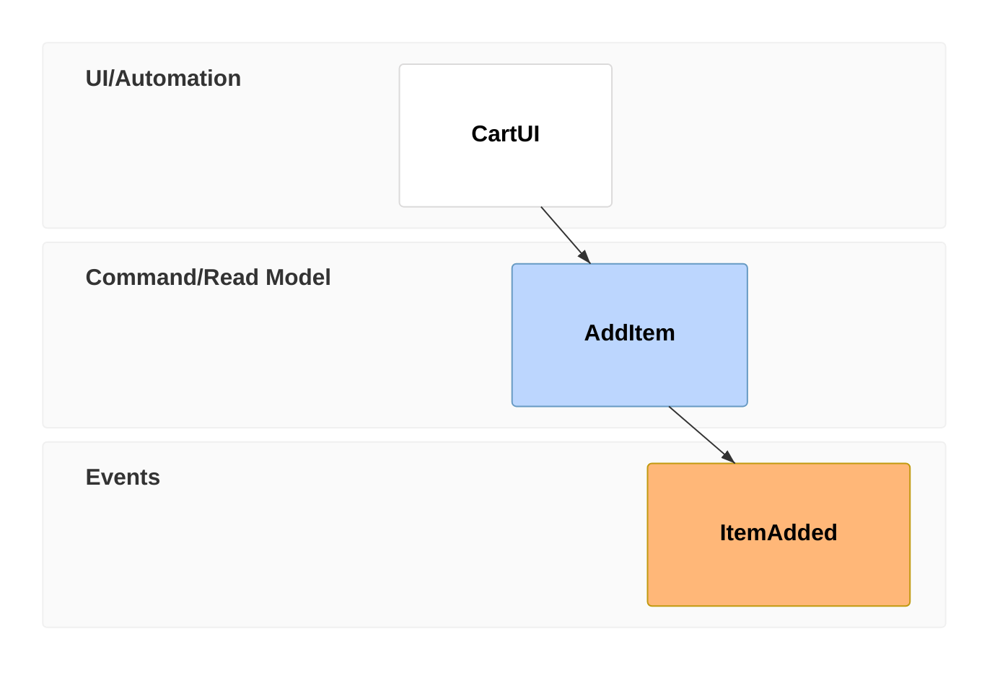

## フローチャート

[公式構文](https://github.com/mermaid-js/mermaid/blob/2086904e76c692331e34a45d7cc3bc30860d040e/docs/syntax/flowchart.md) · [コーパス例 71](../crates/ibis-pptx/tests/mermaid/corpus/flowchart.mmd)

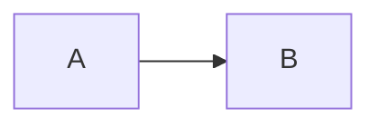

## ガント

[公式構文](https://github.com/mermaid-js/mermaid/blob/2086904e76c692331e34a45d7cc3bc30860d040e/docs/syntax/gantt.md) · [コーパス例 7](../crates/ibis-pptx/tests/mermaid/corpus/gantt.mmd)

```mermaid
gantt
  tickInterval 1week
  weekday monday
```

## Gitグラフ

[公式構文](https://github.com/mermaid-js/mermaid/blob/2086904e76c692331e34a45d7cc3bc30860d040e/docs/syntax/gitgraph.md) · [コーパス例 2](../crates/ibis-pptx/tests/mermaid/corpus/gitgraph.mmd)

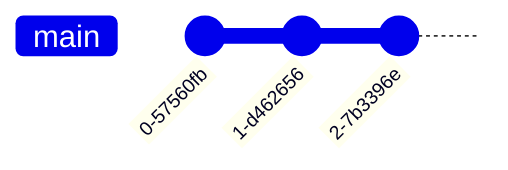

## カンバン

[公式構文](https://github.com/mermaid-js/mermaid/blob/2086904e76c692331e34a45d7cc3bc30860d040e/docs/syntax/kanban.md) · [コーパス例 1](../crates/ibis-pptx/tests/mermaid/corpus/kanban.mmd)

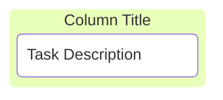

## マインドマップ

[公式構文](https://github.com/mermaid-js/mermaid/blob/2086904e76c692331e34a45d7cc3bc30860d040e/docs/syntax/mindmap.md) · [コーパス例 7](../crates/ibis-pptx/tests/mermaid/corpus/mindmap.mmd)


## パケット

[公式構文](https://github.com/mermaid-js/mermaid/blob/2086904e76c692331e34a45d7cc3bc30860d040e/docs/syntax/packet.md) · [コーパス例 2](../crates/ibis-pptx/tests/mermaid/corpus/packet.mmd)

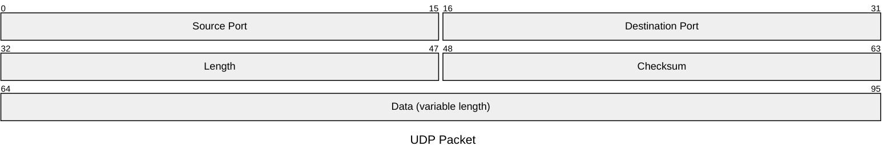

## 円グラフ

[公式構文](https://github.com/mermaid-js/mermaid/blob/2086904e76c692331e34a45d7cc3bc30860d040e/docs/syntax/pie.md) · [コーパス例 1](../crates/ibis-pptx/tests/mermaid/corpus/pie.mmd)

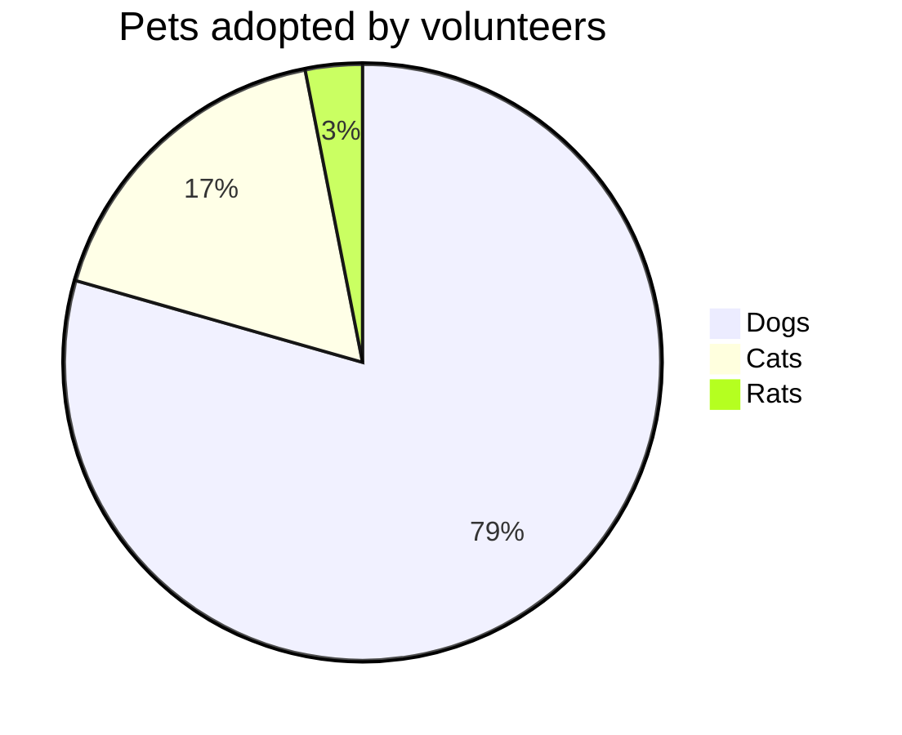

## 四象限

[公式構文](https://github.com/mermaid-js/mermaid/blob/2086904e76c692331e34a45d7cc3bc30860d040e/docs/syntax/quadrantChart.md) · [コーパス例 2](../crates/ibis-pptx/tests/mermaid/corpus/quadrantChart.mmd)

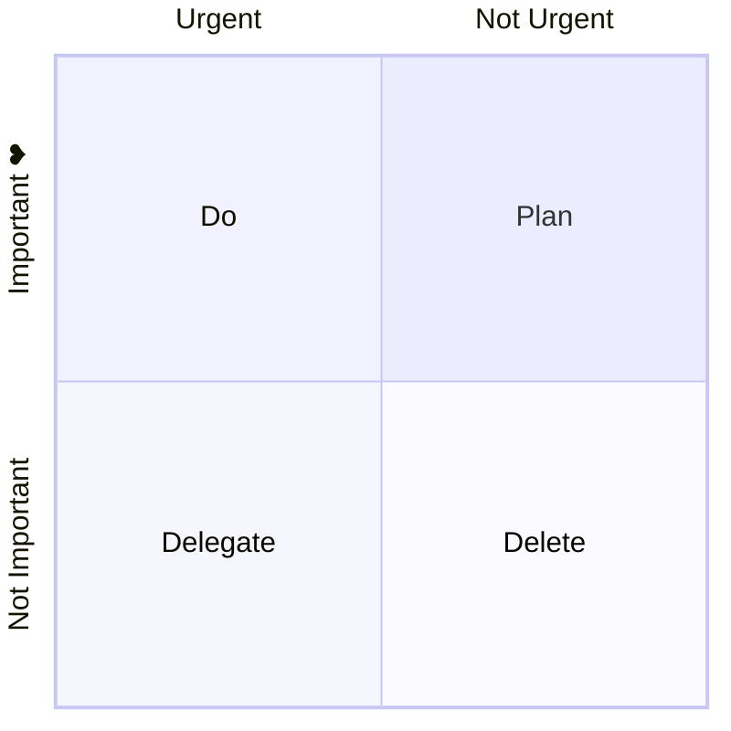

## レーダー

[公式構文](https://github.com/mermaid-js/mermaid/blob/2086904e76c692331e34a45d7cc3bc30860d040e/docs/syntax/radar.md) · [コーパス例 1](../crates/ibis-pptx/tests/mermaid/corpus/radar.mmd)

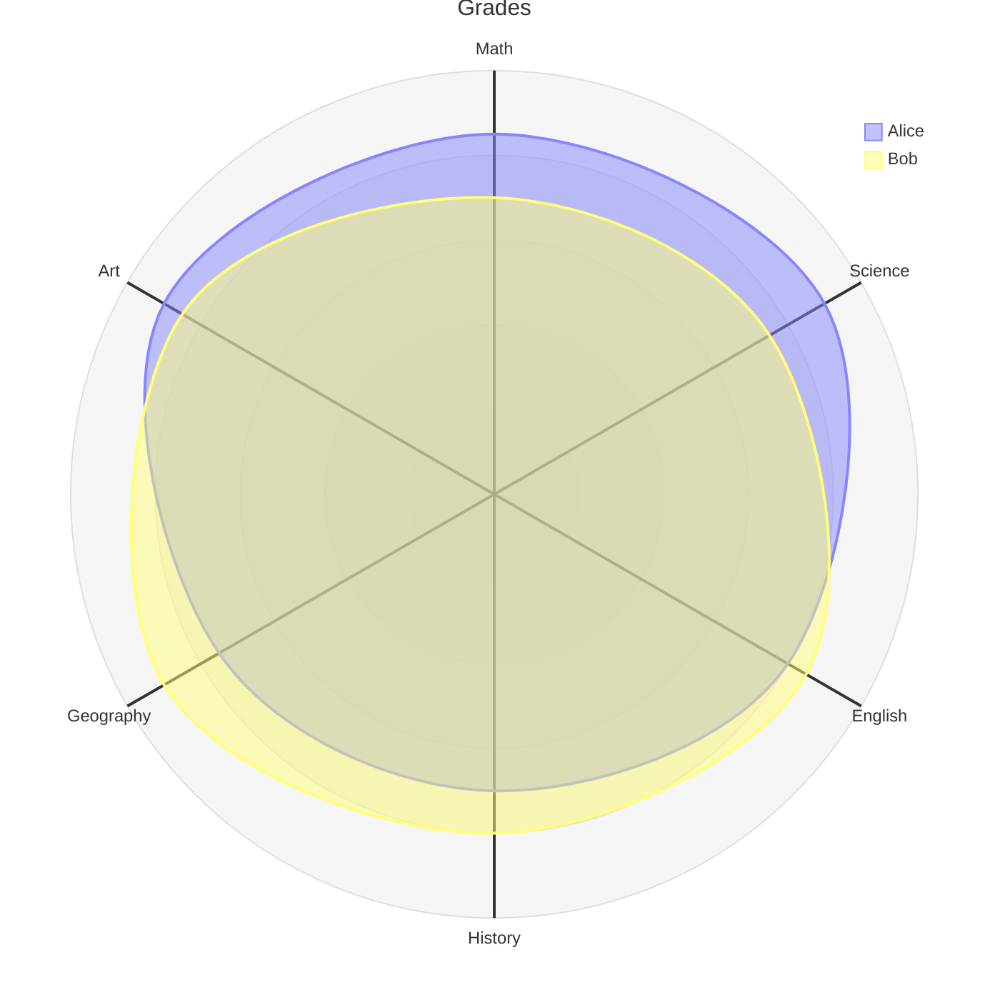

## 構文図

[公式構文](https://github.com/mermaid-js/mermaid/blob/2086904e76c692331e34a45d7cc3bc30860d040e/docs/syntax/railroad.md) · [コーパス例 4](../crates/ibis-pptx/tests/mermaid/corpus/railroad.mmd)

```mermaid
railroad-ebnf-beta
sign = "+" | "-" ;
```

## 要求

[公式構文](https://github.com/mermaid-js/mermaid/blob/2086904e76c692331e34a45d7cc3bc30860d040e/docs/syntax/requirementDiagram.md) · [コーパス例 4](../crates/ibis-pptx/tests/mermaid/corpus/requirementDiagram.mmd)

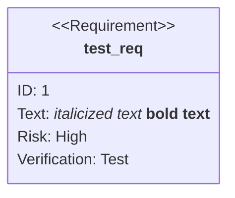

## サンキー

[公式構文](https://github.com/mermaid-js/mermaid/blob/2086904e76c692331e34a45d7cc3bc30860d040e/docs/syntax/sankey.md) · [コーパス例 3](../crates/ibis-pptx/tests/mermaid/corpus/sankey.mmd)

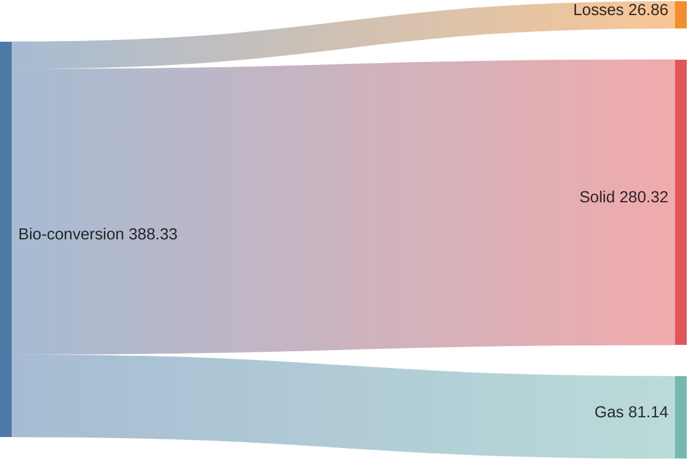

## シーケンス

[公式構文](https://github.com/mermaid-js/mermaid/blob/2086904e76c692331e34a45d7cc3bc30860d040e/docs/syntax/sequenceDiagram.md) · [コーパス例 22](../crates/ibis-pptx/tests/mermaid/corpus/sequenceDiagram.mmd)

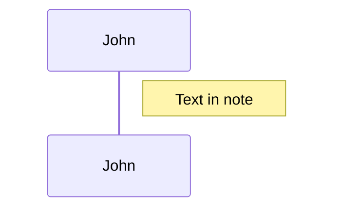

## 状態遷移

[公式構文](https://github.com/mermaid-js/mermaid/blob/2086904e76c692331e34a45d7cc3bc30860d040e/docs/syntax/stateDiagram.md) · [コーパス例 5](../crates/ibis-pptx/tests/mermaid/corpus/stateDiagram.mmd)

```mermaid
stateDiagram-v2
    stateId
```

## スイムレーン

[公式構文](https://github.com/mermaid-js/mermaid/blob/2086904e76c692331e34a45d7cc3bc30860d040e/docs/syntax/swimlanes.md) · [コーパス例 4](../crates/ibis-pptx/tests/mermaid/corpus/swimlanes.mmd)

```mermaid
swimlane-beta
  subgraph Sales
    lead[Qualify lead]
    quote[Prepare quote]
  end
```

## タイムライン

[公式構文](https://github.com/mermaid-js/mermaid/blob/2086904e76c692331e34a45d7cc3bc30860d040e/docs/syntax/timeline.md) · [コーパス例 2](../crates/ibis-pptx/tests/mermaid/corpus/timeline.mmd)

```mermaid
timeline
    title History of Social Media Platform
    2002 : LinkedIn
    2004 : Facebook : Google
    2005 : YouTube
    2006 : Twitter
```

## ツリー

[公式構文](https://github.com/mermaid-js/mermaid/blob/2086904e76c692331e34a45d7cc3bc30860d040e/docs/syntax/treeView.md) · [コーパス例 11](../crates/ibis-pptx/tests/mermaid/corpus/treeView.mmd)

```mermaid
treeView-beta
    "packages"
        "mermaid"
            "src"
        "parser"
```

## ツリーマップ

[公式構文](https://github.com/mermaid-js/mermaid/blob/2086904e76c692331e34a45d7cc3bc30860d040e/docs/syntax/treemap.md) · [コーパス例 1](../crates/ibis-pptx/tests/mermaid/corpus/treemap.mmd)

```mermaid
treemap-beta
"Category A"
    "Item A1": 10
    "Item A2": 20
"Category B"
    "Item B1": 15
    "Item B2": 25
```

## ユースケース

[公式構文](https://github.com/mermaid-js/mermaid/blob/2086904e76c692331e34a45d7cc3bc30860d040e/docs/syntax/usecase.md) · [コーパス例 13](../crates/ibis-pptx/tests/mermaid/corpus/usecase.mmd)

```mermaid
usecase-beta
actor User
Login
User -- "include account details" --> Login
```

## ユーザージャーニー

[公式構文](https://github.com/mermaid-js/mermaid/blob/2086904e76c692331e34a45d7cc3bc30860d040e/docs/syntax/userJourney.md) · [コーパス例 1](../crates/ibis-pptx/tests/mermaid/corpus/userJourney.mmd)

```mermaid
journey
    title My working day
    section Go to work
      Make tea: 5: Me
      Go upstairs: 3: Me
      Do work: 1: Me, Cat
    section Go home
      Go downstairs: 5: Me
      Sit down: 5: Me
```

## ベン図

[公式構文](https://github.com/mermaid-js/mermaid/blob/2086904e76c692331e34a45d7cc3bc30860d040e/docs/syntax/venn.md) · [コーパス例 4](../crates/ibis-pptx/tests/mermaid/corpus/venn.mmd)

```mermaid
venn-beta
  set A["Alpha"]
  set B["Beta"]
  union A,B["AB"]
```

## Wardley

[公式構文](https://github.com/mermaid-js/mermaid/blob/2086904e76c692331e34a45d7cc3bc30860d040e/docs/syntax/wardley.md) · [コーパス例 18](../crates/ibis-pptx/tests/mermaid/corpus/wardley.mmd)

```mermaid
wardley-beta
title Custom Size
size [800, 1000]
```

## XYグラフ

[公式構文](https://github.com/mermaid-js/mermaid/blob/2086904e76c692331e34a45d7cc3bc30860d040e/docs/syntax/xyChart.md) · [コーパス例 7](../crates/ibis-pptx/tests/mermaid/corpus/xyChart.mmd)

```mermaid
xychart
    title "Quarterly Performance"
    x-axis [Q1, Q2, Q3, Q4]
    y-axis "Revenue ($M)" 0 --> 100
    line [25 "Launch", 45, 72, 90 "Target Hit"]
```

## 公式コーパスに単独例がない構文

### 共通テーマ変数とリンクの装飾

共通テーマ変数と `linkStyle` で、ノードと矢印に別の色を指定します。

```mermaid
---
config:
  themeVariables:
    primaryColor: "#dbeafe"
    lineColor: "#334155"
    background: "#ffffff"
---
flowchart LR
  A[受付] --> B[承認]
  linkStyle 0 stroke:#2563eb,stroke-width:3px
```

### カンバンの列幅

```mermaid
---
config:
  kanban:
    sectionWidth: 250
---
kanban
  todo[確認待ち]
    item[申請書]@{ priority: 'High' }
  done[確認済み]
    reviewed[添付資料]
```

双方向シーケンス矢印、横向き、数値 x 軸は [Markdown Reference](markdown-reference-ja.md) の追加例で確認できます。

## 対応範囲の比較

### 初期化ディレクティブ

`%%{init}%%` の指定は未対応です。上の例のように YAML の `config` を使用できます。

```mermaid
%%{init: {"theme": "forest"}}%%
flowchart LR
  A[受付] --> B[承認]
```

### ガントの todayMarker

工程は表示します。todayMarker による当日の線は描きません。

```mermaid
gantt
  dateFormat YYYY-MM-DD
  todayMarker stroke-width:3px,stroke:#2563eb
  section 審査
  受付 :2026-11-16, 2d
```

### 円グラフの凡例位置

円グラフは表示します。下の `legendPosition` は反映されません。

```mermaid
---
config:
  pie:
    legendPosition: bottom
---
pie
  "了承": 80
  "保留": 20
```

## ZenUML

[公式構文](https://github.com/mermaid-js/mermaid/blob/2086904e76c692331e34a45d7cc3bc30860d040e/docs/syntax/zenuml.md) · [コーパス例 7](../crates/ibis-pptx/tests/mermaid/corpus/zenuml.mmd)

```mermaid
zenuml
    new A1
    new A2(with, parameters)
```

## コード表示の例

Cynefin、Ishikawa は Mermaid フェンスのまま保持されます。

### Cynefin

[公式構文](https://github.com/mermaid-js/mermaid/blob/2086904e76c692331e34a45d7cc3bc30860d040e/docs/syntax/cynefin.md) · [コーパス例 3](../crates/ibis-pptx/tests/mermaid/corpus/cynefin.mmd)

```mermaid
cynefin-beta
  title Cynefin Framework

  complex
  complicated
  clear
  chaotic
```

### Ishikawa

[公式構文](https://github.com/mermaid-js/mermaid/blob/2086904e76c692331e34a45d7cc3bc30860d040e/docs/syntax/ishikawa.md) · [コーパス例 1](../crates/ibis-pptx/tests/mermaid/corpus/ishikawa.mmd)

```mermaid
ishikawa-beta
    Blurry Photo
    Process
        Out of focus
        Shutter speed too slow
        Protective film not removed
        Beautification filter applied
    User
        Shaky hands
    Equipment
        LENS
            Inappropriate lens
            Damaged lens
            Dirty lens
        SENSOR
            Damaged sensor
            Dirty sensor
    Environment
        Subject moved too quickly
        Too dark
```
