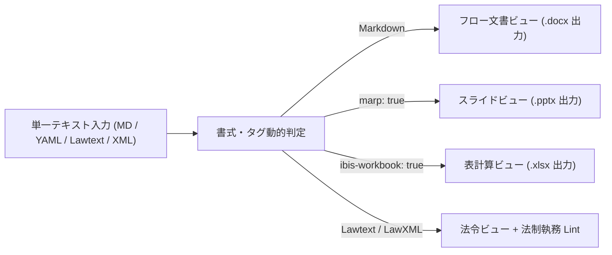
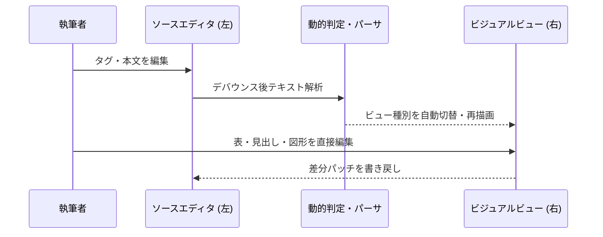

# ブラウザ完結型ドキュメント基盤 技術設計書

## 1. エグゼクティブサマリー

本設計書は、**単一のテキストソース**から文書（DOCX）・プレゼンテーション（PPTX）・表計算（XLSX）・法令テキスト（Lawtext / e-Gov XML）を動的に解釈し、ブラウザ内（WebAssembly + WebGPU）で完結して編集・変換・出力するためのアーキテクチャを定義します。

従来のクラウド型オフィススイートでは、サーバー側でのレンダリングやフォーマット変換に伴う**機密データの外部送信**と**ネットワーク遅延**が課題でした。本基盤では、クライアント端末内のみで OOXML（DOCX / PPTX / XLSX）・PDF・一太郎（JTD）・法令 XML を直接処理します。

## 2. システムアーキテクチャ

## 3. 主要コンポーネントと処理特性

| コンポーネント | 入力形式 | 出力・互換性 | 実行環境 |
| --- | --- | --- | --- |
| フロー文書エンジン | Markdown / DOCX / JTD | `.docx` / `.pdf` / `.md` | 端末内 WASM |
| スライドエンジン | Marp Markdown / PPTX | `.pptx` / `.odp` / `.pdf` | 端末内 WASM + WebGPU |
| 表計算エンジン | Workbook MD / XLSX / CSV | `.xlsx` / `.csv` / 数式再計算 | 端末内 WASM |
| 法令処理エンジン | Lawtext / e-Gov XML | `.xml` / `.lawtext` / 新旧対照表 | 端末内 WASM |

## 4. 処理シーケンス（双方向 Split 同期）

## 5. 品質・運用要件

- [x] **ゼロサーバー処理**: すべてのパース・レイアウト・OOXML 生成をブラウザ内で完結
- [x] **メタデータ非破壊**: 既存の YAML フロントマター・数式・XML 属性を保持
- [x] **即時エクスポート**: 右上の「DOCX 出力」から印刷・配布可能な Word 文書を生成
