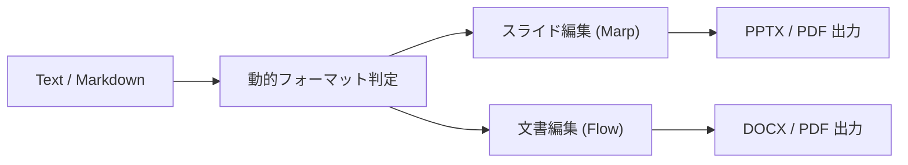

# テキスト駆動ドキュメント設計
### Markdown からそのまま配布可能な PPTX・DOCX を生成する

soraneDocs — WebAssembly + WebGPU Office Engine

---

## なぜ「単一テキスト起点」なのか

- **AI・Git との親和性**: 差分レビュー・PR・LLM 生成がすべてプレーンテキストで完結
- **動的ビュー切替**: `marp: true` や表・法令タグを検出して最適な編集 UI へ自動遷移
- **最終成果物の品質**: そのまま `.pptx` / `.docx` / `.pdf` として業務提出可能

---

## アーキテクチャ全体像

---

## 従来ワークフローとの比較

| 観点 | 従来のスライド作成 | soraneDocs テキスト駆動 |
| --- | --- | --- |
| 原稿作成 | 手作業で箱と文字を配置 | Markdown / AI で構造を記述 |
| レビュー | バイナリ差分で変更点が不明瞭 | GitHub で行単位の差分管理 |
| 図表更新 | 別ツールで画像化して貼り直し | Mermaid コードを即時レンダリング |
| 配布形式 | PPTX のみ | Markdown 原本 + PPTX 出力を両立 |

---

## 双方向 Split 編集のポイント

1. **左ペイン（Source）**: `---` でスライド区切り、YAML フロントマターでテーマ制御
2. **右ペイン（Visual）**: テキスト編集・図形移動・配置調整を直接操作
3. **カーソル連動（⇅）**: 編集中のスライドと Markdown 行番号をリアルタイム同期

---

## まとめ：次のアクション

- 右上の **PPTX 出力** ボタンから、このデッキを PowerPoint ファイルとして保存できます
- 先頭の `marp: true` を外すと、同じテキストがそのまま **文書（DOCX）モード** へ切り替わります
