# Mermaid 構文デモ集（UML・アーキテクチャ・チャート総集編）

この文書は、Docs の Markdown ビューアー／エディターで描画できる **UML を含む主要な Mermaid 22 図種** を 1 ページにまとめた総集編サンプルです。各コードブロックを編集すると、図の表示も確認できます。

---

## 第 1 部：UML 図（構造・振る舞い）

### 1. クラス図（Class Diagram）

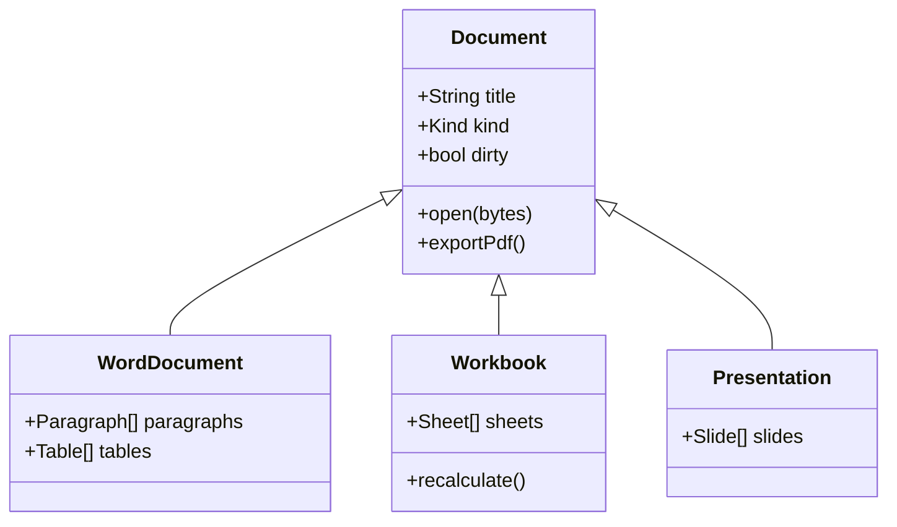

### 2. シーケンス図（Sequence Diagram）

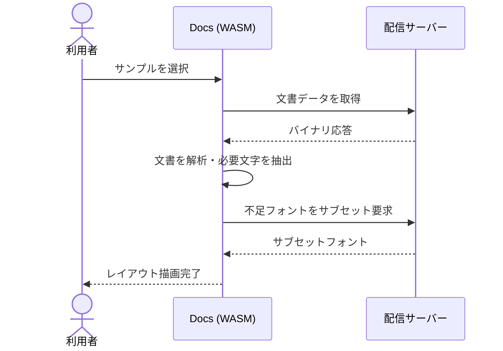

### 3. ユースケース図（Use Case Diagram）

```mermaid
usecase-beta
direction LR
actor User("利用者")
actor Reviewer("監査担当者")
systemBoundary "Docs ブラウザアプリ"
  Open("文書を開く・編集")
  Export("PDF 出力")
  Audit("SBOM / 脆弱性確認")
end
User --> Open
User --> Export
Reviewer --> Audit
```

### 4. 状態遷移図（State Diagram）

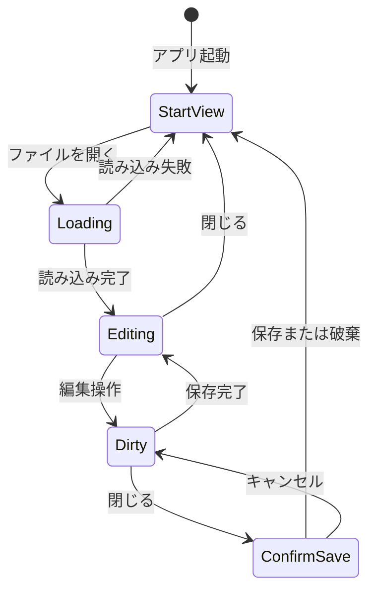

### 5. アクティビティ／フローチャート（Flowchart）

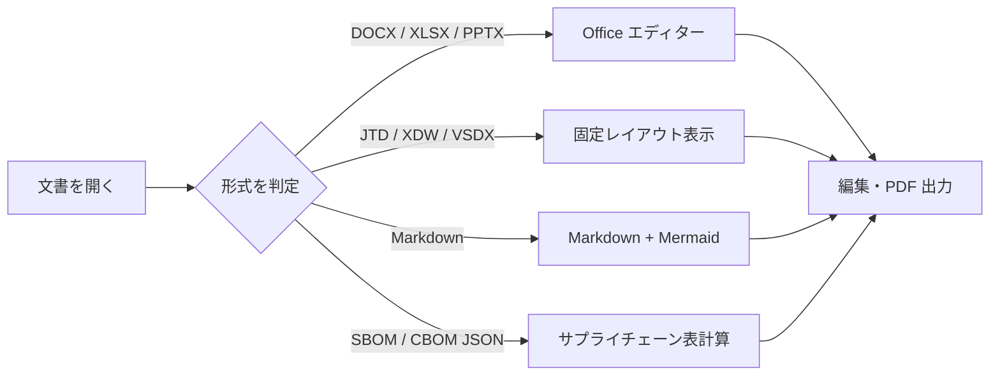

### 6. スイムレーン図（Swimlanes）

```mermaid
swimlane-beta LR
  subgraph 開発者
    Build[リリースビルド]
    Bom[SBOM / CBOM 生成]
  end
  subgraph セキュリティ
    Scan[脆弱性スキャン]
    Triage[影響評価・優先度付け]
  end
  subgraph 運用
    Deploy[本番配信]
  end
  Build --> Bom
  Bom --> Scan
  Scan --> Triage
  Triage --> Deploy
```

### 7. 要求図（Requirement Diagram）

```mermaid
requirementDiagram

requirement wasm_sandbox {
  id: REQ-01
  text: 文書データはブラウザ内で完結して処理すること
  risk: high
  verifymethod: test
}

element docs_wasm {
  type: module
}

docs_wasm - satisfies -> wasm_sandbox
```

### 8. ZenUML（UML シーケンス記法）

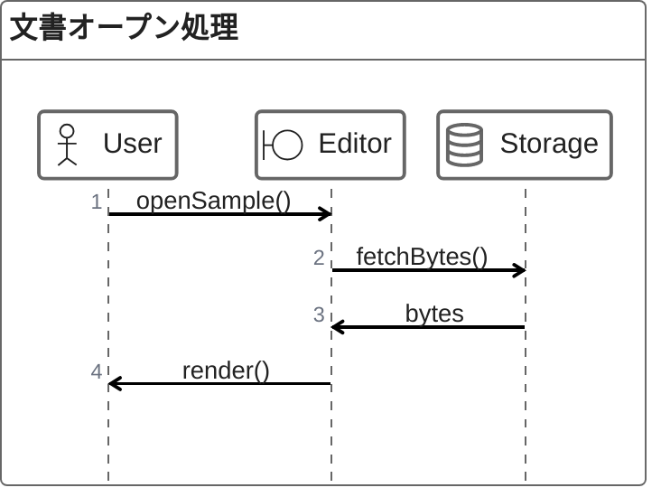

---

## 第 2 部：アーキテクチャ・データ・ネットワーク

### 9. ER 図（Entity Relationship Diagram）

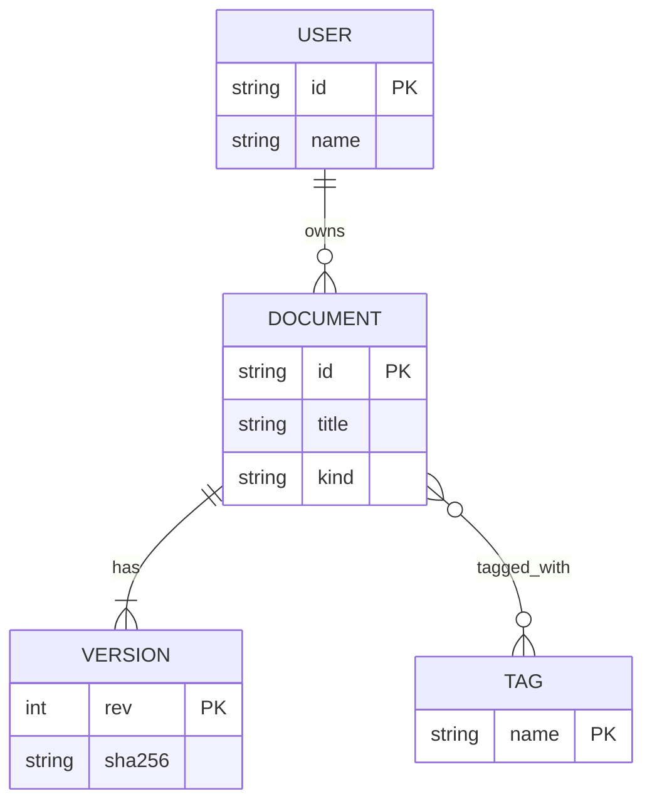

### 10. C4 コンテキスト図（C4 Context）

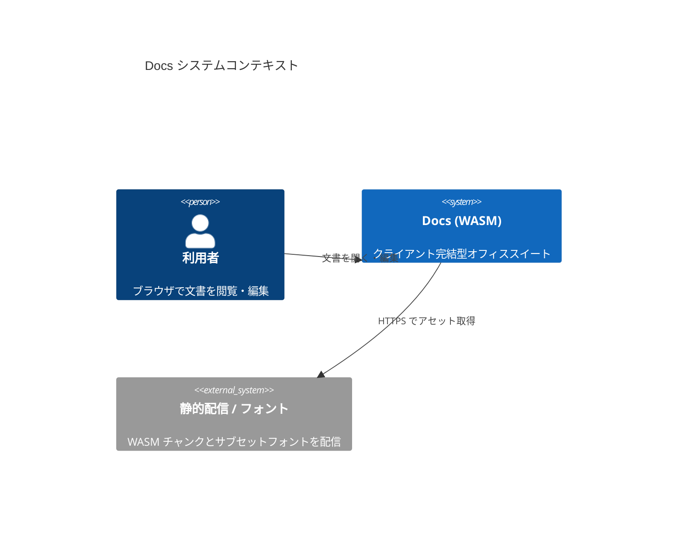

### 11. アーキテクチャ図（Architecture）


### 12. ブロック図（Block Diagram）

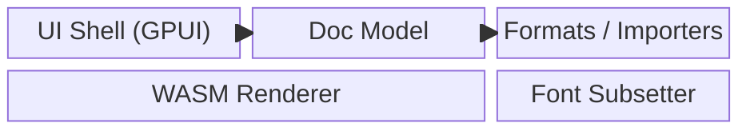

### 13. パケット図（Packet Diagram）

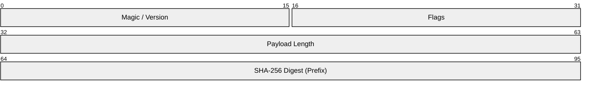

---

## 第 3 部：計画・プロジェクト管理・思考整理

### 14. ガントチャート（Gantt Chart）

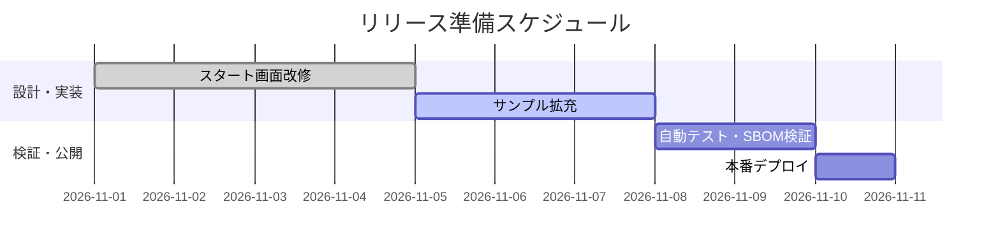

### 15. タイムライン（Timeline）

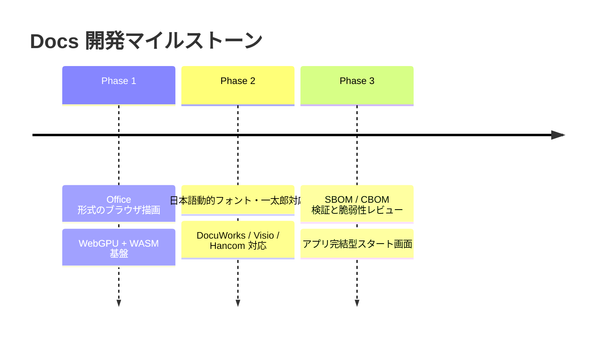

### 16. カンバン（Kanban）

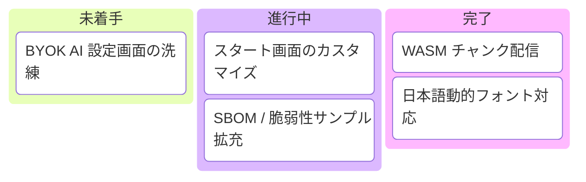

### 17. マインドマップ（Mindmap）

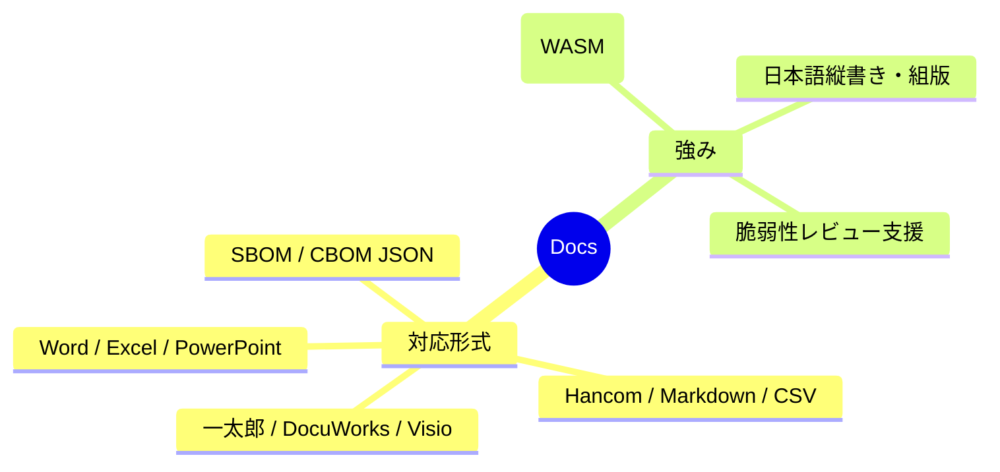

### 18. ユーザージャーニー（User Journey）

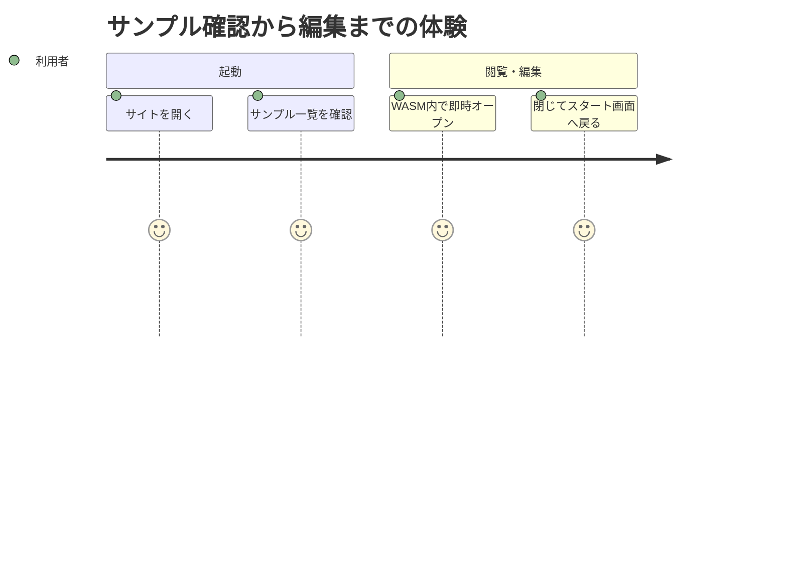

---

## 第 4 部：データ可視化・分析・開発

### 19. 円グラフ（Pie Chart）

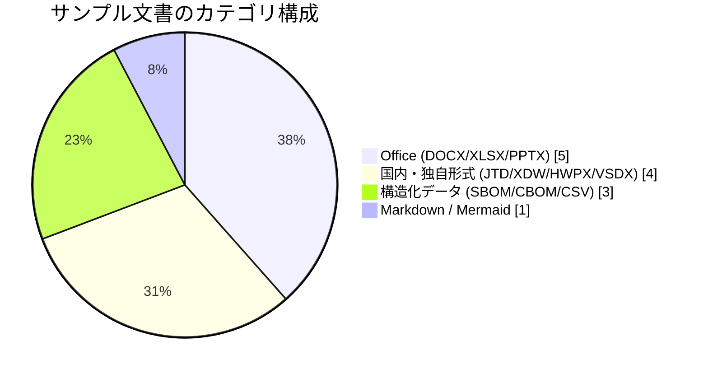

### 20. XY チャート（XY Chart）

```mermaid
xychart-beta
    title "月別ドキュメント処理件数"
    x-axis [4月, 5月, 6月, 7月, 8月, 9月]
    y-axis "件数" 0 --> 120
    bar [42, 58, 65, 80, 94, 110]
    line [38, 52, 60, 75, 88, 104]
```

### 21. 四象限チャート（Quadrant Chart）

```mermaid
quadrantChart
    title 脆弱性トリアージ優先度マトリクス
    x-axis 到達性 低 --> 到達性 高
    y-axis 深刻度 低 --> 深刻度 高
    quadrant-1 最優先で即時対応
    quadrant-2 計画的に修正
    quadrant-3 監視継続
    quadrant-4 緩和策を検討
    CVE-Sample-01: [0.85, 0.90]
    CVE-Sample-02: [0.72, 0.78]
    CVE-Sample-03: [0.35, 0.65]
    CVE-Sample-04: [0.25, 0.30]
```

### 22. サンキー図（Sankey Diagram）

```mermaid
sankey
SBOM部品,安全な部品,680
SBOM部品,要確認部品,28
要確認部品,Critical/High,5
要確認部品,Medium/Low,23
Critical/High,修正版あり,4
Critical/High,到達性なし,1
```

### 23. レーダーチャート（Radar Chart）

```mermaid
radar-beta
  title ブラウザ完結オフィス環境の評価軸
  axis speed["起動速度"], jp["日本語組版"], formats["対応形式"], security["端末内完結"], audit["監査・BOM"]
  curve docs["Docs (WASM)"]{85, 92, 95, 98, 90}
  max 100
  min 0
```

### 24. Git グラフ（Git Graph）

```mermaid
gitGraph
    commit id: "init"
    branch feat/start-view
    checkout feat/start-view
    commit id: "start config"
    commit id: "mermaid 24 diagrams"
    commit id: "sbom/cbom samples"
    checkout main
    commit id: "hotfix"
    merge feat/start-view id: "integrate"
```
