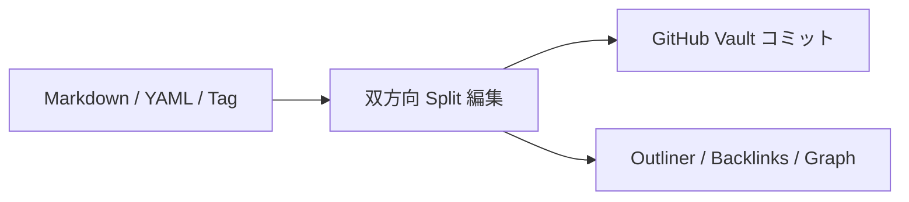

# soraneDocs 機械可読ナレッジ設計メモ

#sorane #markdown-first #obsidian-compatible

このノートは、人間が読みやすい文書と **AI・検索インデックスが扱いやすい機械可読データ** を、ひとつの `.md` ファイルで両立させるためのサンプルです。

## 関連ドキュメントへのリンク

- スライド構成: [[marp-deck-sample]]
- 数値集計モデル: [[workbook-sheet-sample]]
- 条例ドラフト: [[sample-ordinance]]

## ナレッジ構造と双方向同期

## 運用チェックリスト

- [x] YAML フロントマターによるメタデータ管理
- [x] `#tag` と `[[wikilink]]` による知識グラフ構築
- [ ] GitHub Private リポジトリへの自動同期確認

| 形式 | 用途 | 編集体験 |
| --- | --- | --- |
| Markdown ノート | 設計メモ・議事録 | Source ↔ リッチ文書 Split |
| Marp Markdown | 発表資料 | Source ↔ スライド Split |
| Workbook Markdown | 試算・KPI 表 | Source ↔ 表計算 Split |
| Lawtext / e-Gov XML | 法令・規程 | Source ↔ 条文 Split + Lint |
